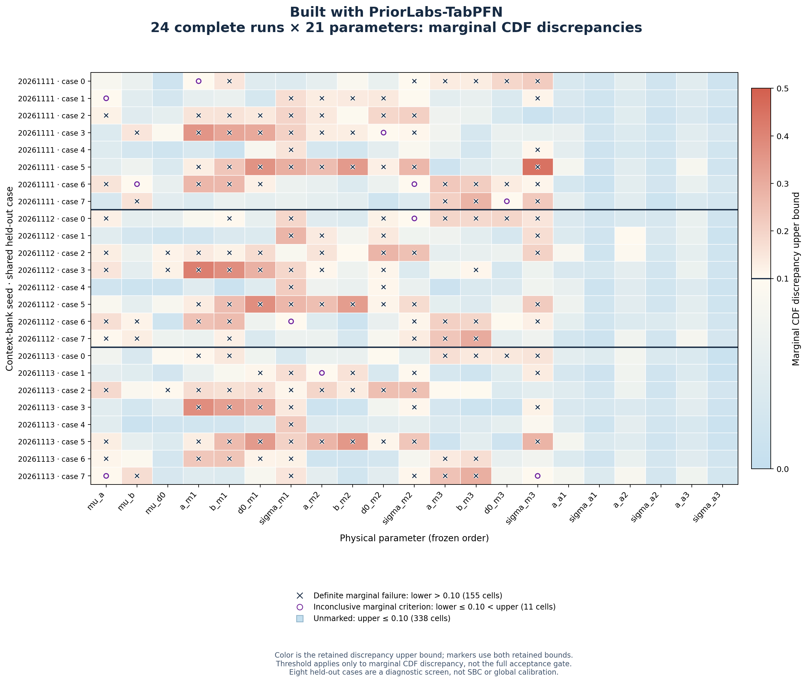

# PosteriorForge

Built with PriorLabs-TabPFN.

Reproducible frozen-transformer inference engineering on a 21-parameter,
33-observation analytical hierarchy with six inferred noise scales.

PosteriorForge evaluates an unmodified, pinned NPE-PFN/TabPFN baseline before
attempting performance optimization. The same frozen regression checkpoint is
reused through 21 autoregressive parameter stages. This project studies posterior
sampling, memory, synchronization, and same-node independent sampling. It does
not study text generation or distributed training.

## Terminal scientific result

**The fixed baseline fails the accepted diagnostic screen in all 24 runs.**
All 1.2 million posterior vectors are finite, complete and within prior support.
All eight independent numerical references qualify. The worst marginal CDF
discrepancy is bounded by [0.444206, 0.449960], against a 0.10 limit; worst mean
bias is 1.20006 reference SD, against 0.20. This is model failure under this
protocol, not unresolved reference uncertainty.

The accepted stopping rule leaves lower-context expansion, optimization,
CPU/CUDA profiling and multi-GPU scaling **deferred and unrun**. No checkpoint,
prior, preprocessing or scenario was changed to rescue the result. Eight cases
are a diagnostic screen, not global calibration or SBC certification.

The [case study](docs/case-study.md), [complete evidence](evidence/feasibility/report.md),
[machine-readable gate](evidence/feasibility/gate.json) and
[public artifact index](evidence/artifacts.json) contain the result and its
reproduction chain. Total allocated cost: **16.1739 GPU-hours**, zero reserved,
under the hard 200-hour cap. The container recipe is provided but remains unbuilt.

## Reproduce

Use Python 3.11. The package has no dependency on private BayesArena or MesoUQ
repositories. The numerical source is vendored with provenance and attribution.
Install the base package with `pip install .`; run `posteriorforge --help`.
For frozen inference and reference environments, use the complete hashed locks
and preparation scripts described in [environment instructions](docs/environment.md).
Model weights are cached externally and never committed.

Karolina runs use account `eu-26-17` and `qgpu` A100 allocations. Every GPU job,
including reference work and failed jobs, must be reserved and reconciled in a
single ledger against the hard cumulative **200 allocated GPU-hour** cap.
See [budget policy](docs/budget.md).

## Scientific stopping rule

Three independent 4096-world joint-prior banks provide nested prefixes
256/1024/4096. Eight separate central-90% held-out cases are shared by all runs.
The first gate covers all 24 seed/case combinations at 4096 context, with
50,000 complete accepted posterior vectors each. Reference CDF precision must
be at most 0.005 with retained refinement and independent checks. Marginal and
32 predefined joint-projection CDF error must be at most 0.10, absolute mean
bias at most 0.2 reference SD, and SD ratios within [0.8, 1.2].

A model failure stops optimization and multi-GPU work. Reference uncertainty
cannot yield a pass. The eight cases are a diagnostic screen, not global SBC
or calibration certification. Lower-context failures remain visible.

## Scope and attribution

The benchmark is analytical, not a learned physical surrogate. Future paired-bank
providers have an interface contract; physical/C-CUDA adapters are out of scope.
See `NOTICE`, the root MIT license, per-file provenance, and the separate Prior
Labs license for upstream code and model terms. Uncorrected upstream log densities
are not used as calibrated densities of support-truncated accepted samples.
