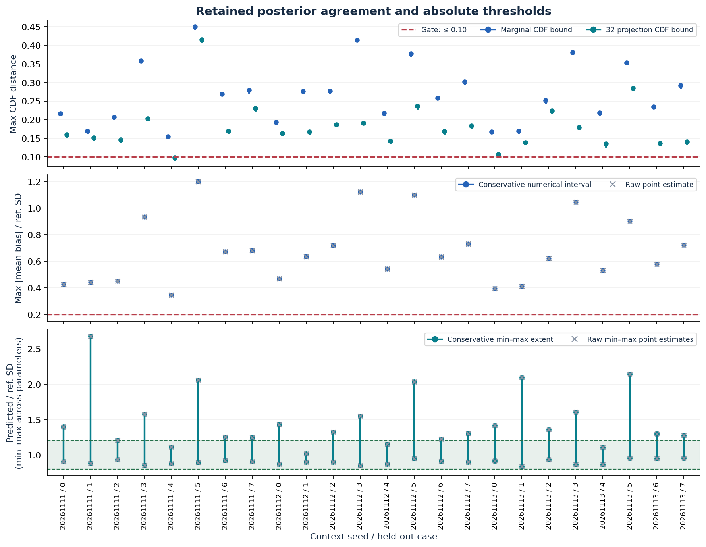
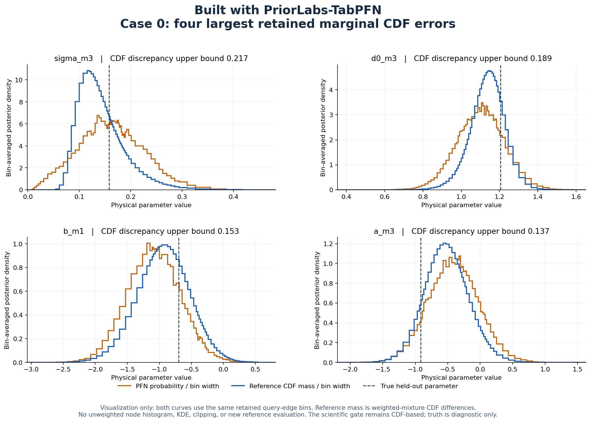
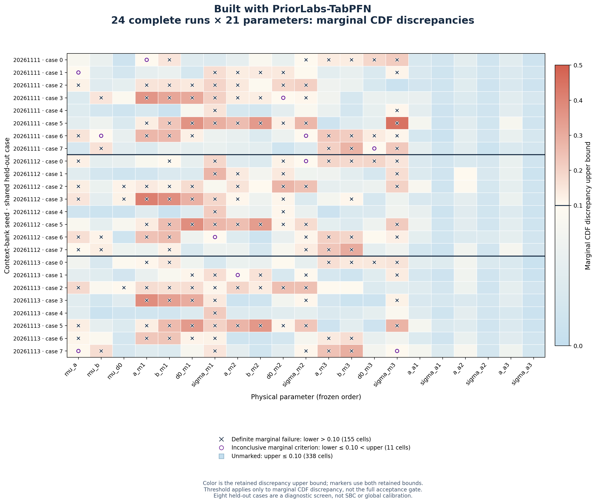
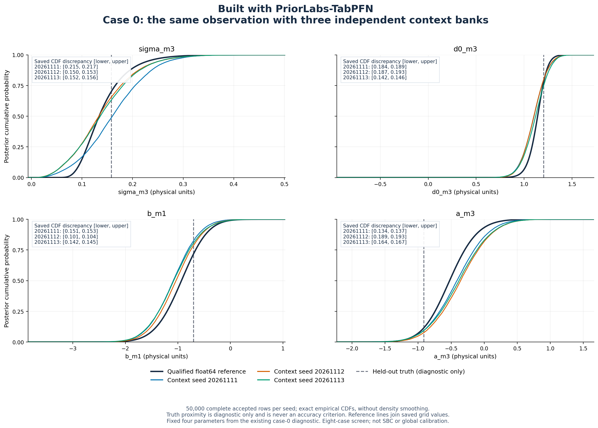
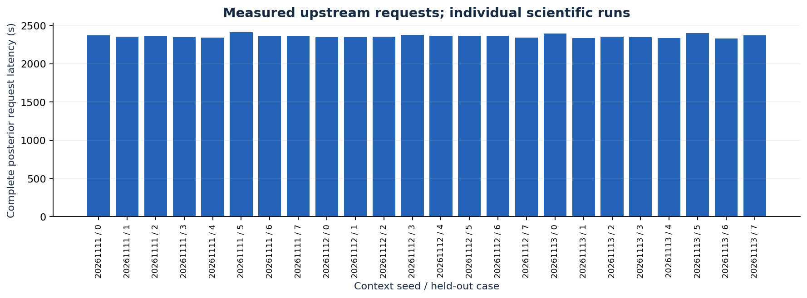
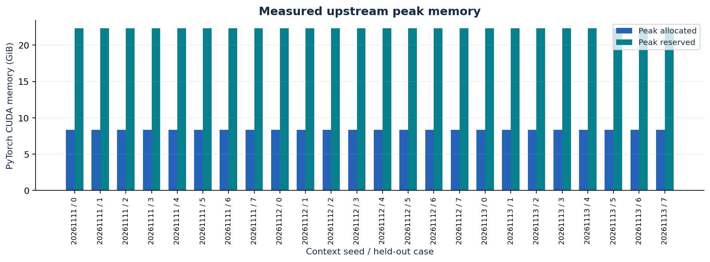
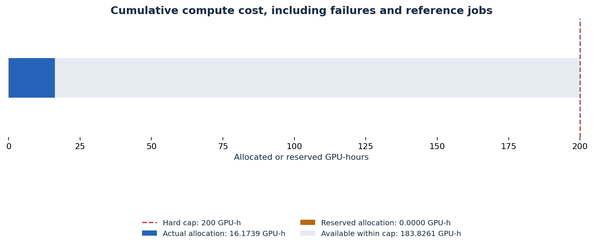

# PosteriorForge case study

Built with PriorLabs-TabPFN.

PosteriorForge completed a reproducible frozen-model inference screen on Karolina
and stopped at its scientific acceptance gate. **All 24 runs failed the declared
posterior-accuracy criteria.** The pipeline returned 1.2 million finite, complete,
prior-supported posterior vectors, but the frozen model did not approximate this
analytical posterior accurately enough to justify optimization.

## What was built

The public package combines a CLI, complete hashed environment locks, offline
Slurm launchers, authenticated arrays and manifests, CPU CI, and public-only
installation checks. A single frozen **11,081,864-parameter TabPFN regression
checkpoint** is reused through 21 autoregressive conditional stages in the
unmodified NPE-PFN implementation. Execution uses PyTorch/CUDA in FP32 on
Karolina A100 GPUs. Checkpoint revision and SHA256 are pinned; weights remain
outside Git. No fine-tuning was performed.

The scientific workload is a 21-parameter, 33-observation analytical hierarchy
with six inferred noise scales. Three independently seeded 4096-world banks come
from the full joint prior. Eight separate coordinate-wise central-90% held-out cases are shared
across seeds. Each of the 24 seed/case combinations returns 50,000 accepted full
vectors; invalid candidates are rejected without clipping or timeout-based
acceptance. NumPy/SciPy algebra and independent float64 JAX GPU calculations
provide the reference controls. This eight-case screen is diagnostic, not global
calibration or SBC certification.

## The scientific result

All eight retained references and their adaptive CDF query grids qualified.
Worst reference CDF numerical precision was **0.0010511**, below the required
0.005; every final grid CDF step was below 0.005. Independent reference checks
also passed. The model's errors were substantially larger than this numerical
uncertainty.

| Criterion | Worst result across the 24 runs | Required |
| --- | ---: | ---: |
| Marginal CDF error bounds | 0.444206–0.449960 | ≤ 0.10 |
| CDF error bounds on 32 fixed joint projections | 0.410059–0.414701 | ≤ 0.10 |
| Absolute mean bias / reference posterior SD | 1.20006 | ≤ 0.20 |
| Largest predicted SD / reference posterior SD | 2.67958 | 0.80–1.20 |

The CDF bounds account for retained reference precision and whole-line
monotonicity, including intervals between queries and tails. They are numerical
bounds, not confidence intervals. Even the worst-case lower error bounds exceed
the acceptance limit, distinguishing **model failure from an inconclusive
reference**. The [authenticated gate](../evidence/feasibility/gate.json) retains
all run-level decisions and input bindings.



For a concrete view, the following figure shows four discrepant marginals for
held-out case 0. Common bins compare PFN sample counts with reference probability
mass obtained from weighted CDF differences. This histogram view is for visual
inspection; the acceptance decision uses the CDF and moment checks above, not
uncorrected model log densities or histogram appearance.



The cross-run view distinguishes a conclusive marginal failure from a
threshold-straddling numerical interval. Of 504 marginal comparisons, 155 fail
conclusively, 11 remain inconclusive and 338 meet this marginal criterion. The
full run verdict also requires the mean, SD and joint-projection checks.



The same four case-0 marginals vary across the three context banks. This is an
observed bank-seed effect under the fixed protocol; these plots do not establish
a root cause. Truth markers are shown only for diagnosis and never determine
the acceptance decision.



## Measured execution and cost

Each of the 24 jobs generated 50,000 accepted vectors, with allocated job
walltimes of **39.10–40.40 minutes**. The latency figure reports the separately
measured complete-request duration, including its first lazy checkpoint load
and rejection work. These are individual scientific requests; no three-repeat
timing study, percentile estimate, or optimization speedup is inferred from them.



CUDA peak allocated and reserved memory were recorded for each request. The
figure reports allocator measurements; detailed stage, transfer, synchronization,
and CPU/CUDA trace profiling remained behind the scientific gate.



All **42 Slurm jobs completed**. Reconciled allocation cost was **16.1738889
GPU-hours**, with **zero outstanding reservation**, against the immutable
200 allocated GPU-hour cap. This total includes qualification, reference work,
query refinement, and the complete 24-run screen. It measures allocated GPU time,
including CPU-side work inside each allocation.



## Decision and reproduction

The accepted stopping rule deferred the remaining 48 lower-context runs,
optimization, CPU/CUDA profiling, precision and compilation experiments, and
same-node multi-GPU scaling. No scaling speedup or optimized serving result is
claimed. The container recipe is provided but remains unbuilt. The workload
concerns posterior sampling; it supplies no LLM text-generation, TTFT/TPOT, or
vLLM benchmark result.

The delivered evidence makes the failed feasibility result reproducible: fixed
parameter order and seeds, immutable model/source provenance, retained reference
checks, complete samples, numerical error bounds, measured latency and memory,
and reconciled compute cost. Public raw-artifact locations and SHA256 values are
listed in the [artifact index](../evidence/artifacts.json); retrieval, verification,
and regeneration commands are in the [artifact guide](artifacts.md) and
[environment guide](environment.md).

From a public checkout, inspect the available operations with:

```bash
pip install .
posteriorforge --help
posteriorforge doctor
```

Use the pinned environments and cached checkpoint for GPU reproduction. After
retrieving the authenticated runs and refined references, regenerate posterior
figures with:

```bash
posteriorforge plot-posteriors \
  --gate gate.json --runs upstream-v1 --references reference-grids-v1 \
  --output posterior-figures
```
