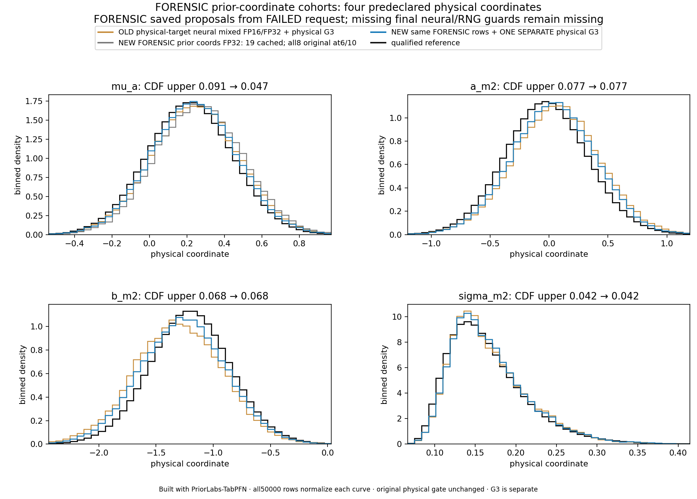
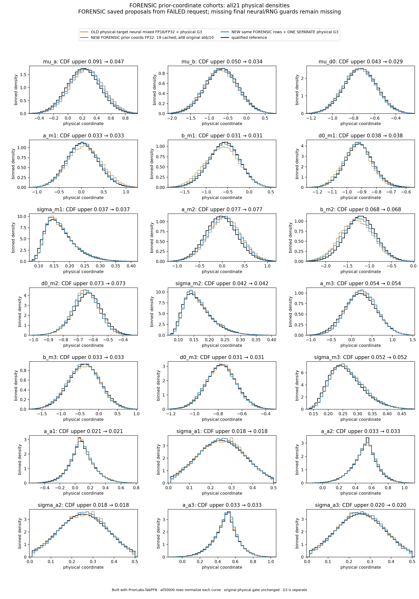
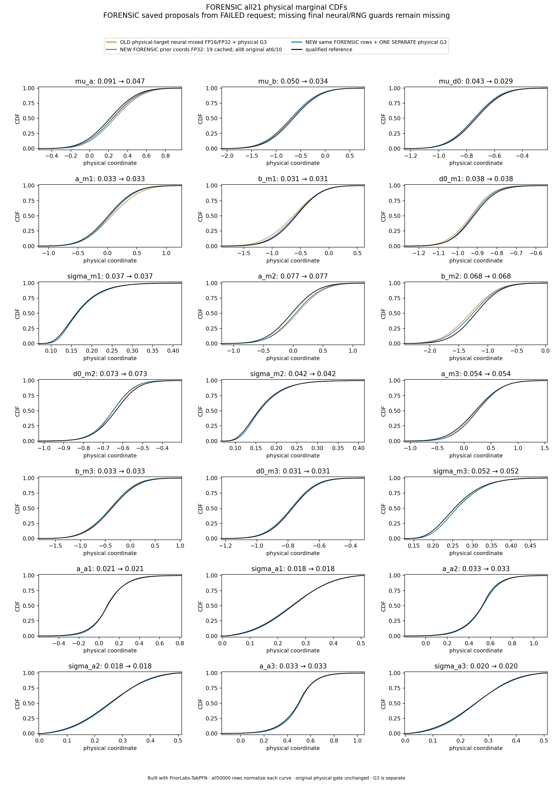
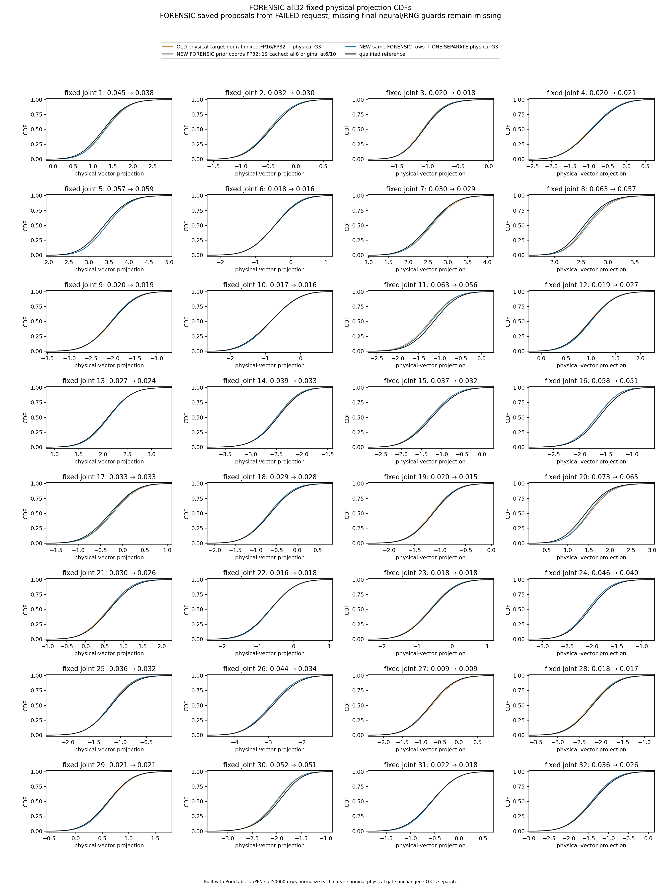

# FORENSIC saved-proposal results — failed request remains failed

**Built with PriorLabs-TabPFN.** These are separately labelled CPU forensic
cohorts from the actual51,200 proposals saved by failed GPU request5411061.
The original request remains **FAILED**. It delivered zero rows to the original
support sampler because its Float32-only FIFO rejected the successfully decoded
Float64 proposals. No completed production50k request or recovered success
footer is claimed.

The fixed first50,000 supported rows, in original saved51,200 order, were replayed
through the **same new Float64 post-decode/FIFO/original-support helper** that the
next production entry calls. This produced an explicitly FORENSIC cohort,
not a rerun of the neural request. Actual raw latent vectors and all21 returned
stage columns authenticate the saved physical wave; full-wave strict decoding
was byte-identical in the original inference Python/NumPy/SciPy environment.
The actual selection checked50,000 rows, rejected0, returned50,000 and left
1,200 unused FIFO rows. All51,200 raw and decoded proposals remain archived
outside Git. The selected physical array SHA256 is
6b6c36843d6c213d086c6712aacc68dc1cb11148163ebe24bc74119a102b54eb.

One separate unchanged original physical three-global conditional update was
then applied **once**. Its PCG64 seed is2551793397 under the original
ss15_global_block_gibbs_once_v1 role. One base standard_normal call produced the
actual50,000×3 draw matrix; the returned matrix, private states, output and
150,000-scalar draw count were recorded. The actual Z archive stays outside Git.
All18 decoded physical local/noise columns remain byte-identical; no latent
local coordinates were decoded again after changing the globals. Subsequent
assessment and plotting reread saved arrays and actual Z and did not repeat
the new G3 update.

| Original unchanged physical gate, applied to FORENSIC arrays | Before G3 | After ONE G3 |
|---|---:|---:|
| Marginal CDF upper maximum |0.0911184427|0.0772446610|
| Fixed joint CDF upper maximum |0.0727308673|0.0653950814|
| Absolute mean error upper / reference SD |0.2221008610|0.1771522180|
| SD-ratio interval across coordinates |0.928652699–1.046114001|0.928652699–1.046114001|
| Array-level gate outcome |FAIL: μa mean only|PASS|

All21 physical marginals and32 original fixed joint projections, numerical
reference uncertainty and all50,000 rows were retained. Before G3, only the
conservative μa mean bound fails. After G3, the worst marginal CDF and mean
bounds occur at a_m2. The physical18 columns and their marginal assessments
are unchanged by G3.

The orange curve is the old physical-target neural mixed FP16/FP32 cohort plus
its physical G3. Gray is the new FORENSIC prior-coordinate neural FP32 cohort
(19 cached stages; all8 original at6/10); blue is the same FORENSIC physical
cohort plus the one separate physical G3; black is the same qualified case2
reference. Coordinates, precision and routing all differ from the old method,
so the comparison does not isolate a causal effect of coordinate changes.

These array-level outcomes are diagnostic evidence. They **do not qualify the
failed neural request, a production implementation, or posterior accuracy**.
The original final engine counters, default-RNG-after/preservation, source
success footer, actual prediction checks and expected final counts remain
missing. New CPU replay RNG observations and posthoc source/Git/proof-file
checks are separately labelled and cannot reconstruct those missing GPU
request observations. The original failed manifest and all frozen source bytes
remain unchanged.

Exact replay, G3 and assessment metadata are preserved as three gzip archives;
[RAW-METADATA-SHA256.txt](RAW-METADATA-SHA256.txt) authenticates their decompressed
bytes. [summary.json](summary.json) contains complete bounds, source/selection/
draw/cost provenance and limits. Actual arrays, all51,200 proposals, selected
cohorts and Z are intentionally outside Git. The three command logs and
[execution-receipt.json](execution-receipt.json) preserve actual CPU command
arguments and observed output.

The [CPU-test receipt](../forensic-cpu-tests-01/receipt.json) records17 passing
inference tests and15 passing reference tests plus two expected skips
(Torch unavailable and exact F64 replay belonging to the inference versions).
The failed request's752 GPU-seconds and original accounting remain in the
[separate failure allocation receipt](../native-pilot-failure-01/allocation-receipt.json).
The forensic replay, update and assessment added **zero GPU allocations,
neural proposals, simulator worlds or reference integrations**.
