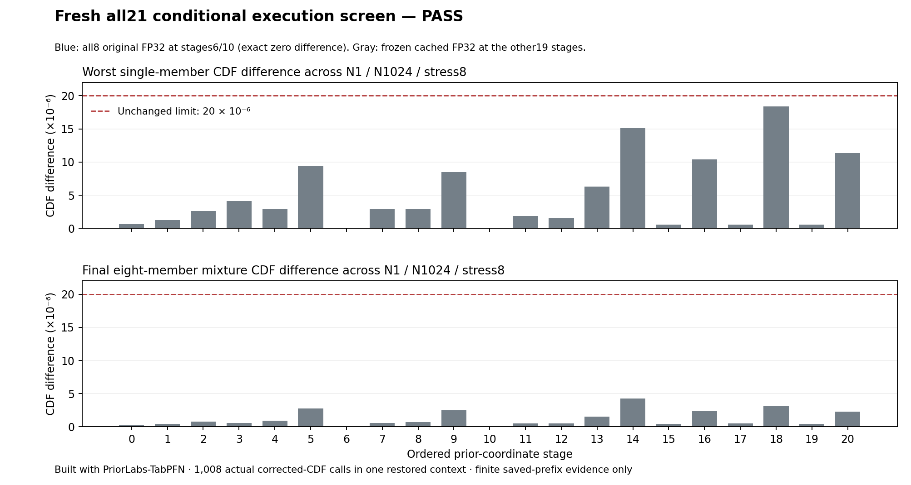

# Fresh native/cached prior-coordinate conditional screen

**Built with PriorLabs-TabPFN.** The fresh all21 finite-prefix execution screen
passed the unchanged numeric limits. This package contains no posterior draws,
physical-accuracy assessment, or population-equivalence claim.

The policy uses all eight original FP32 members at ordered stage6
(z_d0_m1, physical slot5) and stage10 (z_d0_m2, physical slot9). The other19
stages delegate to frozen cached-FP32 backend88. There is no FP16 arm and no
inherited sigma-native fallback map. The failed empty-cache
[550b91af proof](../conditionals-01/README.txt) remains failed and unchanged.

Every stage compared matching original uncached FP32 with this policy on the
same N1, N1024 and stress8 fixtures, all eight members, and unchanged
normalization1e-5 / maximumCDF2e-5 / rowTV1e-4 / ICDFv2 predicates. There were
**1,008 actual corrected-CDF calls in one restored context**. Both native
stages had exact zero member and mixture CDF differences. The worst member
CDF difference was1.8358230590820312e-5 (stage18, N1024, member1);
the worst mixture difference was4.257148145003775e-6 (stage14, N1024).
The saved numerical request elapsed421.220627 seconds, not a posterior timing.

[summary.json](summary.json) contains every stage decision, guard flag and
worst-error coordinate. [policy.json](policy.json) preserves the exact
coordinate/routing policy and limits. [source-guards.json](source-guards.json)
records the actual observation scope:

- Native preparation fitted original all8 preprocessors and executed no neural
  cached-prefill. The first planned N1 query remained in the numerical
  comparison and legitimately initialized encoder/normalizer state; no extra
  warm-up prediction was inserted and cold/warm identity is not claimed.
- At each native stage four immutable snapshots, before N1 and after N1,
  N1024 and stress, preserve frozen parameter values, all8 fitted X/y arrays,
  target statistics, criterion borders, configurations and preprocessors.
  Candidate cold snapshots equal the original-control snapshots taken after
  that control's three planned queries. These are sampled observations,
  not continuous memory monitoring.
- Native N1024 and stress preserve the observed post-N1 utility model contract,
  including normalization/outlier/train-feature/cached-embedding and observed
  used-feature-count fields. This does not claim every field is inherently
  independent of query values. Ephemeral forward/query tensors are not
  inventoried; native KV use is false.
- Cached19 stages retain their recorded prepared-before/after utility contract,
  source/checkpoint/settings/dtype/target/border/RNG and numerical guards.
  No additional full parameter-value or KV-byte hashes are invented for those
  arms. The raw manifest retains the complete actually recorded witnesses.
- Source hashes, original settings, identical masked features and latent labels,
  default RNG, corrected-CDF execution and restored aliases/flags are checked.
  A separate post-run checkpoint file hash corroborates the pinned checkpoint;
  it is explicitly not a newly fabricated in-run qualification observation.

The independent CPU replay reauthenticated the actual raw/model inputs, all21
masked training/query/target/stress bindings, both codec inventories, the closed
24-point prerequisite and failed550 inventory, then replayed all stage, state,
dtype, RNG, CDF and restoration predicates without Torch, new model calls,
draws, source edits or reference integrations.

The [separate CPU-test receipt](../native-cpu-tests-01/receipt.json) authenticates
**39 passing tests in each locked environment**, with CUDA hidden and no PFN
checkpoint inference. Its exact receipt SHA256 is
c3a4da86ec4188c022259463a8d3001afe5689a3aa34a870c4435bc644f01a85.

The exact raw manifest SHA256 is
5ec69eb7aadbd74c7d96ee534b71d0d8bee2b6dd6f6e3d2f44e74607452f682b.
[manifest.json.gz](manifest.json.gz) decompresses byte-for-byte to that
19,187,583-byte saved artifact; [RAW-MANIFEST-SHA256.txt](RAW-MANIFEST-SHA256.txt)
records its uncompressed checksum. The archive preserves the original sources,
checkpoint/input bindings, all guards and exact native initialization
transition. [checksums.json](checksums.json) authenticates this portable package.

Allocation: job5410978 used one GPU, zero restarts/no requeue, 426 allocated GPU-seconds; numerical screen elapsed421.220627s. The [reconciled allocation receipt](allocation-receipt.json) and [raw Slurm accounting](Slurm-accounting.psv) match the ledger:101745 actual GPU-seconds (28.2625/200GPUh), zero reserved. This is numerical-screen cost, not posterior-request latency.
