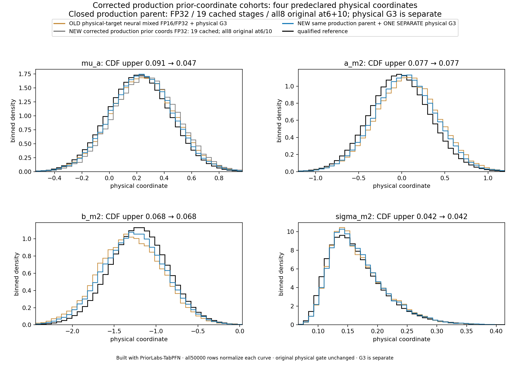
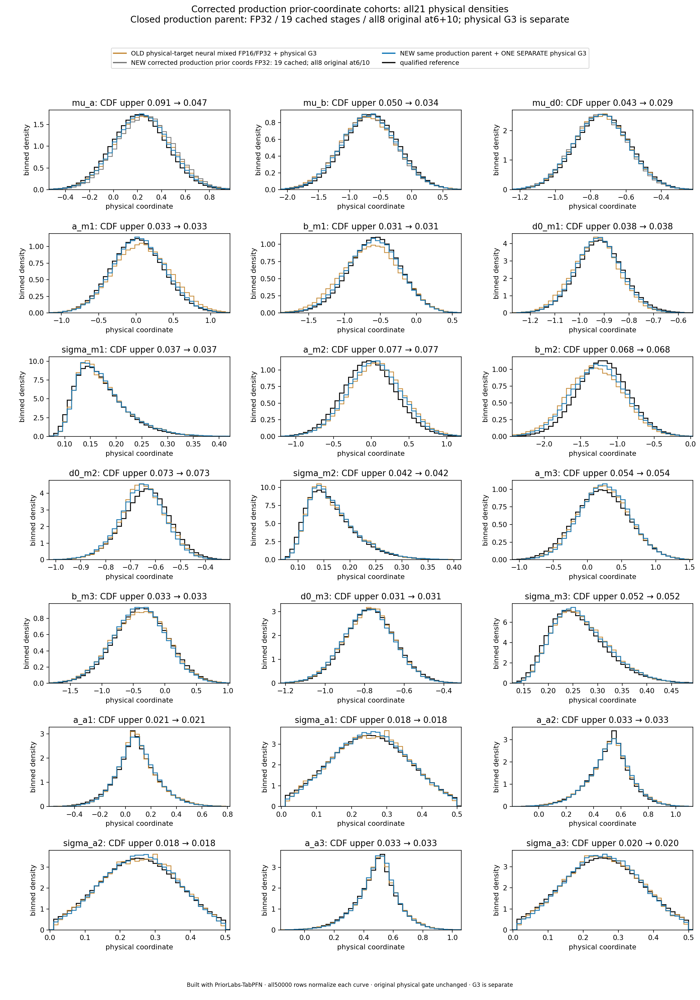
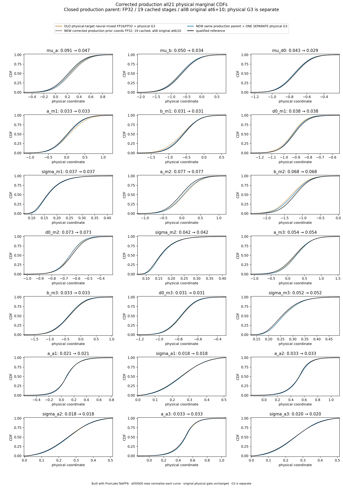
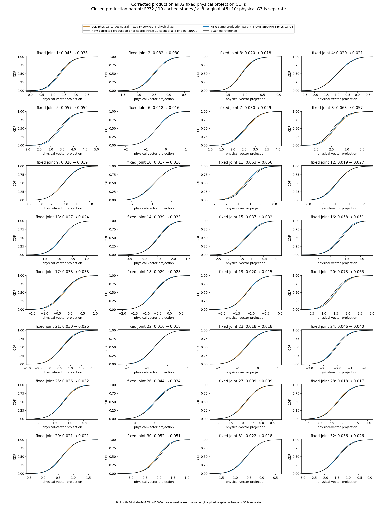

# Corrected production + ONE physical G3 — case2 gates pass

**Built with PriorLabs-TabPFN.** This is the separately authenticated successful
production request62aa8bf7, followed by one physical three-global conditional
update. The50,000-row cohort passes the original physical accuracy gate after G3.
This is **one predeclared development point** (seed20261111, case2, context4096),
not a new24-point campaign or a guarantee of posterior equivalence.

| Original unchanged gate, qualified reference uncertainty retained | Neural parent | Same parent + ONE G3 |
|---|---:|---:|
| Marginal CDF upper maximum |0.0911184427|0.0772446610|
| Fixed joint CDF upper maximum |0.0727308673|0.0653950814|
| Absolute mean error upper / reference SD |0.2221008610|0.1771522180|
| SD-ratio interval across all21 coordinates |0.928652699–1.046114001|0.928652699–1.046114001|
| Gate status |FAIL: μa mean only|PASS|

Before G3, all21 marginal CDFs, all32 fixed joint projections and every SD
interval pass; only μa's conservative mean-bias bound fails. After G3, the
worst marginal CDF and mean bounds occur at a_m2. All18 local/noise sample
columns and their marginal assessments remain unchanged. The three globals
are updated with the unchanged source-derived conditional, without loading
reference/truth values or decoding old local latent coordinates again.

Orange is the old physical-target neural mixed FP16/FP32 cohort plus physical
G3. Gray is the corrected prior-coordinate neural FP32 parent (19 cached stages;
all8 original FP32 members at6/10). Blue is the same new parent plus the one
separate physical G3; black is the qualified original case2 reference.
Coordinates, precision and routing changed relative to the old method, so this
does not isolate a causal effect of coordinate changes. Histograms and CDFs
use all50,000 rows; the saved reference selects only the display range.

The closed neural request contains complete source, default-RNG, stage, dtype,
CDF/alias, memory and timing footers. Full authentication verified147 recorded
Git source files, all21 actual masked training/target bindings, the finite
execution screen and actual query-route/count witnesses. All51,200 Float32
latent proposals decoded strictly to Float64 physical vectors, including the
1,200-row unused FIFO tail. Original complete-vector support selection checked,
accepted and returned50,000 rows in one call, with zero rejection. Decoded physical Float64 values were not cast; no clipping, repair,
partial-vector filtering or extra neural proposal was added.
The [separate technical package](../native-pilot-corrected-01/README.md) preserves
the exact successful62aa8bf7 manifest, sources, stage timings and actual769
GPU-second allocation. Actual request wall time is754.9132694993168 seconds;
CPU validation and G3/assessment are separate from that recorded request time.

One actual PCG64 standard_normal call generated a50,000×3 matrix (150,000
scalars) under the unchanged ss15_global_block_gibbs_once_v1 role and
seed2551793397. The actual returned Z, initial/final states and resulting
physical output were saved. Later assessment algebraically reconstructed the
saved output from actual Z and did not draw another matrix. Arrays remain
outside Git. This method is an explicit neural-plus-physical-G3 hybrid,
not a pure-NPE accuracy claim.

A prior postprocessing consumer stopped **before any G3 draw** when it wrongly
treated a serialized-code fingerprint as a canonical cross-process identity.
The producer's recorded8c8ffe… and fresh-verifier45b0ba… fingerprints are both
retained as process-local, reference-context-dependent telemetry. Exact field,
value and TYPE comparisons remain strict for every other policy value.
Recorded147-file Git identity, source hashes, reverse AST and live code/global
identity guards are unchanged. See the
[exact diagnosis](../marshal-fingerprint-audit-01/diagnostic.json) and
[41-tests-per-environment receipt](../corrected-production-consumer-metadata-cpu-tests-01/receipt.json),
including the actual62aa/fresh-inference-process regression. The stopped
attempt's log409b306c remains preserved and its actual G3 count stays zero.
The successful neural manifest and the earlier failed neural/forensic requests
were never rewritten or promoted.

The [summary](summary.json) contains complete gate bounds, original reference
custody, technical/draw/source evidence and scope limits. Two gzip files
preserve exact G3 and assessment metadata; [RAW-METADATA-SHA256.txt](RAW-METADATA-SHA256.txt)
authenticates their decompressed bytes. CPU02 command logs and
[execution-receipt.json](execution-receipt.json) preserve the actual once-only
G3 invocation and read-only scientific assessment. No arrays are included in
this Git package. No further neural, GPU, simulator or reference-integration
run followed this pilot.
