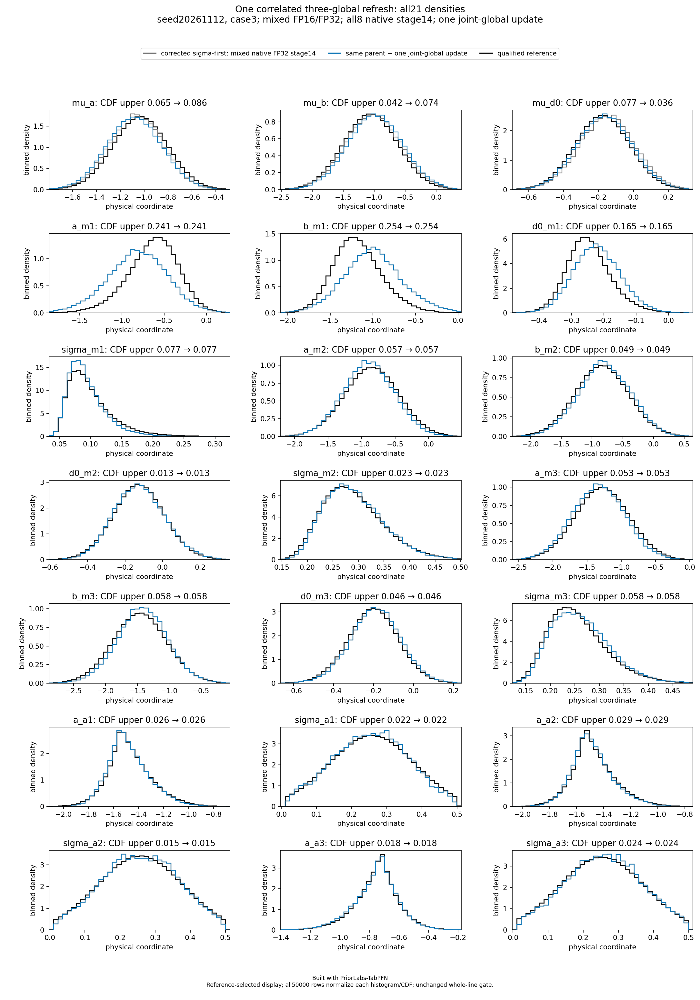
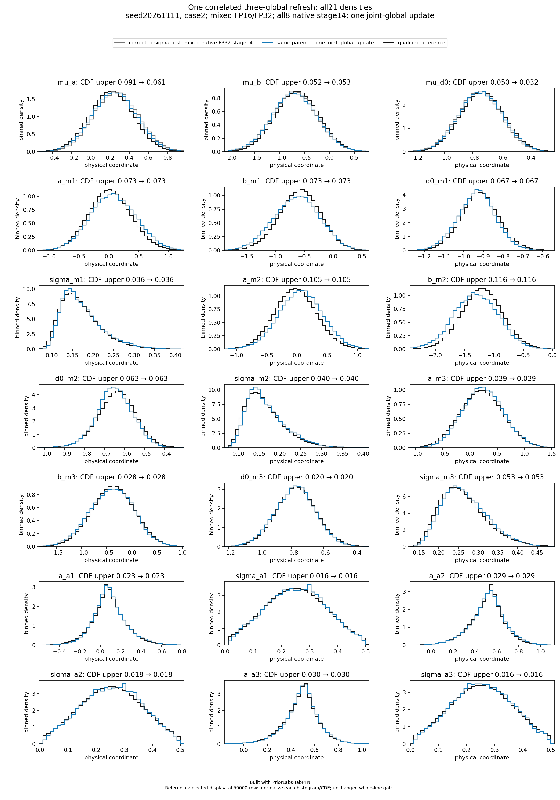
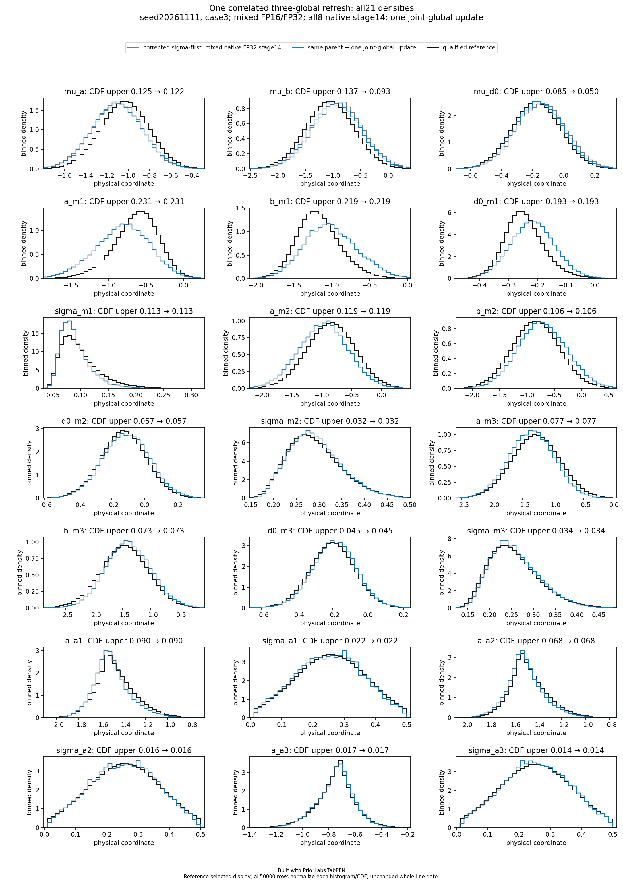
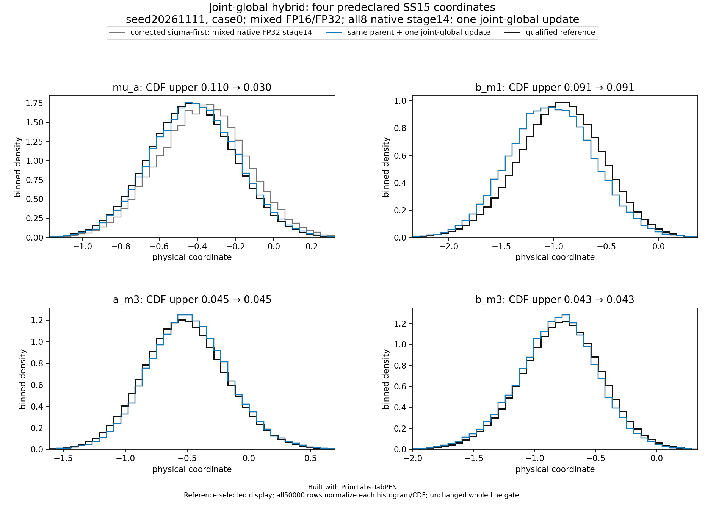
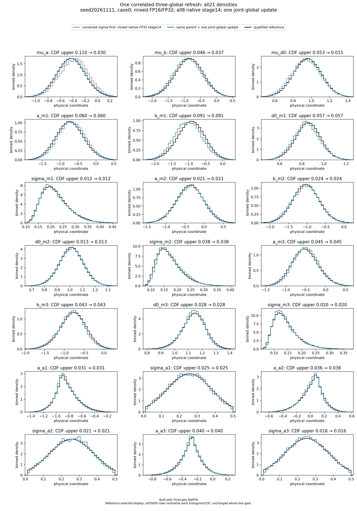
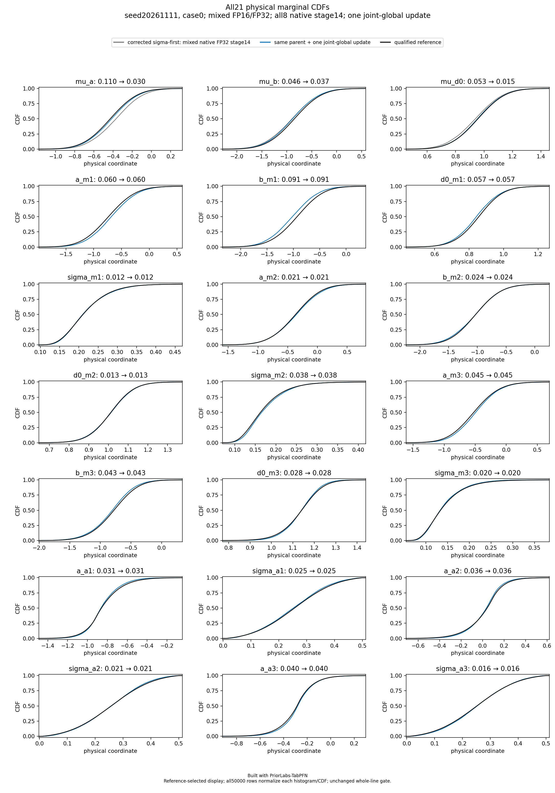
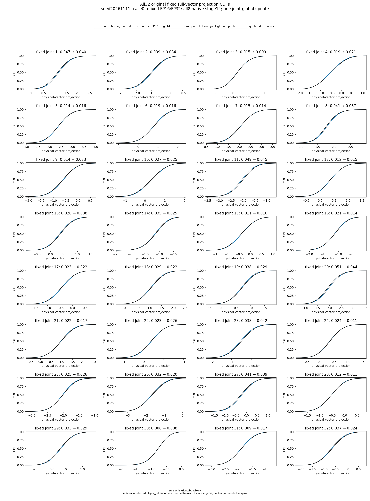

# Corrected sigma-first grid: partial failure

Built with PriorLabs-TabPFN. **16/24 points assessed: 3 pass, 13 model failures,
8 pending in this snapshot. The all-point candidate gate has failed.**
All eight cases for each of context seeds 20261111 and 20261112 are assessed.
The eight points for context seed 20261113 remain pending in this snapshot.
The fixed grid continues without changing the method or omitting failures.

The method is explicitly **hybrid NPE-PFN/Gibbs**, not pure TFM inference:
SS15 observations, all-three-global block-local conditioning, the fixed
sigma-first order in all six blocks, and one exact joint refresh of the three
globals. The scientific rule, original 50,000-vector count, source-bound
execution policy and physical reference limits are fixed; there is no
outcome-dependent mask, order, precision or kernel change during this grid.
The exact global refresh preserves all 18 local/noise columns byte for byte.

This is a development diagnostic, **not evidence of global calibration, SBC,
or an untouched confirmation set**. The retained
[development history](../structured-candidates-01/README.md) includes the failed
MAP2 numerical screen and earlier prototype. The first point here is the
**fresh corrected case 0 cohort**, not that prototype. The numerical execution
screen covers separate finite case 0 prefixes; it does not screen other cases
or establish posterior accuracy.

## Current results

| Seed | Case | Status | Marginal CDF upper | Joint CDF upper | Mean-bias upper / ref SD |
|---|---:|---|---:|---:|---:|
| 20261111 | 0 | [pass](seed-20261111-case-0/README.md) | 0.090541 | 0.044952 | 0.199851 |
| 20261111 | 1 | [pass](seed-20261111-case-1/README.md) | 0.084424 | 0.089961 | 0.185531 |
| 20261111 | 2 | [model_failure](seed-20261111-case-2/README.md) | 0.116391 | 0.091392 | 0.272693 |
| 20261111 | 3 | [model_failure](seed-20261111-case-3/README.md) | 0.231336 | 0.126481 | 0.585035 |
| 20261111 | 4 | [model_failure](seed-20261111-case-4/README.md) | 0.098715 | 0.074394 | 0.205065 |
| 20261111 | 5 | [model_failure](seed-20261111-case-5/README.md) | 0.215403 | 0.166750 | 0.488252 |
| 20261111 | 6 | [model_failure](seed-20261111-case-6/README.md) | 0.189656 | 0.148233 | 0.456835 |
| 20261111 | 7 | [model_failure](seed-20261111-case-7/README.md) | 0.102106 | 0.074185 | 0.229597 |
| 20261112 | 0 | [model_failure](seed-20261112-case-0/README.md) | 0.112156 | 0.057000 | 0.244628 |
| 20261112 | 1 | [pass](seed-20261112-case-1/README.md) | 0.060925 | 0.032829 | 0.111878 |
| 20261112 | 2 | [model_failure](seed-20261112-case-2/README.md) | 0.143834 | 0.102002 | 0.358469 |
| 20261112 | 3 | [model_failure](seed-20261112-case-3/README.md) | 0.253600 | 0.104904 | 0.608350 |
| 20261112 | 4 | [model_failure](seed-20261112-case-4/README.md) | 0.127898 | 0.052187 | 0.271692 |
| 20261112 | 5 | [model_failure](seed-20261112-case-5/README.md) | 0.133825 | 0.067457 | 0.324887 |
| 20261112 | 6 | [model_failure](seed-20261112-case-6/README.md) | 0.150244 | 0.111484 | 0.365972 |
| 20261112 | 7 | [model_failure](seed-20261112-case-7/README.md) | 0.138837 | 0.081981 | 0.324075 |

Case 2 retains its qualified-reference model failure: a_m2 and b_m2 fail
both marginal CDF and mean-bias limits. Its joint CDF and SD-ratio checks pass.
Case 3 also fails marginal, mean, joint and SD-ratio criteria: marginal maximum
0.231336352, joint maximum 0.126480968, mean-bias maximum 0.585035025 reference SD,
and sigma_m1 SD-ratio lower bound 0.751748871. Technical controls pass for both.
Case 4 fails only the sigma_m2 mean-bias limit (upper 0.205064535 reference SD);
its CDF and SD-ratio checks pass. This failure is also retained.
The seed-20261112 / case-3 parent passed its joint CDF criterion
(upper 0.097582759), while the same one-pass global refresh produces a joint
upper 0.104904064 at direction 18 and adds a mu_a mean failure. This worsening
is retained without omitting the fixed kernel. Exactness of a conditional
update does not guarantee monotonic finite-cohort criteria.

No failed point is dropped and no method fallback is introduced. Original
limits remain CDF upper <=0.10, mean-bias upper <=0.20 reference SD,
SD-ratio interval inside [0.8,1.2], and reference precision <=0.005.

## First corrected point

Seed 20261111 / case 0 passes the unchanged physical gate. Its largest conservative
mean-bias bound is 0.199851420 reference SD, close to the 0.20 limit; this single
point does not establish generalization. These four original figures use all
50,000 rows. The focus panel is predeclared, not selected from the hybrid result.

Its neural posterior request took 200.903236 seconds; wrapper time was 206.314274
seconds and the single-GPU allocation was 209 seconds with zero restarts.
The separate CPU global refresh is recorded separately, not folded into the
neural request time.

## Exact artifacts and extension

grid-index.csv and grid-index.json retain all 24 predefined rows, including
pending points. Standard subsequent assessments come from
sigma-native-grid-assessment-01/seed-SEED-case-CASE/.
Add only checksum-closed assessments; preserve failed results and update the
counts, point files and publication checksums together.

Each point has its exact assessment, figures, original checksums, a provenance
JSON file, and gzip copies of the **unmodified raw parent/refreshed manifests**.
Decompress each archive and compare it with its corresponding raw SHA256
sidecar. publication-checksums.json checks every packaged file.
Raw sample arrays are not included. The frozen source
and proof identities are recorded in grid-index.json.
