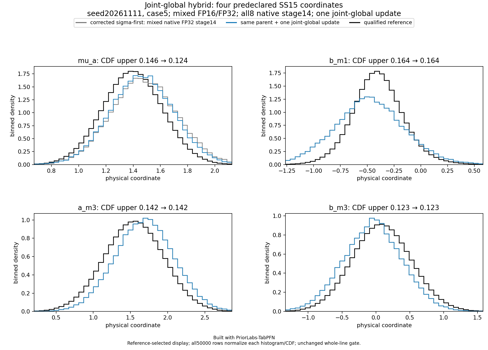
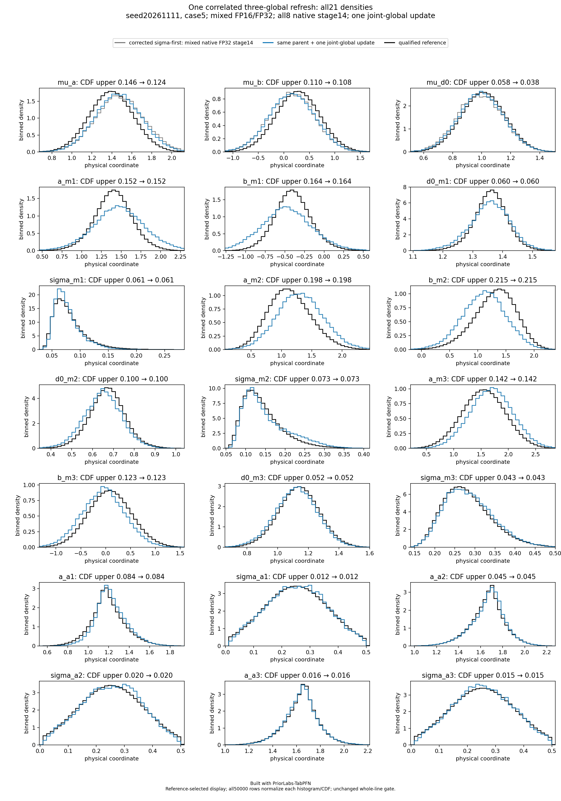

# Seed 20261111, case 5: model_failure

Built with PriorLabs-TabPFN. This is the frozen **hybrid NPE-PFN/Gibbs** method:
sigma-first local-block neural conditionals, followed by one exact joint refresh
of all three globals. All 50,000 complete physical vectors are assessed.

The case-specific qualified reference and unchanged conservative limits give
marginal CDF maximum 0.215402544, joint CDF maximum
0.166750367, and mean-bias maximum
0.488252290 reference SD.
Failed marginal coordinates: mu_a, mu_b, a_m1, b_m1, a_m2, b_m2, d0_m2, a_m3, b_m3.
Failed mean coordinates: mu_a, mu_b, a_m1, b_m1, a_m2, b_m2, d0_m2, a_m3, b_m3.
Failed joint CDF indices: 10, 19.
Failed SD-ratio coordinates: a_m1, b_m1, d0_m1, sigma_m1, d0_m2.
The full SD-ratio interval range is [0.787129848, 3.089818234].
The predeclared focus uses indices [0,4,11,12]; every coordinate remains in the
full density plot and exact assessment. No failure is omitted.

The JSON assessment, source figure bytes and checksums are unchanged copies.
The two gzip archives decompress to the exact original producer manifests;
their raw SHA256 sidecars verify that identity. Payload hashes are retained,
but no raw samples or private CV material are included.
