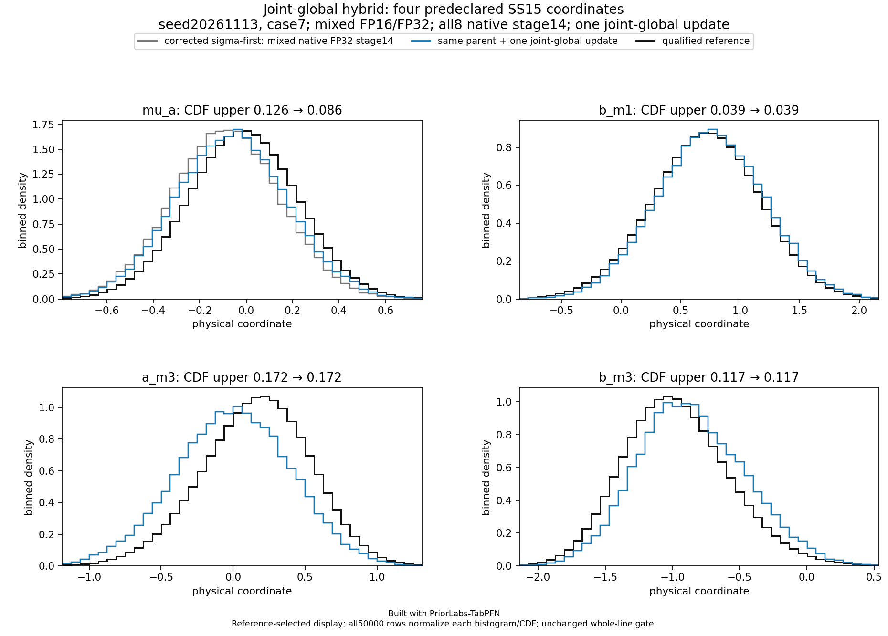
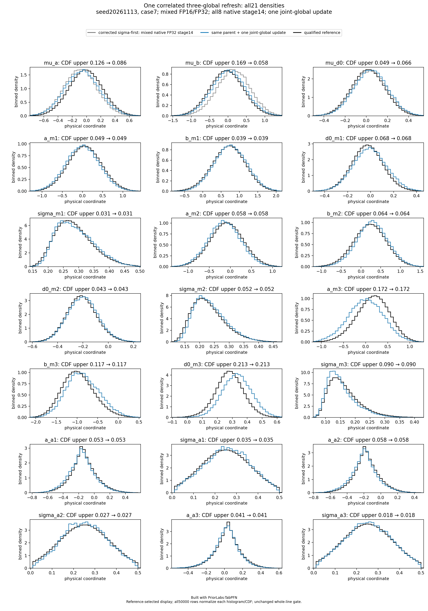

# Seed 20261113, case 7: model_failure

Built with PriorLabs-TabPFN. This is the frozen **hybrid NPE-PFN/Gibbs** method:
sigma-first local-block neural conditionals, followed by one exact joint refresh
of all three globals. All 50,000 complete physical vectors are assessed.

The case-specific qualified reference and unchanged conservative limits give
marginal CDF maximum 0.213474993, joint CDF maximum
0.094837083, and mean-bias maximum
0.507917841 reference SD.
Failed marginal coordinates: a_m3, b_m3, d0_m3.
Failed mean coordinates: mu_a, a_m3, b_m3, d0_m3.
Failed joint CDF indices: none.
Failed SD-ratio coordinates: a_m1.
The full SD-ratio interval range is [0.900921305, 1.203271287].
Before the exact global refresh, the parent status was model_failure, with
marginal CDF maximum 0.213474993, joint CDF maximum
0.115081064, and mean-bias maximum 0.507917841.
Its failed mean coordinates were mu_a, mu_b, a_m3, b_m3, d0_m3;
failed joint indices were 10, 24.
Both before and after summaries are preserved; the exact global kernel is not
claimed to improve every finite-cohort criterion.

The predeclared focus uses indices [0,4,11,12]; every coordinate remains in the
full density plot and exact assessment. No failure is omitted.

The JSON assessment, source figure bytes and checksums are unchanged copies.
The two gzip archives decompress to the exact original producer manifests;
their raw SHA256 sidecars verify that identity. Payload hashes are retained,
but raw sample arrays are not included.
