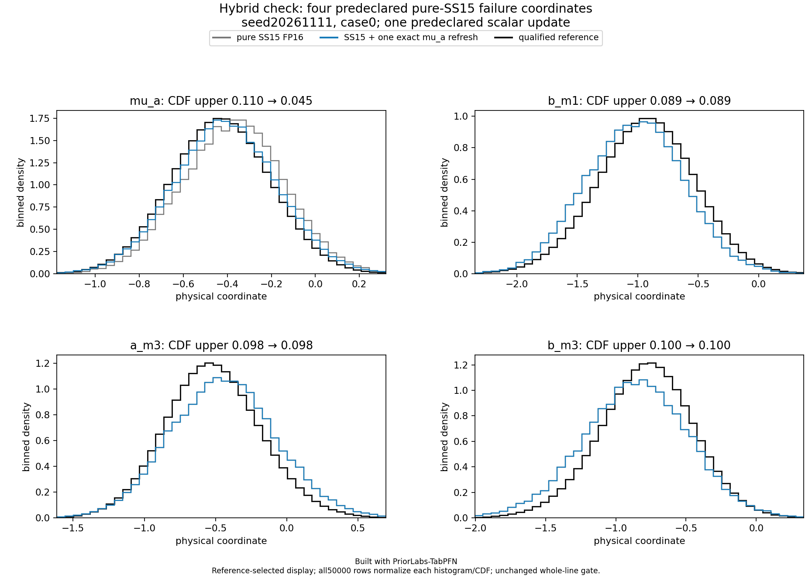

# One exact mu_a conditional refresh

Built with PriorLabs-TabPFN. This separately labeled **hybrid NPE-PFN/Gibbs** diagnostic corrects the targeted mu_a discrepancy in the first SS15 development case. The full physical result remains **model_failure**, because three local mean errors are unchanged.

The mathematical operation, random stream and full scientific criteria were [fixed publicly before generating or assessing the cohort](../../../docs/accuracy-ss15-mu-a-gibbs-v1.md). Starting with the saved 50,000 complete supported pure-SS15 vectors, draw mu_a once per row from the exact Gaussian full conditional implied by the unchanged hierarchical prior. All other 20 physical columns remain byte-identical. The likelihood depends only on local coefficients and noise, so observations, noise and reference distributions cancel from this conditional once the other parameters are given. No truth, observation or reference file is a correction input. No model, simulator or GPU call is added.

| Conservative physical result | Pure SS15 FP16 | One mu_a refresh |
| --- | ---: | ---: |
| mu_a marginal CDF upper bound | 0.109972 | 0.045147 |
| mu_a mean-bias upper, reference SD | 0.250365 | 0.102166 |
| Worst marginal CDF upper bound | 0.109972 | 0.099735 |
| Worst of 32 joint CDF upper bounds | 0.064554 | 0.068423 |
| Worst mean-bias upper, reference SD | 0.250365 | 0.219599 |
| Failed marginal / joint / mean / SD checks | 1 / 0 / 4 / 0 | 0 / 0 / 3 / 0 |

Every marginal CDF, fixed joint projection CDF and SD interval passes in this hybrid cohort. Mean checks for b_m1, a_m3 and b_m3 still fail the unchanged 0.20 reference-SD upper limit. Their entire empirical distributions and marginal assessments are identical to pure SS15. The b_m3 CDF upper bound is 0.099735, just below the unchanged 0.10 limit; rounding a plot label to 0.100 does not change the decision. Reference numerical uncertainty, all 50,000 rows and the original tails remain in the assessment. Improvement in mu_a does not imply uniform improvement of joint projections, full scientific success, or calibration.

Grey is pure SS15, blue is SS15 followed by the one exact mu_a draw, and black is the qualified saved reference. The unchanged local blue/grey curves overlap. Histograms use the full cohort count, including mass outside the reference-selected display interval. [All 21 densities](mu-a-refresh-density.png), [all 21 marginal CDFs](mu-a-refresh-marginal-cdf.png), and [all 32 joint projection CDFs](mu-a-refresh-joint-cdf.png) retain every original check.

## What the kernel tests

With global prior precision S0 and independent Gaussian local blocks beta_i|g ~ N(A_i g+c_i,D_i), let P=S0+sum(A_i^T D_i^-1 A_i) and eta=S0*m+sum(A_i^T D_i^-1(beta_i-c_i)). The scalar conditional mean is (eta_0-P_01*mu_b-P_02*mu_d0)/P_00 and its variance is 1/P_00. Coefficients are derived from the frozen model, rather than fitted from a reference. The conditional SD is approximately 0.1806481. Globals are unbounded; unchanged local/noise columns keep their original support. No filtering, clipping, redraw, iteration or trim occurs.

A model-only standardized conditional-residual diagnostic changed mean/SD from 0.182213 / 0.970418 to -0.004203 / 0.999136. The refreshed values follow the prescribed private normal draws by construction. This checks the operation and identifies conditional inconsistency; it is not posterior calibration or independent accuracy evidence. An exact conditional kernel preserves the true posterior but does not turn arbitrary approximate local marginals into the correct posterior.

The CPU kernel-only timer was 0.014080 seconds. It excludes the original 50,000-vector neural request, loading and verification; no new end-to-end inference speed is claimed. The diagnostic added zero allocated GPU hours.

## Custody and validation

The pure cohort manifest/sample SHA256 values are 28da396e0af6cf26009b4eb8feab8b75ed7a1d7a5add30440a35b38539da4f94 / f263f712d943d7916205b2f2b77f9243ac4ba3819f5f739c45f00710d5b4be47. The hybrid manifest/sample SHA256 values are 0eecafd7775ad1b5f7d3156cdcd66f57b85aecf23a17a4d92bb5ab88b4800db3 / 90d4813ba5d1d1b8fa5158b5ba92268cbeda57c4d83e951984f7407134274f28. The kernel source is 850df8d6498f78c12500ffdf60c4c9126f5c1ab67bc29867002d4c991373d2e8; the producer source is 5c1997f2b5e830f88aca1e29a4871c47c7b51940740e866acc7c8801e8a42feb, committed at 94acc42 before execution. The construction used the predeclared private PCG64 seed 2020043410 and one standard-normal draw per row. The exact draw stream, target column and final private RNG state independently replayed byte for byte; recorded default NumPy/Python RNG observations are unchanged. Torch RNG was not imported or observed in this CPU-only producer.

Thirty-four kernel/producer CPU tests passed in both environments, including independent joint-Gaussian Schur conditioning, actual prior log-density ratios, likelihood independence from globals, support, unchanged-column bytes and RNG isolation. Eleven evaluator checks also passed in both environments. The [assessment](assessment.json), [producer manifest](producer-manifest.json), and [checksums](checksums.json) retain source/contract/Git/reference/payload bindings and the unchanged full physical gate. This folder does not include raw sample payloads retained in scratch.

The [fixed three-seed × eight-case grid](../../../docs/accuracy-ss15-grid-v1.md) now compares both methods without changing this scalar kernel after seeing further cases. The existing case-0 pair is reused. Development cases are not untouched confirmation or SBC. No additional neural candidate or performance optimization is introduced during that grid.
