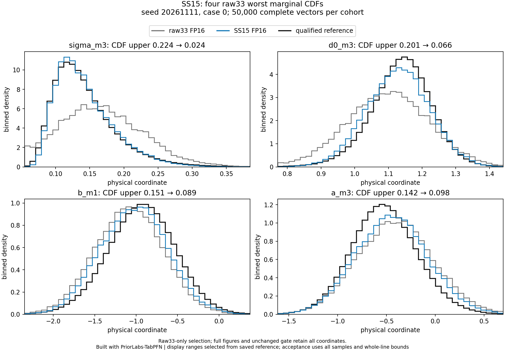

# First SS15 accuracy pilot

Built with PriorLabs-TabPFN. The exact sufficient-statistic representation substantially improves the first development case, but the original physical result remains **model_failure**. This is one fixed seed/case, not complete validation or a calibration result.

The raw33 FP16 and SS15 FP16 cohorts each contain exactly **50,000 complete finite prior-supported 21-dimensional physical vectors**, from the same context 4096, context seed 20261111, held-out case 0, checkpoint, raw bank, qualified reference, and original physical gate. Density plots divide bin counts by the full cohort count, retain tail mass outside display ranges, and use saved reference-CDF bins. Gate calculations use every row and conservative whole-line CDF bounds including reference uncertainty.

| Conservative metric | Raw33 FP16 | SS15 FP16 |
| --- | ---: | ---: |
| Worst marginal CDF upper | 0.224425 | 0.109972 |
| Worst of 32 fixed joint CDF uppers | 0.166952 | 0.064554 |
| Worst absolute mean bias upper, reference SD | 0.445224 | 0.250365 |
| SD-ratio interval envelope | 0.900915–1.395516 | 0.906986–1.120452 |
| Failed marginal / joint / mean / SD checks | 7 /7 /8 /4 | 1 /0 /4 /0 |

All 32 joint CDF checks and all 21 SD intervals now pass. Remaining failures are the mu_a marginal CDF and mean biases for mu_a, b_m1, a_m3, b_m3. The mu_a result worsened: its CDF upper bound changed 0.093531→0.109972 and mean-bias upper bound 0.206695→0.250365. The unchanged limits remain0.10 for CDF upper bounds,0.20 reference SD for mean-bias upper bounds, and SD-ratio intervals inside[0.8,1.2]. Reference precision here is 0.000618534, below the unchanged0.005 requirement.

[All 21 physical densities](ss15-pilot-density.png) · [All 21 marginal CDFs](ss15-pilot-marginal-cdf.png) · [All 32 joint projection CDFs](ss15-pilot-joint-cdf.png)

## Counts and runtime scopes

Slurm 5408971 completed on one GPU in 301 allocated seconds with zero restarts. The posterior request took 197.740194s; the complete wrapper took 285.948231s. Peak CUDA allocated/reserved bytes were 2,981,376,000 /9,896,460,288. These are single-run observations, not final repeated timing claims. The request/wrapper difference is not attributed to one operation.

One wave generated 51,200 complete proposals. The original support function screened 50,395, accepted 50,128 before trim, rejected 267, returned 50,000, trimmed 128 accepted surplus rows, and left 805 generated FIFO rows unscreened. The observed rejection fraction is 267/50395≈0.5298%; it estimates population rejection probability, not a population guarantee. Counts alone do not prove that the learned proposal fails the CDF gate. No counts-only mean bound is available for unbounded globals.

## Direct saved stage 0 diagnostic

mu_a is physical index 0 and stage 0, followed by mu_b and mu_d0. It sees all 15 SS15 features before any target prefix. Changing only normalized downstream factors leaves its proposed marginal unchanged; whole-row support conditioning can reweight the returned marginal. For a fixed proposal law P and support event A, marginal CDF displacement is at most P(A-complement). The finite observed fraction above is not that population quantity.

A separate deterministic diagnostic uses the already saved original FP32 stage 0 density. Its1024 observation queries and probability rows are exactly identical. Normalizing its saved finite-bar masses in Float64 gives a whole-line CDF distance to the qualified mu_a reference between **0.101219 and 0.105801**, already beyond0.10 before posterior sampling or support rejection. Recorded singleton FP16-versus-FP32 conditional CDF drift was0.000174127. FP16 probability arrays were not archived; that measured drift does not reconstruct a production FP16 density. No ideal finite-bar moment is claimed to equal a production inverse-CDF moment. See[diagnostic receipt](stage0-density-diagnostic.json).

## Custody and scope

The SS15 producer is source4099da3c19366997ab0800e5430b5bb1c129b4b3e535f678b3d4652233303480 at executed commit e9d38530f05663fb9b4664f3304e8ad2626a3af4. Its manifest SHA256 is 28da396e0af6cf26009b4eb8feab8b75ed7a1d7a5add30440a35b38539da4f94; sample NPZ SHA256 is f263f712d943d7916205b2f2b77f9243ac4ba3819f5f739c45f00710d5b4be47. The raw33 control manifest/sample SHAs are retained in the assessment. The compact evaluator independently replays the source-bound conditional assembly, raw scientific/model-input descriptors, reference custody, all 21 stage/member/CDF counters, source restoration and default-RNG records. The all 21 FP16 strict-FP32 drift failures remain visible. The failed original SS15 final-stage cached FP32 result is preserved, with its declared narrow native fallback replay; no threshold was relaxed.

The canonical original assessment is preserved; a later layout-only refresh fixes the marginal-CDF footer, leaves all numerical assessments identical, and leaves the other three PNGs byte-identical. The[final assessment](assessment.json), original scientific source/assessment receipts where included, and[checksums](checksums.json) describe those scopes. This compact evidence folder does not claim to include the multi-gigabyte golden archive or raw posterior payloads retained in scratch.

The next isolated diagnostic was[fixed before generating its cohort](../../../docs/accuracy-ss15-mu-a-gibbs-v1.md): one exact prior-derived mu_a full-conditional refresh, separately labeled hybrid NPE-PFN/Gibbs. Other20 physical columns stay byte-identical, so remaining local mean failures cannot be repaired by that operation. The predefined3-seed×8-case diagnostic grid remains required; development cases are not untouched confirmation. GPU optimization, retained-session timings, compilation and 1/2/4-GPU scaling are deferred. Current reconciled usage is 25.955833 of 200 allocated GPU-hours, with no reservation.
