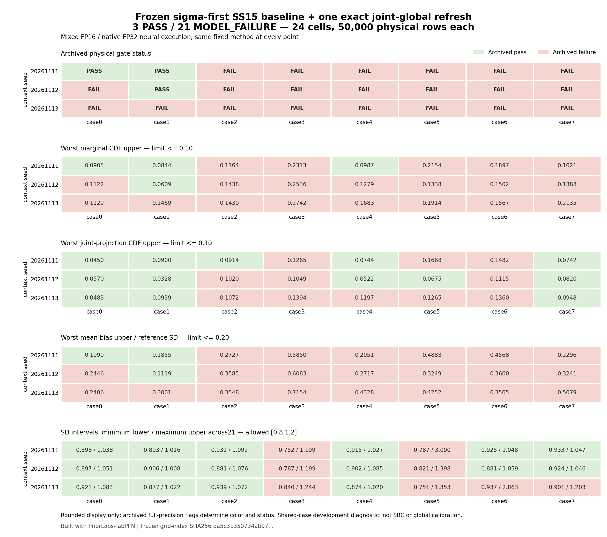

# Frozen sigma-first grid overview

Built with PriorLabs-TabPFN. **24/24 points: 3 pass,
21 model failures, zero pending.** Each cell uses all
50,000 supported physical vectors and its original qualified reference.

This is the frozen hybrid method: fixed SS15, sigma-first block-local neural
conditionals with mixed FP16/native FP32 execution, followed by one exact
joint-global Gibbs refresh. It is a shared-case development diagnostic,
**not SBC, global calibration, or an untouched confirmation set**.

Cell color comes from the archived full-precision failure flags. Numbers are
rounded only for display; a rounded boundary value does not change a gate.
Original limits are CDF upper <=0.10, mean-bias upper <=0.20 reference SD,
and each SD-ratio uncertainty interval contained in [0.8,1.2].
The SD panel shows the minimum lower and maximum upper endpoints over all21
marginal intervals, which need not belong to the same parameter. All reference
precision checks remain those of the saved assessments.

The only data input is the exact frozen grid-index.json, SHA256
da5c31350734ab97d7a4baf07a264d19e93aaaade0df1a5727fb9893dd1b5016. Its unchanged bytes are copied here as input-grid-index.json.
No samples, references, metrics, or statuses were recomputed.
The [full frozen evidence](../corrected-sigma-grid-01/README.md) retains original
assessments, all parent/after-refresh outcomes, plots and exact manifests.
This overview does not assess or qualify the new prior-coordinate candidate.

The display ran after the root supplied new-qualification job
5410894. That identifier is a workflow trigger, not evidence
that the new qualification passed.
