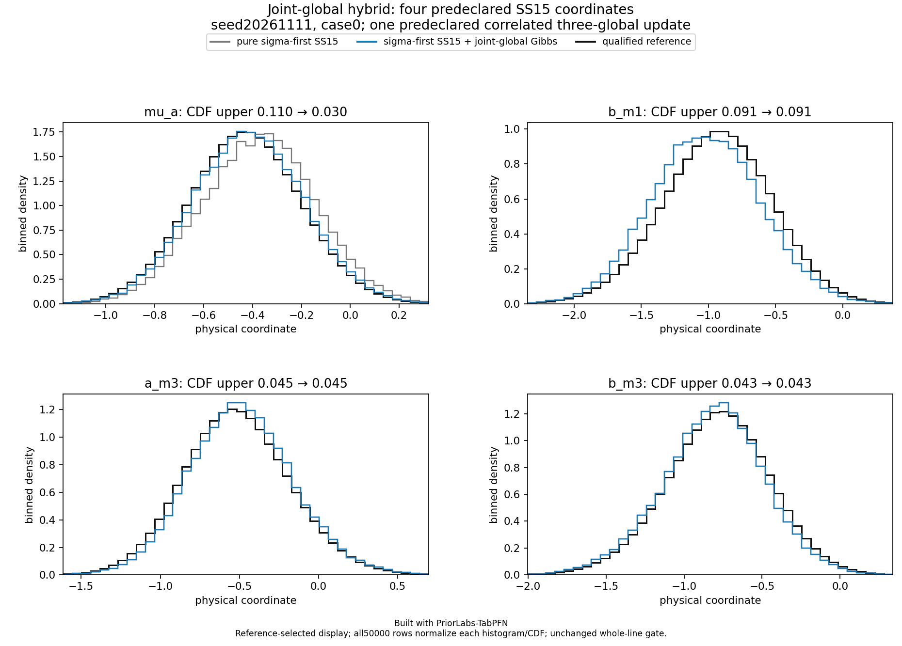

# Structured SS15 development candidates

Built with PriorLabs-TabPFN. Every cohort here contains exactly 50,000 complete finite supported physical 21 vectors. These are development results on context seed 20261111, context 4096, held-out case 0, the frozen checkpoint and the same qualified original reference. All physical limits and conservative reference uncertainty remain unchanged. The selected sigma-first prototype has a physical pass after one prior-only joint-global draw, but its fresh numerical execution screen failed; it is **provisional development evidence, not the final corrected-path validation record**.

| Fixed development method | Worst marginal CDF upper | Worst joint CDF upper | Worst mean-bias upper, ref SD | Failed marginal / joint / mean / SD |
| --- | ---: | ---: | ---: | ---: |
| Full SS15 FP16 | 0.109972 | 0.064554 | 0.250365 | 1 / 0 / 4 / 0 |
| Fixed graph-local SS15 | 0.109912 | 0.059354 | 0.250066 | 1 / 0 / 2 / 0 |
| Full SS15 + joint-global Gibbs | 0.099735 | 0.063849 | 0.219599 | 0 / 0 / 3 / 0 |
| Graph-local + joint-global Gibbs | 0.094034 | 0.055825 | 0.217551 | 0 / 0 / 1 / 0 |
| Sigma-first graph-local prototype | 0.109912 | 0.051304 | 0.250389 | 1 / 0 / 1 / 0 |
| Sigma-first prototype + joint-global Gibbs | 0.090541 | 0.044972 | 0.199851 | 0 / 0 / 0 / 0 |

The graph-local factorization keeps all three globals, each block's own sufficient observations and only preceding parameters from that same local block. It applies the same source-derived rule to all six blocks. Global neural proposal factors stay unchanged. This removes a_m3 and b_m3 mean failures but leaves b_m1 above the original 0.20 reference-SD upper limit.

The universal sigma-first order places each block's learned noise conditional before its learned physics conditionals. Given noise and globals, the frozen model's physics conditionals are Gaussian; the implementation still learns every local conditional and performs no analytic local update. Complete proposals return to original physical order before the original FIFO, whole-vector support rejection and final accepted-row trim. The prototype lowers b_m1's mean-bias upper bound to **0.1998514196**, barely below 0.20. This small margin is not a robustness or population-calibration guarantee.

The separately labeled hybrid step draws all three global means jointly once from their exact Gaussian full conditional implied by the known hierarchical prior. It takes saved physical rows and the prior only: observations, truth and references do not construct a correction. All 18 local/noise columns remain byte-identical. The same preregistered private PCG64 role and correlated [50000,3] normal matrix are used for the paired controls. An exact global conditional kernel does not repair approximate local marginals or establish posterior calibration.

## Ordinary physical plots

[Pure graph-local focus](pure-graph/graph-local-density-focus.png) · [Graph-local plus joint-global focus](graph-joint/joint-global-density-focus.png) · [Pure sigma-first prototype focus](pure-sigma-prototype/sigma-first-density-focus.png) · [Sigma-first prototype plus joint-global focus](sigma-joint-prototype/joint-global-density-focus.png)

Every subfolder also retains its full 21 density and marginal/joint CDF figures, numerical assessment and original figure checksums. Histograms use all 50,000 rows in their normalization and saved reference bins; assessment retains tails outside the displayed interval. The focus coordinates were fixed before each comparison. The18-column invariance control separates the neural local-mean improvements from the global-only update.

## Numerical execution and timing scopes

Graph-local's fresh execution screen passed all 18 local stages; three global stages reused earlier records only after exact source/predictor/label/query identity. The maximum matching FP32 member CDF error was 0.00001987815 under the unchanged0.00002 limit; the maximum mixture error was 0.0000040723. All 21 strict FP16-versus-FP32 flags remain failed and visible. This is fixed-conditional execution evidence, not posterior equivalence.

The sigma-first screen collected fresh original-FP32 controls. Stages0 through 13 passed. At stage 14 (physical d0_m3), N1024 raw-member CDF errors for members 1,2,4,5,6 exceeded 0.00002, reaching 0.00002482533; final mixture error 0.00000627837 and all hard/source/RNG guards passed. The failed screen is preserved; stages 15 through 20 were not reached by its fail-fast collector. The[execution correction contract](../../../docs/accuracy-ss15-sigma-execution-correction-v1.md) fixes the rule before further results: finish the numerical inventory, use original native FP32 for every member of a numerically failing local stage, freshly qualify all 21 stages, and then obtain a fresh corrected-path50,000-vector case 0 cohort for the identical frozen 24-point grid. No scientific ordering, feature, kernel, reference or acceptance limit changes.

Graph-local job 5409178 used 183.768542 request seconds and 193.606502 wrapper seconds (197 allocated GPU-seconds, zero restarts). Sigma-first prototype job 5409374 used 183.417979 request seconds and 196.673791 wrapper seconds (201 allocated GPU-seconds, zero restarts). Request scopes include stage preparation and CPU sampling. These are single observed requests, not retained-session warm benchmarks or final corrected-path timings. The joint-global CPU updates add no GPU allocation. Numerical screens 5409324 / 5409401 used 497 / 435 allocated GPU-seconds. All failures and idle allocations are charged.

The earlier full-SS15 case 1 / seed 20261111 job 5409143 also passes its own original physical gate: marginal/joint CDF upper maxima 0.088707 /0.090300, mean-bias upper maximum 0.197019 and SD-ratio interval envelope [0.911183,0.995646]. It is an original-order full-SS15 cohort, not a sigma-first validation result. Request/wrapper seconds were 405.153834 / 447.569872; allocation 459 GPU-seconds, zero restarts.

## Custody and limits

The source and posterior payload hashes, raw scientific/model bindings, executed Git identities, actual masks/target order, private RNG replays, whole-vector counters and qualified-reference custody remain in the assessment and compressed original producer manifests. Plain producer-manifest SHA256 sidecars authenticate their uncompressed bytes. The matching and failed execution screens are preserved as compressed original manifests with their own raw-byte hash sidecars. Raw sample payloads remain in scratch; this folder does not claim a complete raw-data archive.

The scientific ordering and global kernel are frozen. Keep the original raw33, SS15, graph-local, scalar-global and prototype failures visible. The final corrected candidate must use the same source and unchanged gate across all 24 predefined seed/case combinations, including a fresh corrected case 0. Development selection is recorded and is not untouched confirmation or SBC. Validation uses serialized one-GPU requests. No performance tuning or multi-GPU work is resumed.
