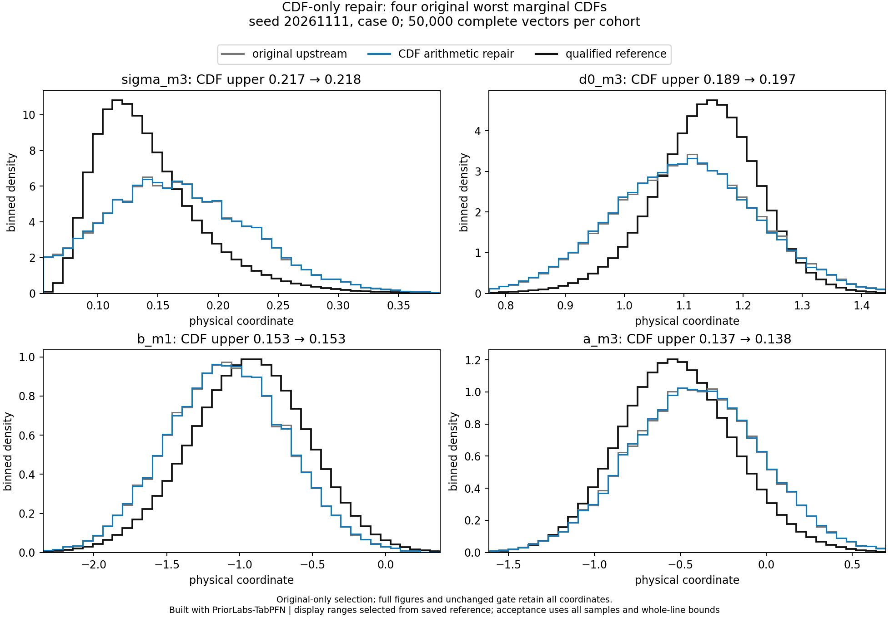
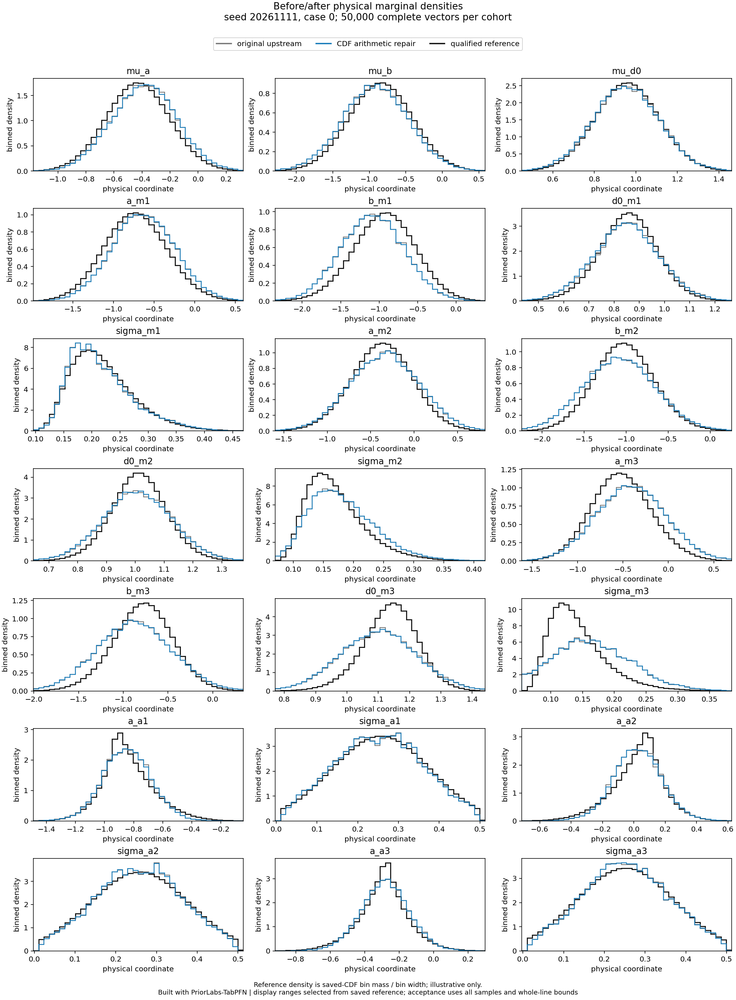
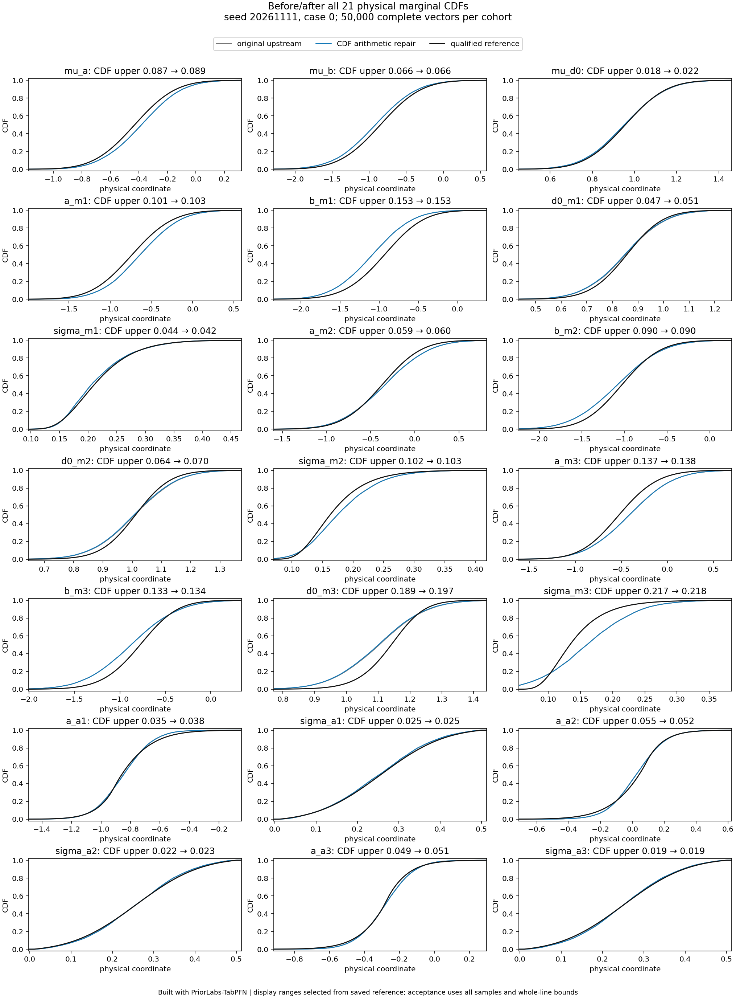
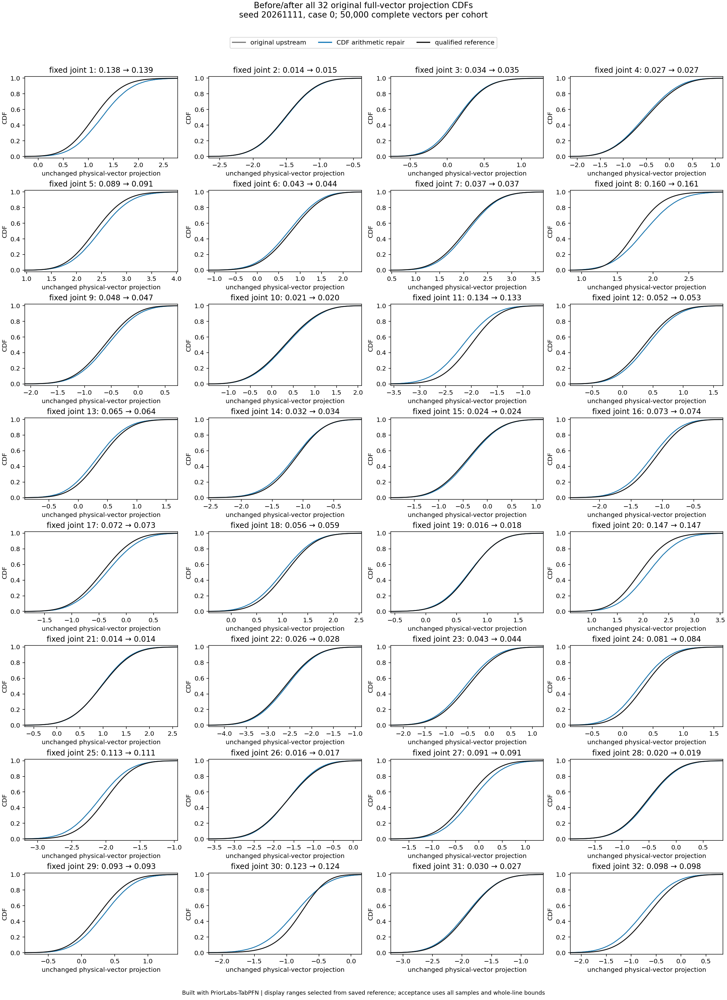

# CDF-only arithmetic repair: failed scientific pilot

**Built with PriorLabs-TabPFN**

The source-guarded CDF arithmetic repair is implemented and demonstrably executed, but **case 0 still conclusively fails the unchanged scientific gate**. Expansion to the remaining 23 case/seed runs and GPU optimization are stopped. This is not reference uncertainty: the retained case-0 CDF precision is `0.0006185337`, below the original `0.005` limit. All 50,000 returned vectors are complete, finite and in prior support, without clipping or row repair.

| Unchanged criterion | Original case 0 | CDF-only pilot | Required |
|---|---:|---:|---:|
| Worst marginal CDF conservative upper | 0.217112 | 0.218266 | <=0.10 |
| Worst fixed joint-projection CDF upper | 0.160020 | 0.160960 | <=0.10 |
| Worst absolute bias conservative upper, reference SD | 0.426757 | 0.429919 | <=0.20 |
| Lowest SD-ratio interval endpoint | 0.905890 | 0.905387 | >=0.80 |
| Highest SD-ratio interval endpoint | 1.399227 | 1.397662 | <=1.20 |

The same six marginal-CDF, six joint-CDF, six bias and four SD criteria conclusively fail. The worst marginal/bias remains `sigma_m3`; `d0_m3`, `b_m1`, and `a_m3` retain visible shifts or excessive width. Differences between the two saved cohorts are small relative to the remaining reference discrepancy; this single matched-seed experiment is not evidence of a statistically significant worsening or improvement.

Gray is the original upstream posterior, blue the repaired arithmetic, and black the qualified reference. The focus coordinates are chosen using only the **original** marginal errors; the full assessment retains every coordinate and fixed joint witness. Histograms use all 50,000 rows, and displayed tails are not renormalized. Reference density is saved-CDF bin mass divided by bin width, not a new integration.

**What changed and what was proved.** The explicit `cdf_arithmetic_v1` adapter changes only `y-left/width` to `(y-left)/width` in the pinned finite ensemble-CDF helper. It guards TabPFN2.0.9 source hashes and function identities, uses private function globals, and never edits site-packages. The original six upstream files, default runner, scientific source, checkpoint, environment locks, original banks/references/samples/gate and previous diagnosis remain unchanged.

The real manifest records **1,008 corrected helper calls**, exactly `21 stages × 8 ensembles × 6 proposal rounds`; the executed helper code fingerprint matches the declared corrected helper, differs from the original helper, and the translator code fingerprint remains identical. Original aliases and the metadata writer were restored; before/after SDK hashes match. This rules out an unused/no-op adapter as the explanation of the failed pilot. It establishes arithmetic correctness and execution, not physical posterior accuracy. The separate endpoint-tail-family change was not combined with this experiment.

The same seed `20261111`, case 0, 4,096 full-joint-prior worlds, raw 33 observations, 21-target order, frozen checkpoint, preprocessing, eight ensembles, FP32, original RNG role and support rejection were retained. The scalar seed is the original `4265748221`. Matched initial seeds do not guarantee rowwise paired random numbers after rejection paths diverge.

**Remaining failures.** Definite marginal-CDF failures remain `b_m1`, `sigma_m2`, `a_m3`, `b_m3`, `d0_m3`, `sigma_m3`. Bias fails for `a_m1`, `b_m1`, `a_m3`, `b_m3`, `d0_m3`, `sigma_m3`; SD intervals fail for `d0_m2`, `b_m3`, `d0_m3`, `sigma_m3`. Six of the same 32 fixed joint projections fail. The arithmetic defect is therefore **not a sufficient fix** for this case. This does not show that it contributes nothing elsewhere or identify a unique remaining cause.

The evaluator reuses the original `assess_samples` and numerical-uncertainty contract. Whole-line CDF bounds and moment intervals determine acceptance, not truth proximity, displayed ranges, selected panels or point estimates alone. A layout-only rerender was checked to retain exactly identical baseline/pilot assessments and reference custody; its verification and checksums are beside the figures. Original gate SHA remains `42163c5d77f0f1f8f7e1bb3a78c81fba43ca36a0682446a0dc533544995e490d`.

**Runtime and cost.** Corrected request: **2,419.05 s (40.32 min)**, `20.67` accepted vectors/s; outer wrapper including adapter/setup: `2,434.47 s`. The matched original request was `2,373.27 s`. These are one scientific request per variant, not timing repetitions or an optimization benchmark; no speedup/slowness conclusion is drawn. The pilot proposed 50,461 vectors, accepted 50,155 before trimming and returned 50,000: 306 invalid candidates rejected and 155 valid surplus rows trimmed. Peak CUDA allocated/reserved bytes remain `8,975,456,256 / 23,966,253,056` (8.36/22.32 GiB).

Slurm job `5398923` completed with one GPU, **2,440 allocated GPU-seconds (0.677778 GPU-hours)** and zero restarts. The existing ledger is reconciled at **17.4825/200 cumulative GPU-hours, zero reserved**. No other scientific, profiling or engineering GPU job followed the failure. See [accounting](budget.json) and the machine-readable [stop decision](decision.json).

**Next proposed statistical experiment.** Test only the exact sufficient-observation adapter on the corrected unoptimized base: three fixed-design signal coordinates plus residual energy per mechanical block, retaining the three acoustic observations (**33→15 inputs**). Residual energy is essential for unknown noise. The previous likelihood-identity audit established information preservation, but no PFN inference with this representation has been run. Reuse the same worlds/checkpoint/order/case/50k budget and unchanged physical gate. It needs a separate decision; no sufficient-statistic or target/locality/fine-tuning change was stacked automatically.

**How to improve the attention bottleneck, once accuracy qualifies.** First test stage-and-ensemble-specific prepared-context/KV reuse across posterior batches against a scientifically accepted corrected **unoptimized** control. Measure actual cache bytes, residency, transfers and probability equivalence before timing. The pinned SDK's cache mode moves member models/cache between CPU and GPU; a flag change is not a proven resident-GPU speedup. A small fixed-conditional FP32 equivalence experiment across query chunks 1/16/128 should precede whole-posterior validation. Keep stage, bank/row/feature order, transforms, embedding state, checkpoint and dtype/device isolated. Batching, precision/compile/attention dispatch and independent 1/2/4-GPU workers are later separate tests. The original trace's attention dominance does not establish a repaired variant's breakdown or arithmetic-versus-bandwidth limit. See [the unimplemented proposal](attention-plan.json) and [prior trace evidence](https://github.com/BrieucB/PosteriorForge/blob/1d32aa245eaa8462656e7d3b7acced93892dc8f4/evidence/diagnostics/report.md).

**Reproduce.** Implementation code ran at `9ed1bb2724dd6f88f27e7c3874d3339e8878c8b3`, with 233 pinned-environment CPU tests and [public CI](https://github.com/BrieucB/PosteriorForge/actions/runs/43067584944) passing. The only later helper change reserves figure header space and adds the original-only focus view; scientific assessment dictionaries are exactly unchanged. [Variant instructions](https://github.com/BrieucB/PosteriorForge/blob/9ed1bb2724dd6f88f27e7c3874d3339e8878c8b3/docs/cdf-arithmetic-variant.md), [full assessment](pilot/cdf-pilot-assessment.json), CSVs, [real execution manifest](pilot-run-manifest.json), [implementation record](implementation.json), [raw artifact index](artifacts.json) and checksums support replay. Model weights are excluded from public archives.
