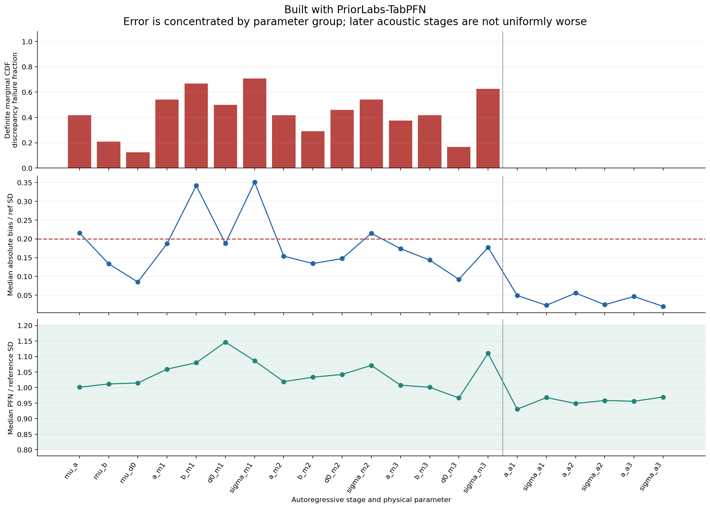
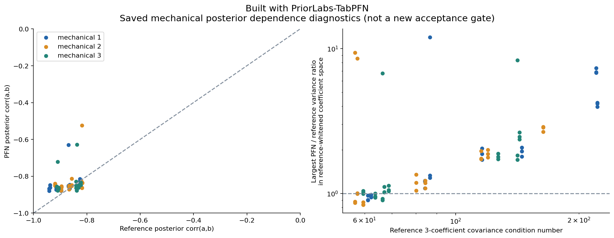
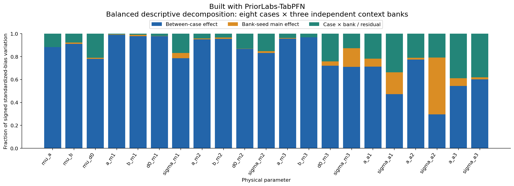
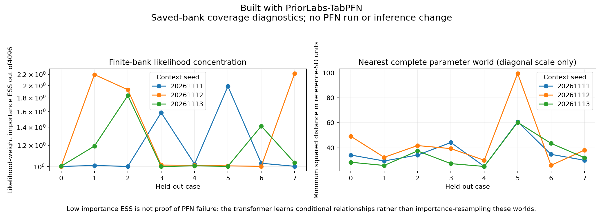
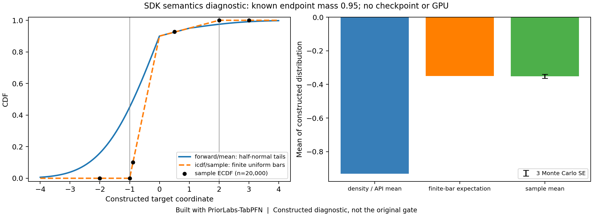
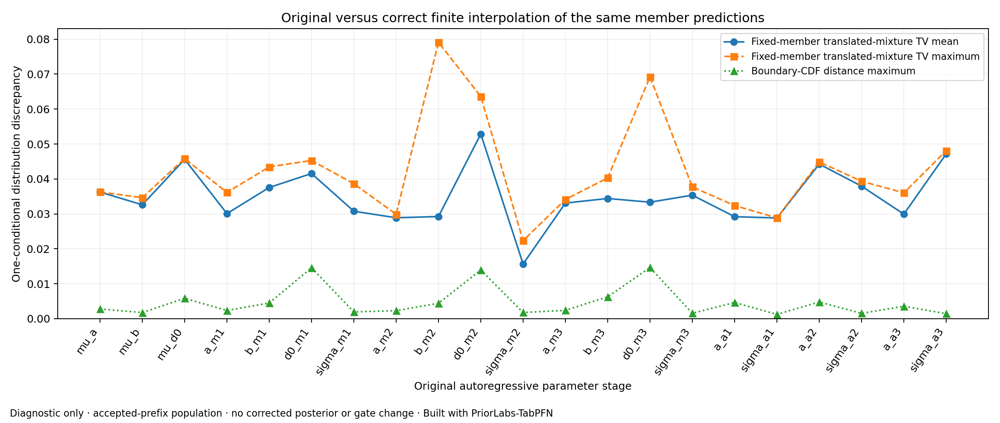
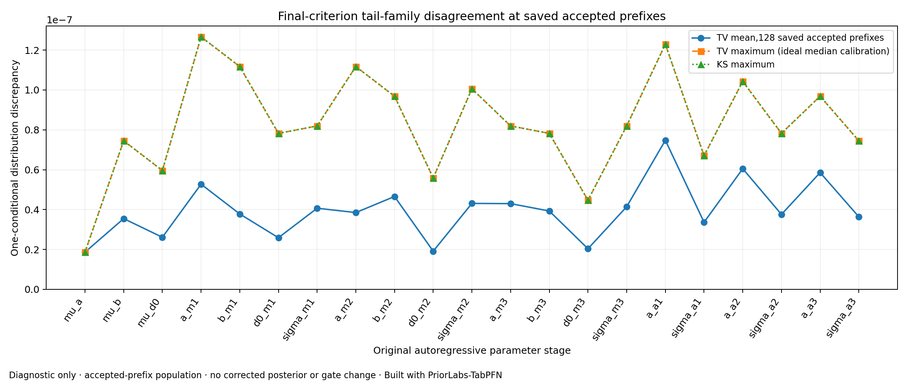
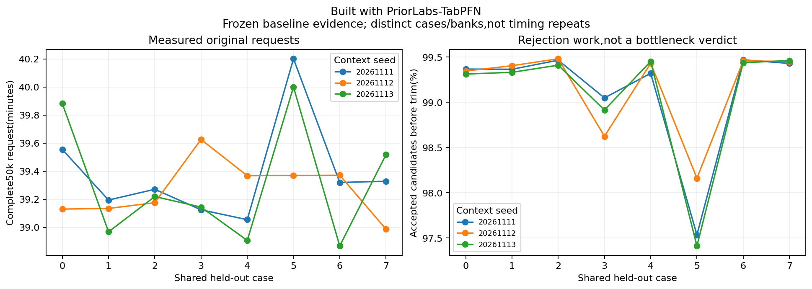
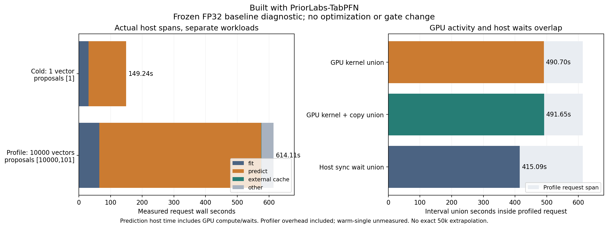

# Failure investigation: frozen NPE-PFN

**Built with PriorLabs-TabPFN**

This is an investigation of release `89404ac9e43bf9fb72d3e51a7113dbd207871221`, not a repaired or optimized baseline. The original 24 cases, checkpoint, six upstream source files, environments, scientific configuration, samples, references and gate remain unchanged. All 24 original 4,096-context requests fail the unchanged accuracy gate. Every original returned vector is complete, finite and within prior support. No statistical candidate, fine-tuning, replacement checkpoint or multi-GPU implementation was run here.

A confirmed SDK interpolation defect measurably distorts real conditional probabilities. It is not yet established as the cause of the full failed gate. The original error is concentrated in mechanical inference; repeated GPU attention is the measured runtime bottleneck. The next proposed experiment isolates reconstruction correctness before changing statistical inputs.

## What the evidence establishes

The independent audit found no scientific prior/support, standard-deviation versus variance, observation-order, forward-model, full-joint-context, query-conditioning, true-label leakage, stage-order or whole-vector-rejection defect. All 24 source/data/checkpoint bindings and eight numerical-reference chains agree. Independent forward/prior/likelihood identities agree to maximum absolute errors of `1.78e-15`, `7.11e-15`, and `2.91e-11`; the acoustic affine maps are included. Maximum observation FP32 rounding is `2.18e-5` declared noise SD. This narrows the explanation; it does not certify every SDK edge case.

The error is structured rather than a small sample fluctuation. All 155 definite marginal CDF failures are global/mechanical: 18 global, 92 mechanical coefficient and 45 mechanical noise cells. All 144 acoustic cells meet the marginal CDF criterion. The acoustic locations are strongly informed (median reference/prior SD `0.152`), whereas acoustic noise remains nearly prior-like (median SD ratio `0.997`), so the latter is a weak-information control. Mechanical posterior geometry is substantially wrong: worst reference-whitened variance ratio `11.98`, fitted-curve SD ratio `3.44`, and expected residual-energy ratio `3.75`.

Case effects explain approximately 71–99% of mechanical signed-bias variation across three banks. Bank variation still exceeds conditional Monte Carlo error. Only 59% of point-bias failures point toward the prior mean, so uniform prior shrinkage is insufficient. Stage/error Spearman correlation is `-0.376`: later acoustic stages are better. The autoregressive chain rule is exact; inevitable monotonic error accumulation is not an explanation. Local propagation of imperfect conditionals remains possible, and a matched conditional-reference experiment would be needed to separate it from conditional estimator error.

For 50,000 independent draws from a fixed approximate distribution, nominal 95% DKW CDF error is `0.00607` for one marginal, `0.00996` simultaneously over 504 marginals, or `0.01041` over all 1,272 marginal/projection CDFs. These are sampling-only bounds, conditional on IID draws and a fixed approximation, and are much smaller than observed discrepancies up to about `0.44`. More posterior draws address Monte Carlo error, not the learned approximation error. Whole-vector support acceptance is 97.41–99.48%; for a fixed proposal law conditioning changes total variation by its rejected mass. That alone cannot explain large CDF errors, assuming batch-invariant proposal laws.

## Model, representation and reconstruction

The 33 observations have an exact 15-value sufficient representation for this declared likelihood: three orthonormal signal coordinates plus residual sum of squares for each ten-point mechanical block, and the three acoustic observations. An equivalent stable OLS/QR representation is possible. Retaining residual energy is necessary when noise is unknown. The complete original likelihood was reconstructed for all 24 bank/case pairs with maximum discrepancy `4.66e-10`; no PFN was evaluated with this representation. Low-variance residual directions carry noise information, so arbitrary PCA truncation or curve means alone are not justified.

Each mechanical design is rank three with condition number `19.20`. Raw/standardized observation participation ratio is only about `2.05–2.20`, but 24–25 PCs are needed for 99% variance. Full-bank likelihood-weight ESS is `1.000–2.216`; no prior world is within two reference marginal SDs in all 21 coordinates. These quantify scarce nearby worlds, not failure of PFN generalization. Scientific prior correctness and the checkpoint's pretraining task prior are different questions; no capacity/task-prior ablation was run.

A confirmed installed TabPFN 2.0.9 API inconsistency is distinct from those hypotheses. `FullSupportBarDistribution.forward/mean` use half-normal endpoint tails, while inherited `cdf/icdf` and `sample` use finite uniform endpoint bars. A CPU synthetic witness with 95% endpoint probability has declared mean `-0.93050`, finite-sampler expectation `-0.35`, and 20,000-draw mean `-0.35151`. The physical-unit affine restoration separately passes a toy equivariance check to `5.96e-8`; that check does not rule out the endpoint defect. The unused `pdf()` sign defect is excluded as a cause because this baseline never calls it.

For one fixed conditional in the pinned distribution, the direct half-normal versus finite-bar discrepancy has TV `0.5*(p_left+p_right)` and KS `0.5*max(p_left,p_right)`. Joint bounds require the appropriate unfiltered prefix law or uniform bounds; saved accepted-prefix averages do not provide them. Support conditioning can amplify joint TV by at most the inverse of the larger support probability, but small mass alone does not bound unbounded mean/SD errors. Final output endpoint mass does not settle the separate ensemble-translation path described next. No reconstruction repair was implemented, and even a semantically corrected sampler is not guaranteed to improve agreement with the physical posterior.

The installed SDK utility, bar-distribution and regressor files match the extracted cached 2.0.9 wheel and its RECORD hashes ([source authenticity](model-sdk-source-authenticity.json)); the original wheel zip was unavailable for a fresh whole-archive digest.

The separate **ensemble interpolation defect is executed and measurable**. In pinned `tabpfn/utils.py:_cdf`, `y - left / width` is used where `(y - left) / width` is required. The real regressor calls this helper for all eight members. A same-borders witness maps probabilities `[0.5,0.5]` to `[0,1]`, even though the resulting mass remains normalized and CDF monotone. A bounded real-checkpoint capture covered 21 stages, eight members, and 16 saved accepted prefixes. The wrapper returned the original tensor unchanged; corrected finite-bar arithmetic was computed only on captured member outputs. Original CPU-formula replay error is at most `2.08e-7`; reconstruction of the actual returned mixture agrees to `2.28e-8`.

At those fixed member predictions, replacing only the defective arithmetic changes conditional bin probabilities by stage-mean TV `0.0157–0.0529`, maximum TV `0.0791`, and maximum boundary-CDF distance `0.01463`. Four of eight members at every stage even use identical source/destination borders. This proves a reconstruction defect with real probability effects. It does not prove that correcting it fixes the joint posterior: the recorded CDF effect is much smaller than several original errors, prefixes are accepted rather than free-running, and no corrected posterior was sampled. Density-tail consistency is a separate ablation.

The direct final-head endpoint-tail mismatch is tiny at the 128 accepted prefixes examined in all 21 stages: maximum endpoint mass `2.5332e-7`, maximum direct one-conditional KS about `1.2666e-7`. It is a confirmed SDK semantic defect, but looks immaterial at these queried conditionals. This finding is not a uniform all-case or joint bound.

## Measured inference time and bottleneck

| Measurement | Result | Scope |
|---|---|---|
| Original complete 50,000-vector request | 2,332–2,412 s; median 2,354.7 s (39.25 min) | All 24 distinct cases/banks; not timing repeats. |
| Original throughput | 20.73–21.44 accepted vectors/s | Includes stage preparation, sampling and rejection. |
| Isolated one-vector request | 149.24 s | One unprofiled first request after imports/bank attachment, same frozen FP32 context. No rejection; no warm-single measurement. |
| Instrumented 10,000-vector request | 614.11 s | 10,101 proposals over batches `[10000,101]`, 42 fit/predict stages; profiler overhead present. |
| GPU kernel interval union | 490.70 s, 79.90% of the 614.11-s span | Full saved CPU/CUDA trace; overlaps counted once. |
| Leading FP32 attention kernel | 361.84 s over 12,096 calls | About 59% of the profiled request and 74% of kernel time. |
| Device copy intervals | About 0.95 s | 12,642 copies; 6.10 GB device-to-host, 2.82 GB host-to-device. |

The profiled host-method walls are `predict=510.84 s`, `fit=64.59 s`, and proposal remainder `38.21 s`. Prediction walls include GPU execution and waits. The trace's host stream synchronization (`415.09 s`) and asynchronous-copy API walls (`66.90 s`) overlap device work and must not be added as separate CPU overhead. Independent CPU sampling of 10,000 rows at repeated real captured logits takes median `1.29–2.25 s` across six stages/three repeats (individual range `1.29–2.72 s`). It is real cost, but is not the dominant measured bottleneck. Fixed-logit timing does not establish an exact full-request share.

All original 50k requests used six support rounds, hence 126 fits/predictions and 1,008 ensemble member forwards. Actual proposals are 50,387–51,994, not 60,000; only 0.52–2.59% are rejected. The short sixth batch still repeats 21 stages. Source inspection shows each fit initializes/loads the model again; eight members run sequentially, transformed context is cached on CPU, and `cache_kv=False` causes context forward work to recur. The trace supports attention/context computation as the first performance target. It does not assign an exact fraction to checkpoint I/O or prove a particular cache design or multi-GPU speedup.

The original constructor/import walls are `3.69–26.24 s`, and simple context attachment `0.003–0.230 s`; attachment is not stage preprocessing. Dividing full-request time by 50,000 gives about 47 ms/vector of amortized throughput, not isolated latency. Original peak CUDA allocated/reserved memory is `8.36/22.32 GiB`. No baseline OOM or device-transfer bottleneck was observed. The 11.08M-parameter frozen checkpoint has no training/backpropagation here.

The trace contains 27,518,694 events and 198,078 CUDA kernels. After complete raw export, expensive CPU-only aggregation retained about 95 GiB; only that profiler child was stopped, then the GPU reservation ended after the conditional check. The partial manifest and controlled-stop sidecar remain public evidence; the planned warm draw is unmeasured. A validated two-pass parser recovered the complete trace on Karolina CPUs with about 62 MiB peak memory. No profiled duration is substituted for the original unprofiled 50k benchmark.

## Ranked proposals, not implemented fixes

The ranking is based on mathematical validity, observed error structure, reuse of existing worlds, feasibility, and retaining a meaningful frozen foundation-transformer workload. It is not an estimated probability of success.

| Rank | Controlled change | Evidence, feasibility and cost |
|---|---|---|
| 1 | Isolate and repair ensemble CDF interpolation | Confirmed arithmetic defect, executed call path and measurable real-probability distortion. Tiny implementation; reuse worlds/checkpoint. No evidence yet that it repairs the full gate. Keep coherent-tail sampling as a separate change. |
| 2 | Exact 33-to-15 sufficient observation statistics with stable scaling | Likelihood preservation established; improved PFN accuracy untested. Deterministic adapter, no new worlds, same transformer and physical posterior. |
| 3 | Exact graph-local conditional covariates | Reuse banks/checkpoint. Global factors retain all observations and their joint dependence; local factors retain all globals, own observations and earlier own-block targets. Cannot cure global bias or within-block geometry by itself. |
| 4 | Separate invertible target-coordinate experiments | A QR/likelihood-aligned coefficient basis targets measured anisotropy. Bounded-noise transforms are a different experiment. Push complete draws back to physical coordinates; handle density Jacobians if used. Noncentering can help or hurt depending on information. |
| 5 | Observation-only context localization, then more worlds only if justified | Existing-world selection first. Nearby-world scarcity motivates testing, not a guarantee. Observed-covariate filtering can preserve the population conditional; arbitrary parameter proposals need correction. Future one-hour/world providers make large banks costly. |

If these fail, a better-matched pretrained task prior/checkpoint or domain adaptation is a separate model decision requiring qualification and the full gate. An exact-conditional hybrid is a credible fixture-specific fallback with less transfer to arbitrary expensive simulators. These are proposals only. No statistical candidate or execution optimization was implemented.

The structural identity behind rank 3 is `p(g,{b_i,sigma_i}|y) = p(g|all_y) product_i p(b_i,sigma_i|g,y_i)` for this independent-noise hierarchy. It is posterior conditional independence, not merely masking to direct prior parents: observed mechanical coupling makes the first coefficient depend on all three globals. Correlated globals must not be sampled independently. Ranking locality above target whitening is a structural judgment; neither has been evaluated.

## Smallest proposed next scientific experiment

After the user chooses, isolate **only the ensemble interpolation correction**, preserving checkpoint, FP32, parameter order, bank seed `20261111`, 4,096 worlds, case 0 and 50,000 complete accepted vectors. Require a same-border identity test, independent finite-CDF agreement and original physical-coordinate integrity/accuracy criteria: conservative marginal/projection CDF upper bounds <=0.10, bias upper bounds <=0.20 reference SD, and SD-ratio intervals within [0.8,1.2]. A violation or unresolved interval does not establish a fix. Do not combine the tail-family change, sufficient statistics, target transforms or locality into this pilot. Original evidence remains unchanged.

The baseline's approximately 40-minute inference is a planning reference, not a measured candidate runtime. One-case success only justifies expansion; all 24 original bank/case combinations must pass before GPU optimization or scaling. If the arithmetic correction still fails, test the exact sufficient-statistic adapter next as its own factor. Do not add observations or relax the gate to manufacture a pass.

A later matched conditional-reference diagnostic could distinguish estimator error from free-running prefix effects. Accepted-joint conditional PIT uniformity is only a necessary joint-consistency check, not that oracle ablation and not proof of causal autoregressive accumulation.

The optional noise-conditional PIT attempt did **not** qualify: its numerical guard rejected the calculation before completing all three banks. The failed manifest and logs are retained; no PIT statistic is used to localize or rank causes. A recovery helper has additional CPU precision/metadata tests but was not rerun on real rows. No further GPU jobs were launched after the direct SDK and runtime evidence was sufficient.

## Reproducibility and limits

All scientific computations and tests ran on Karolina. JSON/CSV files beside this report hold bindings, per-cell values, bank/case decomposition, covariance diagnostics, representation identities and checksums. Helper scripts are under `scripts/diagnose_*.py`. GPU diagnostics use the immutable original checkpoint and full-joint 4,096-world bank, with the existing private cumulative ledger and no automatic retry. Diagnostic samples are never promoted into original gate evidence.

Primary literature informs proposals rather than proving benefit here: [NPE-PFN](https://arxiv.org/html/2504.17660v2) describes context filtering and representation/order experiments; [PFN statistical foundations](https://arxiv.org/abs/2305.11097) distinguishes learned task-prior effects; [APT](https://proceedings.mlr.press/v97/greenberg19a.html) and [TSNPE](https://arxiv.org/abs/2210.04815) address proposal-aware inference. Conclusions above primarily derive from the pinned local code and saved project data.

The investigation used **2271/7,200 additional allocated GPU-seconds (0.630833 GPU-hours)** across three reconciled one-GPU jobs: 5395988 `FAILED` (1734 s, controlled profiler stop plus inconclusive PIT), 5396047 COMPLETED (343 s), and 5396548 COMPLETED (194 s). Cumulative actual cost is **16.804722/200 GPU-hours**, with **zero reserved**. No further GPU work is pending. See [accounting](budget.json), [artifact index](artifacts.json), and [reproduction commands](reproduce.md).

Validation: **137 CPU tests passed** on Karolina (the original 109 plus 28 diagnostic tests). Original test files and protected baseline paths are unchanged; all report figures exist and compact JSON parses. Public CI validates the pushed commit.
