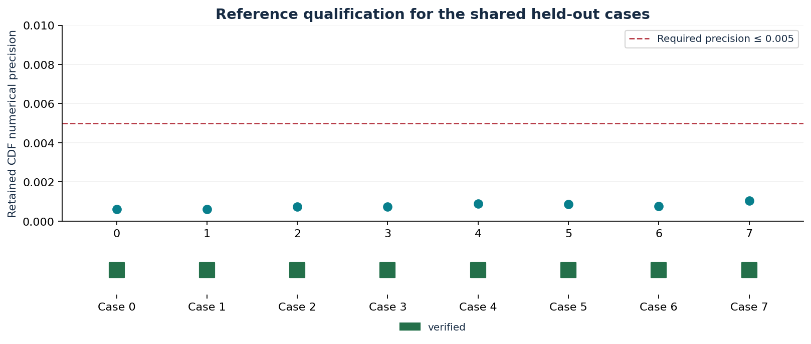
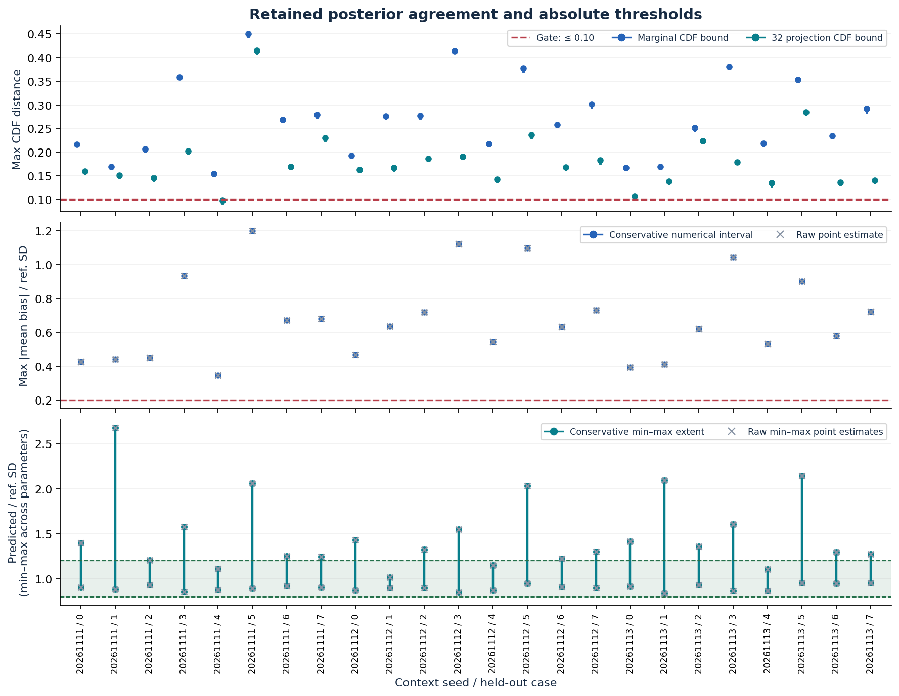
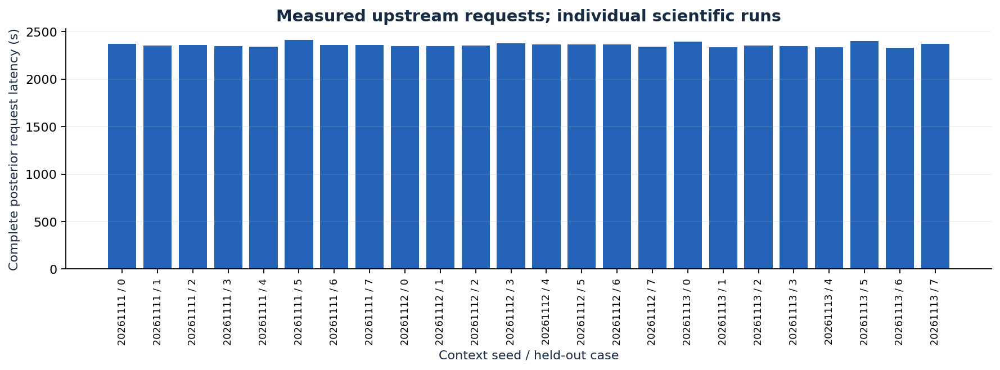
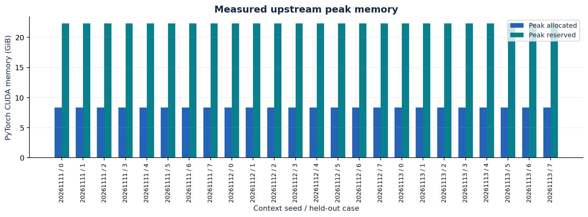
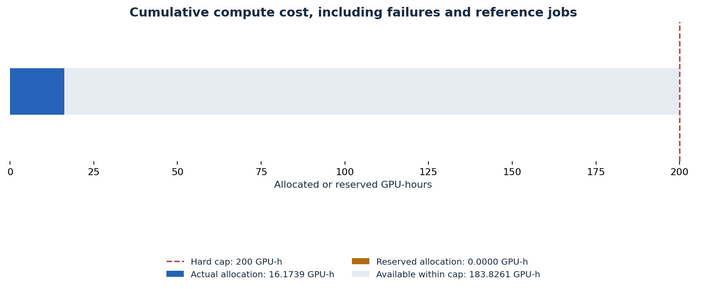

# PosteriorForge retained evidence

Built with PriorLabs-TabPFN.

Scientific gate status: **model_failure**. 0/24 expected upstream runs passed the absolute gate.

This is an eight-case diagnostic screen of the analytical 21-parameter, 33-observation inferred-noise hierarchy. It is not full SBC or a global calibration certificate.

## Reference precision

Each shared held-out case needs retained float64 refinement, independent numerical checks, and CDF precision at most 0.005. Unavailable precision is shown explicitly and cannot pass.

## Posterior agreement

CDF segments show the witnessed lower and conservative whole-line upper bounds, including tail mass and the source reference precision where available. Reference qualification is assessed separately; an inconclusive reference cannot pass. A finite-grid lower bound cannot establish a pass. Mean and SD panels overlay raw point estimates (crosses) on conservative numerical intervals (circles and lines) from the same case reference. Crosses without intervals are diagnostic and cannot establish a moment pass.

## Measured runtime and memory

Request latency includes upstream repeated stage/context work and support rejection for the complete accepted vectors. These are individual scientific runs, not three-repeat timing summaries; no p95 or scaling speedup is inferred. Constructor/import timing is recorded separately in runs.csv; cold checkpoint loading remains included in the request when its retained flag is true.

## Cumulative compute budget

Actual allocation: **16.1739 GPU-hours**. Held reservations: **0.0000 GPU-hours**. Capacity after reservations: **183.8261 GPU-hours**.

The immutable cap is 200 allocated GPU-hours. Failed allocations and reference calculation are included; unknown submission outcomes retain their full reservation. Reconciled job tables retain the actual allocated GPU count, elapsed seconds and Slurm allocation TRES separately from the requested resources.

## Engineering gate

Optimization and multi-GPU scaling remain deferred because the retained scientific gate has not passed. No engineering success is claimed.

## Portable evidence

`gate.json` retains per-run assessments. `runs.csv`, `references.csv` and `budget.csv` provide portable tables. `budget.json` omits submission commands and private absolute paths. `checksums.json` binds this report to its input snapshots and all output files. Raw arrays remain external; retrieval and verification commands are documented in the repository at `docs/artifacts.md`.
