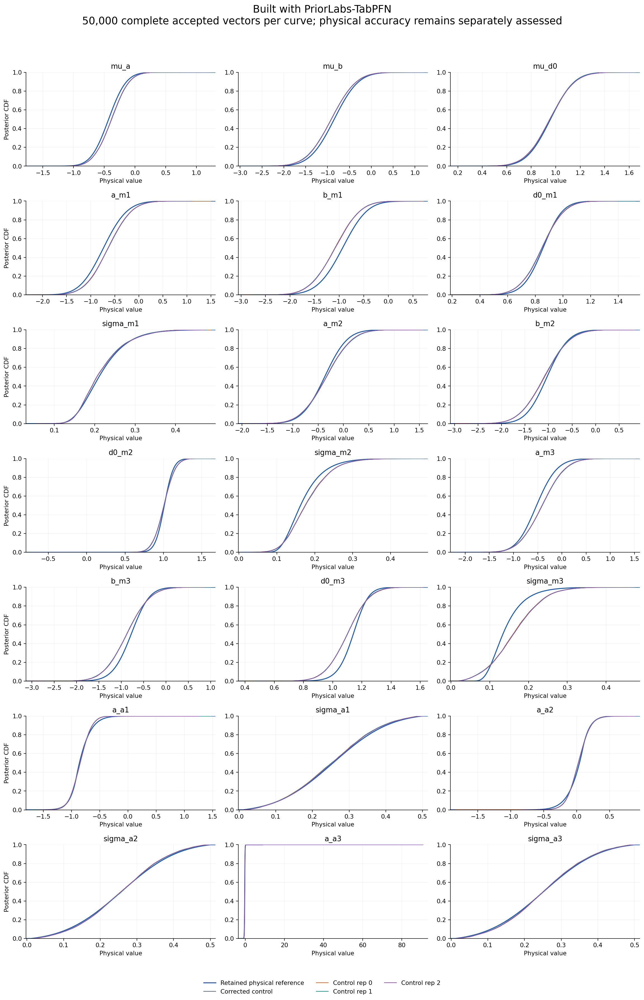
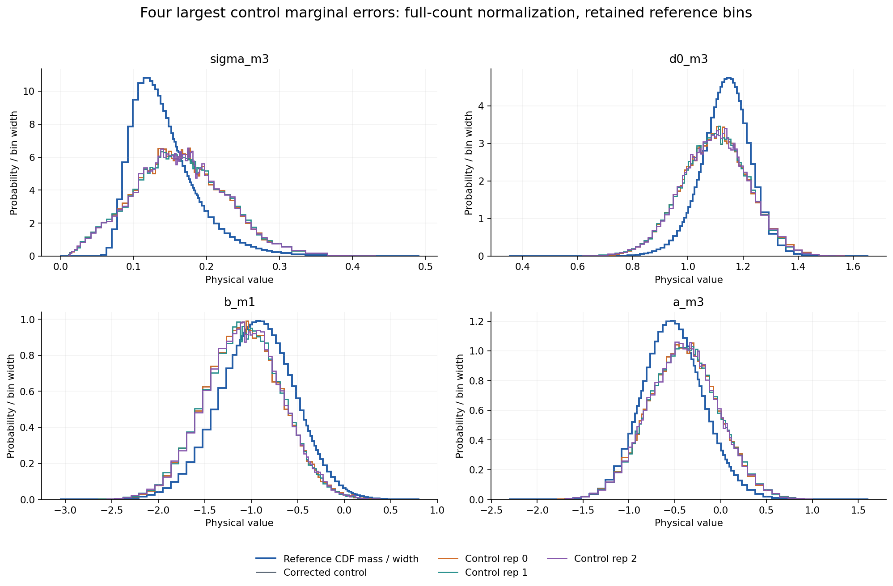
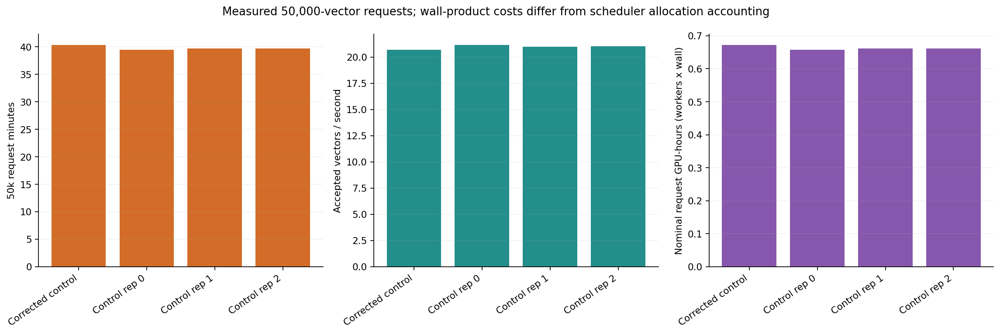
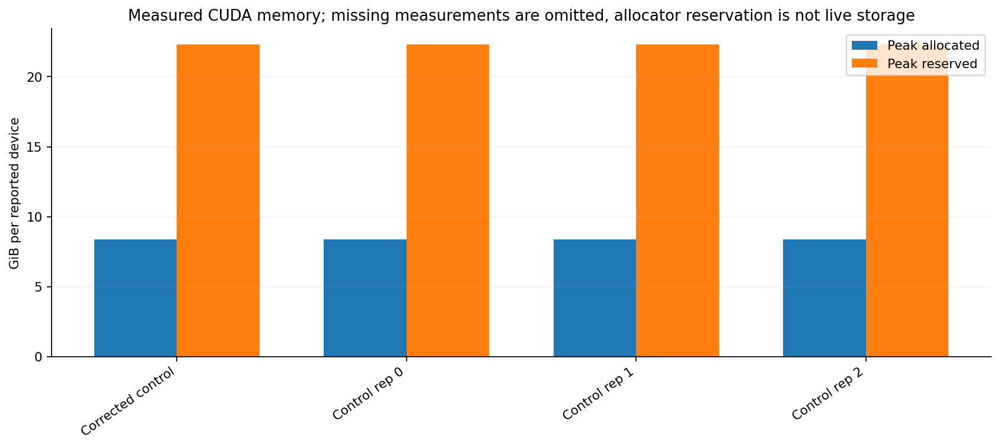
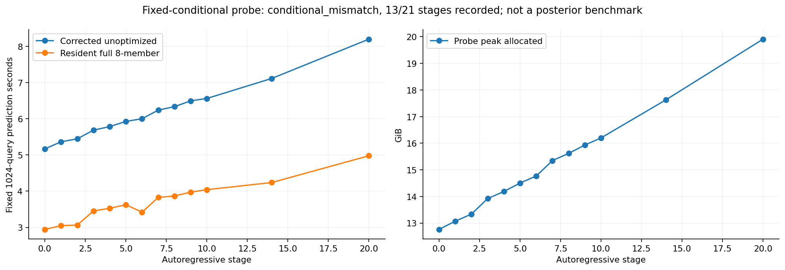
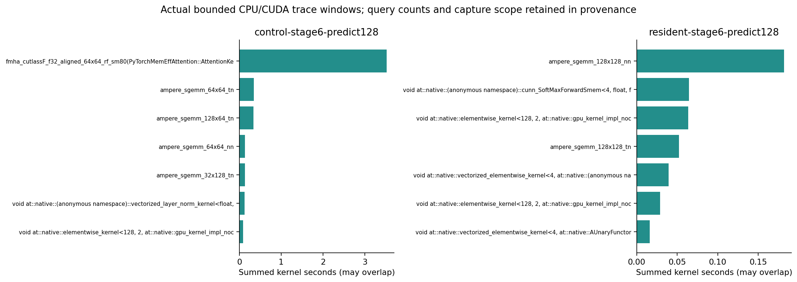

# PosteriorForge performance evidence

Built with PriorLabs-TabPFN. Every posterior curve contains 50,000 complete accepted physical vectors. Runtime qualification and absolute physical accuracy are separate decisions. These plots alone do not establish an optimized execution pass.

| Run | Request seconds | Vectors/s | Physical result |
|---|---:|---:|---|
| Corrected control | 2419.0509968628176 | 20.669262477245518 | model_failure |
| Control rep 0 | 2364.5507467584684 | 21.145665860013512 | model_failure |
| Control rep 1 | 2383.4860378028825 | 20.977676901388698 | model_failure |
| Control rep 2 | 2380.309143734048 | 21.005674885390643 | model_failure |

| Run | Max two-sample CDF | Max mean change / reference SD | Max SD fractional change | Investigation flag |
|---|---:|---:|---:|---|
| Corrected control | 0 | 0 | 0 | False |
| Control rep 0 | 0 | 0 | 0 | False |
| Control rep 1 | 0.01062 | 0.0169244 | 0.00752352 | True |
| Control rep 2 | 0.01042 | 0.0174565 | 2.01708 | True |

Investigation thresholds remain 0.01 CDF, 0.05 reference SD in mean, and 5% in SD. Repeated controls can also raise flags; every flagged comparison remains an investigation, not an automatic equivalence claim. No reported vector or outlier is removed.

One finite, prior-supported accepted a_a3 sample accounts for88.8% of this coordinate's rep2 squared deviation; central quantiles remain similar and the unchanged engine produces a201.7% relative-SD investigation flag.

The outlier is inside the nominal very wide finite terminal bar. It is not evidence by itself of extrapolation beyond the last finite border.

Original per-draw probabilities and uniform were not retained, so numerical CDF/bin-selection roundoff versus genuine learned terminal-bin probability cannot be identified.

Cumulative allocated cost at the saved snapshot: 19.839167 GPU-hours spent and 0.250000 reserved, under the immutable 200-hour cap. Request wall-products in the plots are separate from scheduler allocation accounting.

All densities divide by the complete draw count, including mass outside the displayed retained grid. Reference curves use saved values; no new reference integration, clipping, tail repair or physical gate changes were performed. Detailed input/output SHA256 values and absolute assessments are in figure-data.json.
