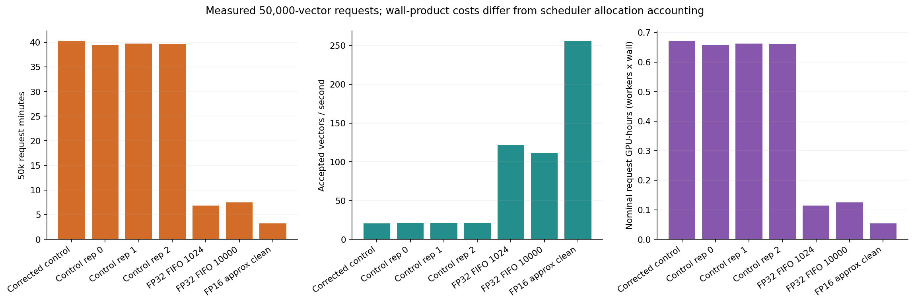
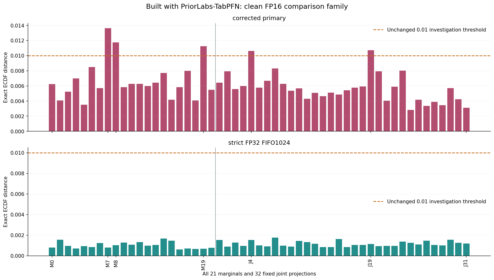
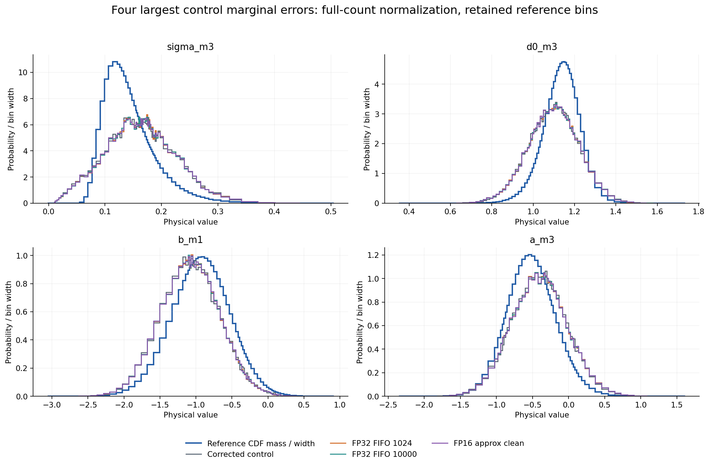
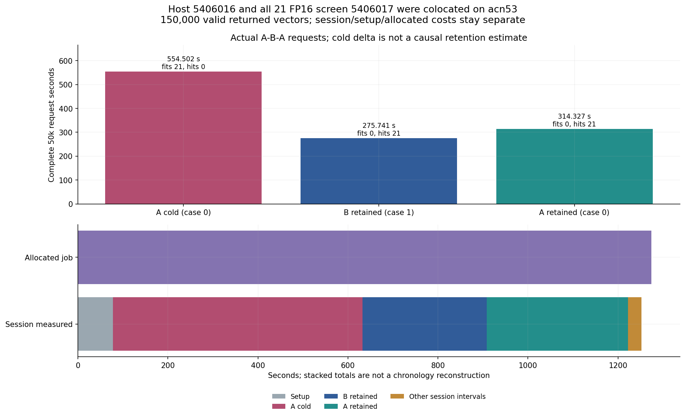

# Clean FP16 pilot and separate host ABA evidence

Built with PriorLabs-TabPFN. [NOTICE](NOTICE) and the copied [MIT license](LICENSE) retain attribution.

The clean FP16 approximation returned 50,000 complete supported vectors in 195.181788 s (wrapper 213.298992 s; allocated 216 GPU-seconds, acn65). It is one clean optimized timing repetition. All three unoptimized control timings and both FP32 FIFO pilots remain visible.



The all 21 hard screen passed while all 21 strict failures remain. Against strict FIFO 1024: max 53-axis ECDF 0.00176, mean 0.002883531 reference SD and SD fraction 0.001405115 (0.1405115%), no empirical flags. Against primary, M7/M8/M19 and J4/J19 remain flagged (max 0.01362); absolute physical status remains model_failure. These finite-cohort diagnostics do not establish equivalence or global calibration.





The separate host ABA job returned 150,000 valid vectors over three complete requests 554.502019/275.740727/314.327154 s. Session total 1252.439019 s includes 77.859402 s setup; allocated duration 1274 s. All 11 equality predicates passed; A arrays and NPZ bytes equal prior FIFO 1024. B has its own reference/physical failure and no same-case unoptimized control. Host ABA and the all 21 FP16 screen were colocated on acn53; the cold timing difference cannot be assigned wholly to retention.



The host has observed default/global RNG hashes; clean FP16 has recorded stream/source policy but no saved production before/after global hashes. Observed f01 RNG preservation belongs to the characterization. Profiling is separate from this clean repetition. All old flags, strict failures and source artifacts are preserved; no old p-values are transferred.

[report.md](report.md) embeds all ten figures. Compact review, screen, allocation and ABA extracts retain original metrics, hashes and scopes. Raw samples, large cache JSON and the derived signed-curve NPZ stay outside Git. [checksums.json](checksums.json) hashes every other package file.

Source script SHA256: `97a1ee4776a1136174239fe17a170d6982b42a6dafc8d1427384e87a18e9ded3`. Independent FP16 reviews: `589ed262d9eb97b98b0c78690eb001edc207bbb4b258b5896ec172ae74a50aca` and `b5e7532473a62dc88eabba5a8b32c5204c789f77bc8ce4be3389a56d33a86f93`; their numerical comparisons are identical. All21 source: `f01bfddb87dcd16c9bd7c9df15f482ed3ea46756b1d84f3c04f6584644a0687a`. Host session/review: `8d66ac1a4a8eea1284f93e66f24c4e5ab72b04f8a4ded97516dabe0d2fd62fbb` / `eead7c3342e3e57ee8d1d3e31576b94c76e71f2d45eef00a0807249dec413750`. Producer/source hashes are also retained in the extracts. Public raw publication and overall runtime-phase completion are separate pending steps.

## Reproduce

Use the verified Python 3.11 reference environment with NumPy/SciPy/Matplotlib, preserving results/ gate, banks, authenticated case 0/case 1 references, primary and all three controls, both FP32 FIFO cohorts, clean FP16 cohort/reviews, all 21 screen and host ABA session/visits/review. Include budget/ledger.json with the completed 5406772/5406016/5406017 allocation entries. The report reads saved artifacts only and infers the checkout from __file__.

```bash
PF_ROOT=/path/to/unpacked-artifacts
PF_PYTHON=/path/to/verified-python3.11
PF_OUTPUT=/path/to/new-fp16-report
PF_PACKAGE=/path/to/new-portable-package
PYTHONPATH=src OPENBLAS_NUM_THREADS=2 OMP_NUM_THREADS=2 "$PF_PYTHON" \
  scripts/report_fp16_pilot_aba.py --root "$PF_ROOT" --output "$PF_OUTPUT" \
  --package-output "$PF_PACKAGE"
```
