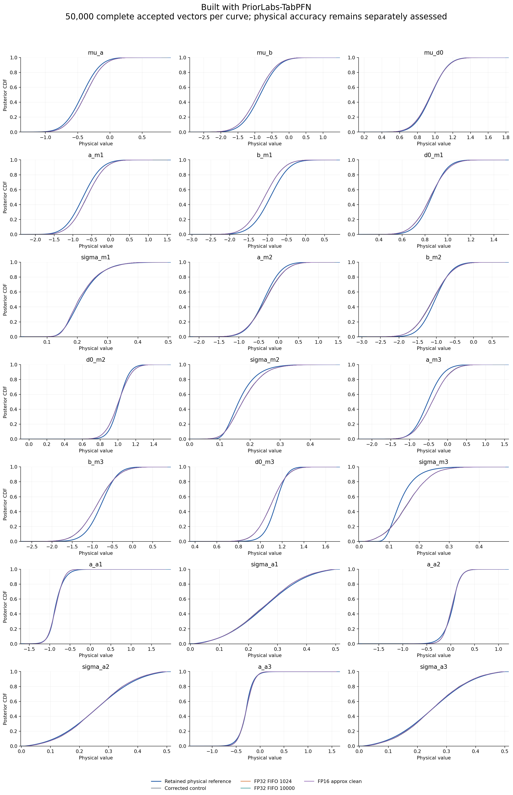
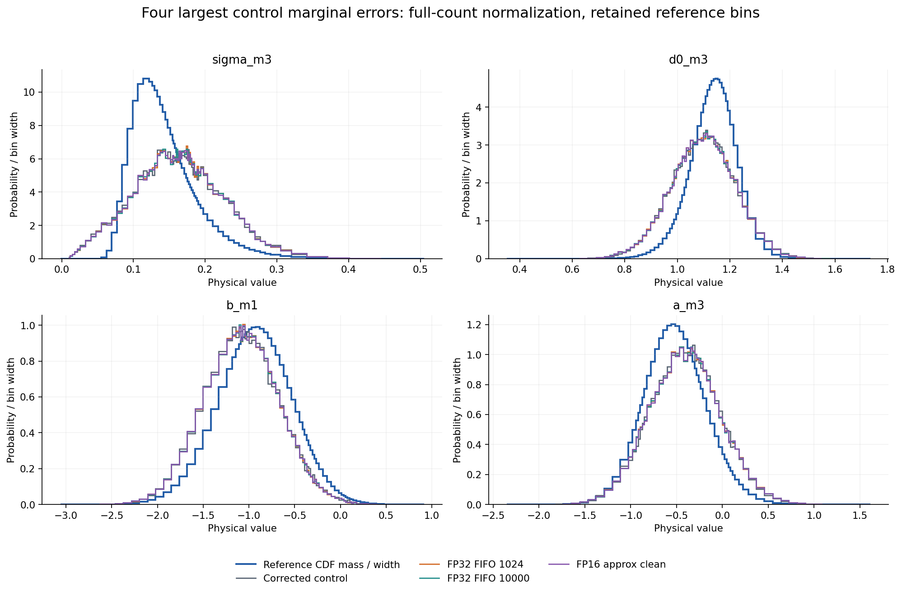
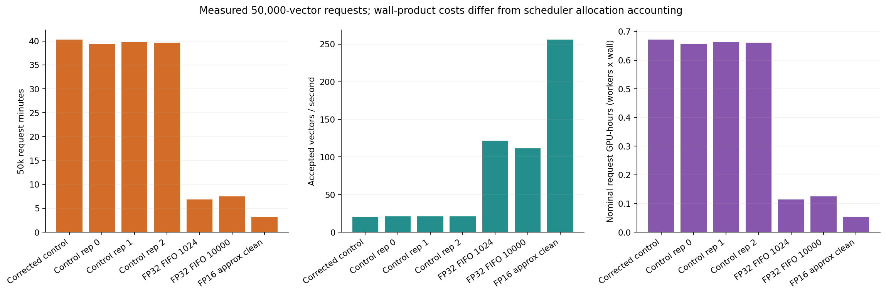
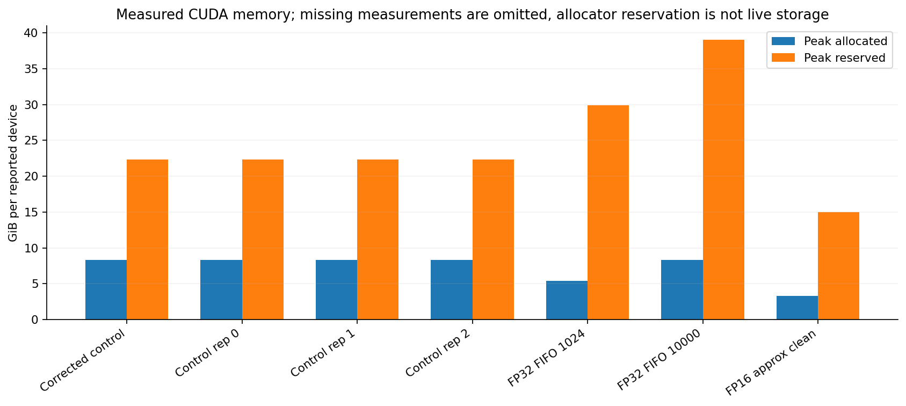
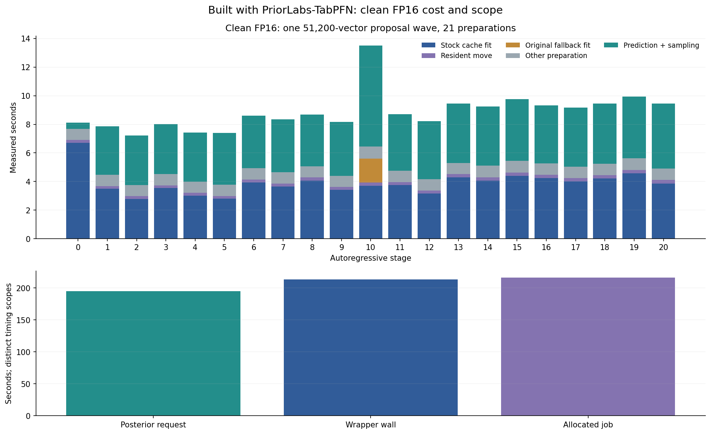
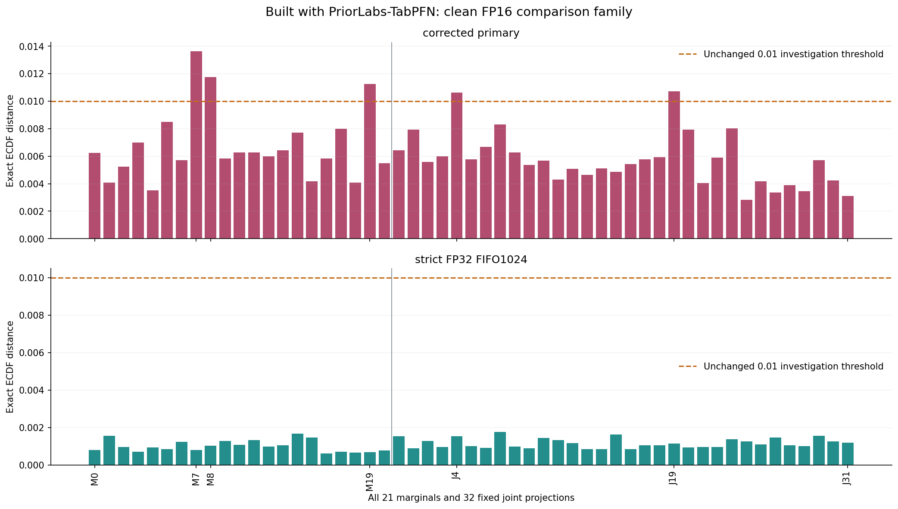
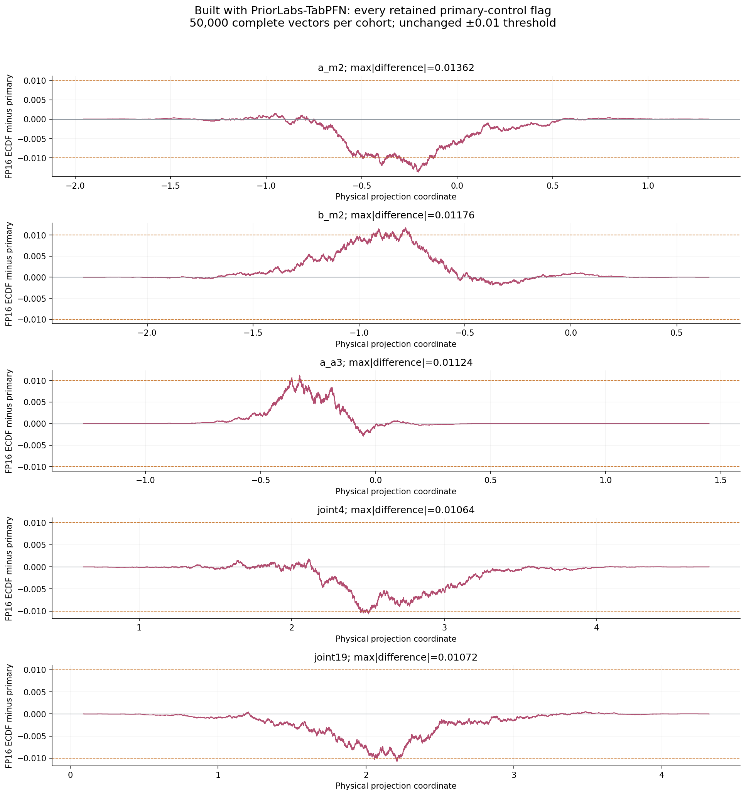
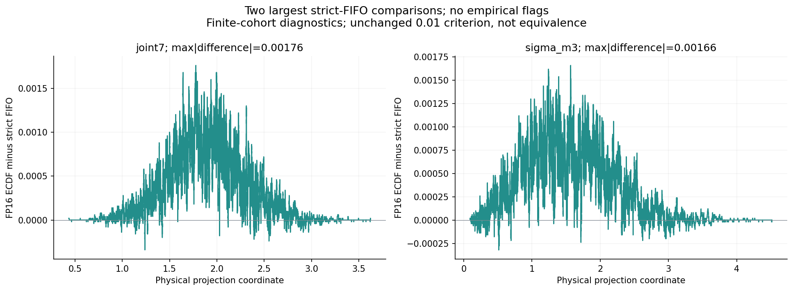
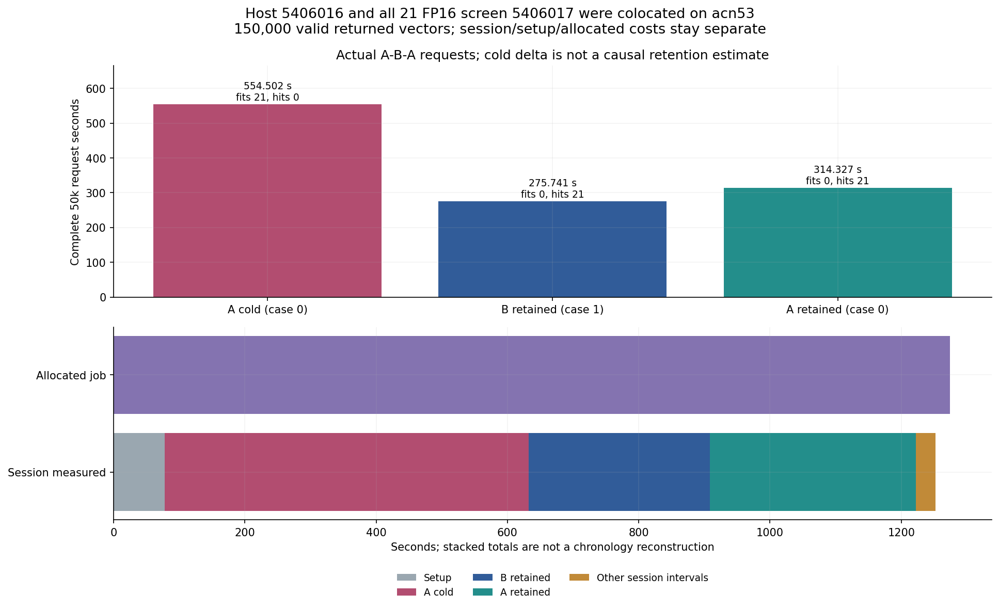
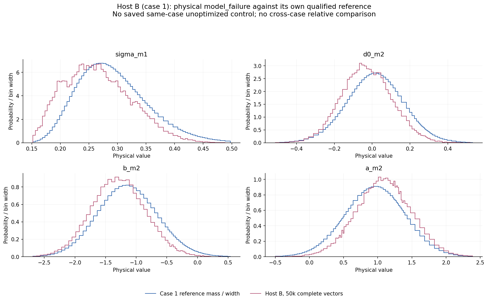

# PosteriorForge performance evidence

Built with PriorLabs-TabPFN. Every posterior curve contains 50,000 complete accepted physical vectors. Runtime qualification and absolute physical accuracy are separate decisions. These plots alone do not establish an optimized execution pass.

| Run | Request seconds | Vectors/s | Physical result |
|---|---:|---:|---|
| Corrected control | 2419.0509968628176 | 20.669262477245518 | model_failure |
| Control rep 0 | 2364.5507467584684 | 21.145665860013512 | model_failure |
| Control rep 1 | 2383.4860378028825 | 20.977676901388698 | model_failure |
| Control rep 2 | 2380.309143734048 | 21.005674885390643 | model_failure |
| FP32 FIFO 1024 | 410.9634176120162 | 121.66533043387375 | model_failure |
| FP32 FIFO 10000 | 448.12487697135657 | 111.5760417897887 | model_failure |
| FP16 approx clean | 195.18178771901876 | 256.17144193790955 | model_failure |

Timing-only runs retain their distinct runtime and memory measurements without adding duplicate posterior curves or relative-assessment rows. Their complete 50k payload and scientific bindings pass the same checks as the plotted cohorts.

| Run | Max two-sample CDF | Max mean change / reference SD | Max SD fractional change | Investigation flag |
|---|---:|---:|---:|---|
| Corrected control | 0 | 0 | 0 | False |
| FP32 FIFO 1024 | 0.01368 | 0.0220494 | 0.0146949 | True |
| FP32 FIFO 10000 | 0.0137 | 0.0219952 | 0.0145697 | True |
| FP16 approx clean | 0.01362 | 0.0219418 | 0.0152192 | True |

Investigation thresholds remain 0.01 CDF, 0.05 reference SD in mean, and 5% in SD. Repeated controls can also raise flags; every flagged comparison remains an investigation, not an automatic equivalence claim. No reported vector or outlier is removed.

One finite, prior-supported accepted a_a3 sample accounts for88.8% of this coordinate's rep2 squared deviation; central quantiles remain similar and the unchanged engine produces a201.7% relative-SD investigation flag.

The outlier is inside the nominal very wide finite terminal bar. It is not evidence by itself of extrapolation beyond the last finite border.

Original per-draw probabilities and uniform were not retained, so numerical CDF/bin-selection roundoff versus genuine learned terminal-bin probability cannot be identified.

All densities divide by the complete draw count, including mass outside the displayed retained grid. Reference curves use saved values; no new reference integration, clipping, tail repair or physical gate changes were performed. Detailed input/output SHA256 values and absolute assessments are in figure-data.json.

## Clean FP16 approximation pilot

Built with PriorLabs-TabPFN. The single clean 50,000-vector FP16 request took **195.181788 s**, wrapper wall **213.298992 s**, and scheduler allocation **216 GPU-seconds** on acn65.karolina.it4i.cz. The measured request ratio is 12.195x against the three-control median and 2.106x against the prior strict FP32 FIFO 1024 pilot. These are single completed-configuration measurements; no clean FP16 timing repetitions are implied. Request, wrapper and allocation are distinct scopes.

Preparation consumed 104.479571 s, including stock-cache fitting 81.649904 s, resident movement 4.528027 s and original fallback fitting 1.662491 s. Prediction plus sampling consumed 81.504276 s. Peak allocated/reserved memory was 3.27268/15.02539GiB. Wrapper scope includes setup and NPZ/hash completion; its excess over request time is not assigned to one phase.

This is an **FP16 prefill/query approximation experiment**. The original all 21 hard-validity passes and all 21 strict-screen failures remain unchanged. No strict FP32/exact/KV-only/joint qualification is inferred from the new posterior review. The characterization generated zero posterior vectors; its G0-first/Cp-later measurements were not randomized or interleaved timing repeats. The original screen-source hash and every stage decision remain in fp16-all21-characterization-extract.json and its CSV.

## Complete finite-cohort comparisons

Review v1 and v2 have identical numerical comparison metrics. Against strict FP32 FIFO 1024, the maximum 53-axis exact two-sample ECDF distance is 0.00176, mean change at most 0.002883531 reference SD, and SD fractional change 0.001405115 (0.1405115%), with **no empirical flags**. Against the corrected primary control, flags remain at M7/M8/M19 and J4/J19, with maximum distance 0.01362. The absolute physical result remains **model_failure**. All original 53 CDF and 21 mean/SD comparisons are retained in the CSVs and authenticated review extract.

Every plotted cohort has 50,000 complete finite supported vectors. Ordinary densities use whole-count normalization and retained reference-bin masses; display windows do not remove reported draws. The 0.01 CDF/0.05 reference-SD mean/5% SD investigation criteria are unchanged. No earlier p-values, population-equivalence or global-calibration claim is transferred.

The clean production manifest records named stream roles/seeds and source-bound isolation policy, **not before/after default CPU/CUDA RNG hashes**. Observed characterization RNG preservation belongs to the immutable f01 all 21 screen. It is not relabelled as observed clean-production state equality.

## Host A-B-A: a separate 150,000-vector session

| Visit | Case | Complete 50k request s | Actual fits | Retained hits | Physical result |
|---|---:|---:|---:|---:|---|
| 0 | 0 | 554.502019 | 21 | 0 | model_failure |
| 1 | 1 | 275.740727 | 0 | 21 | model_failure |
| 2 | 0 | 314.327154 | 0 | 21 | model_failure |

Session total was 1252.439019 s, including setup 77.859402 s; allocated duration was 1274 GPU-seconds. Source/footer authentication, all 150,000 finite supported returned vectors, shutdown restoration and all 11 A-B-A equality predicates passed. Both A arrays and their NPZ payloads are exactly equal to the prior FIFO 1024 cohort. These are coupled repeated-seed checks, not independent posterior/timing repetitions.

The host job 5406016 and all 21 FP16 screen 5406017 were colocated on **acn53**. The entire cold difference from the prior FIFO timing is **not a causal retention-cost estimate**. Cold/warm, case differences, setup, session and allocated scopes remain distinct. No claim attributes their whole difference to retention.

B uses its own authenticated case 1 reference and also has physical model_failure. There is **no saved same-case unoptimized B control**; no cross-case relative comparison or missing-control zero is invented.

The host requests recorded default Torch CPU/CUDA, NumPy and Python state hashes and preserved them within each request. Dedicated sampling streams were consumed normally; their repeated A before/after hashes satisfy the ABA test. Production migrations use identity/layout guards; full-storage byte-hash evidence belongs to the separate host qualification. Current FP16 profiling is a separate experiment and is not counted as a second clean repetition. Overall runtime-phase completion remains pending.
