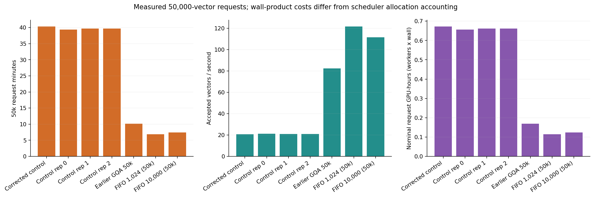
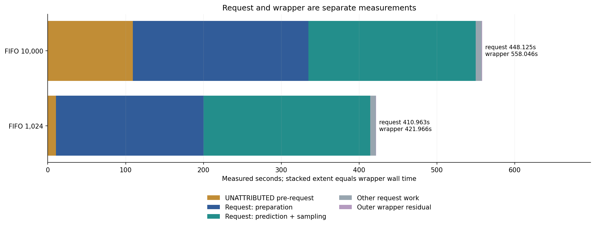
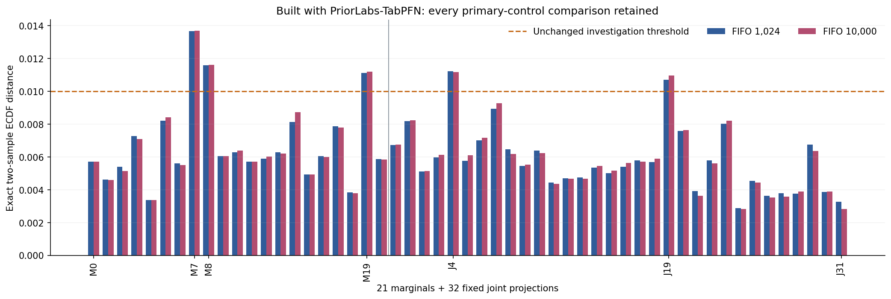
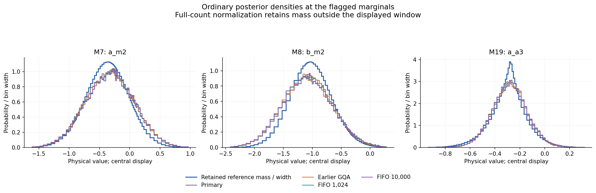
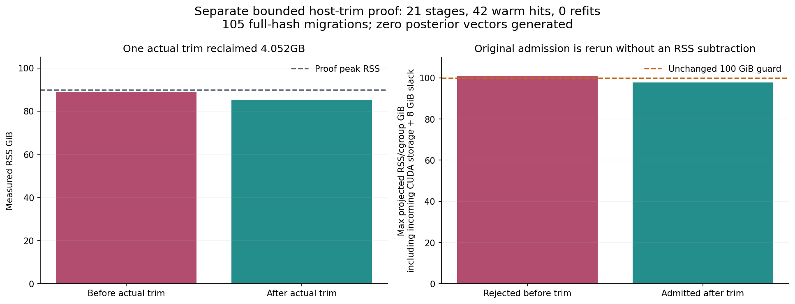

# FIFO 50k pilots and bounded host-trim evidence

Built with PriorLabs-TabPFN. [NOTICE](NOTICE) and the copied [MIT license](LICENSE) retain attribution; bundled upstream terms remain in the repository.

FIFO 1024 completed its50,000-vector request in 410.963418 s (wrapper 421.965773 s); FIFO 10000 took 448.124877 s (wrapper 558.046330 s). Each generated one51,200-vector wave with 21 preparations. All three contemporaneous control timing measurements, the earlier 607.081521 s GQA request and both FIFO pilots remain visible below. Each optimized configuration has one timing repetition.



The 10,000-row runner pre-request interval is 109.467749 s and remains UNATTRIBUTED; it is not post-sampling time. Request and wrapper values have distinct scopes.



Both cohorts retain M7/M8/M19 and J4/J19 CDF investigation flags; absolute physical status remains model_failure. Complete 53-axis CDF metrics and 21-parameter mean/SD comparisons against primary and all three controls are in the CSVs and hash-bound review extracts. No rows or flags were removed, and no old randomized p-values, equivalence or global-calibration claim is made.





The separate host-trim proof passed21 stages,42 warm hits/0 refits and 105 full-hash migrations. One actual trim reclaimed 4.052 GB while preserving live storage; the 100 GiB/8 GiB guard remained unchanged. Peak RSS was 89.94 GiB and known global GPU residual 8.52 MB. This proof generated zero posterior vectors and is not a 50k host timing benchmark.



[report.md](report.md) embeds all figures. [fifo-pilots-summary.json](fifo-pilots-summary.json), [fifo-1024-review-extract.json](fifo-1024-review-extract.json), [fifo-10000-review-extract.json](fifo-10000-review-extract.json) and [host-trim-proof-extract.json](host-trim-proof-extract.json) retain the metrics and custody. [checksums.json](checksums.json) hashes every other package file. Raw samples, full review/cache JSON and the derived signed-curve witness NPZ remain outside Git.

The report script SHA256 is `a2abf10d7590b392c5a049597fadf08c7420ed074db530aec7686351b5f0edeb`. Review SHA256 values are `6d93b0243c8203455b0c66dbcdef7ea2832d8ac49019bc6c7ad3d8b1dfad0b84` and `6d33770b729662abceaeb3e39729101bec056fa5974bc8f4d3b9f44b95e80be1`; the full host proof SHA256 is `18179d2d2161c7713050be99c03d3b8c8a92d82cd1b310fb69134e112a3bf8ba`. Runner source SHA256 is `23ccad8b5bbcdd7a48340b349d515ca870763359cfeb71333e02fc2b6a8aca3b`. Existing controls are linked from the [controls raw release](https://github.com/BrieucB/PosteriorForge/releases/tag/performance-first-v1-controls); new raw publication remains a separate pending step. Overall runtime-phase completion remains pending.

## Reproduce from saved artifacts

Use the verified Python 3.11 reference environment with NumPy, SciPy and Matplotlib. Preserve the original results layout: gate-final.json, banks-v1, authenticated parent/refined references, corrected primary cohort, all three controls, old GQA cohort, both FIFO cohorts and independent-review-v4 files, control-tail diagnostic, and the full host-trim manifest. The generic renderer is reused unchanged; no model/GPU calls or reference integrations are made.

From the repository root, use fresh output/package directories:

```bash
PF_ROOT=/path/to/unpacked-artifacts
PF_PYTHON=/path/to/verified-python3.11
PF_OUTPUT=/path/to/new-fifo-report
PF_PACKAGE=/path/to/new-portable-package
PYTHONPATH=src OPENBLAS_NUM_THREADS=2 OMP_NUM_THREADS=2 "$PF_PYTHON" \
  scripts/report_gqa_fifo_pilots.py --root "$PF_ROOT" --output "$PF_OUTPUT" \
  --package-output "$PF_PACKAGE"
```

The script infers its checkout from __file__, verifies frozen sample/manifest/review/proof hashes, recomputes exact signed ECDF witnesses from all 50,000 rows, and copies a bounded package without raw NPZ or large trace files.
