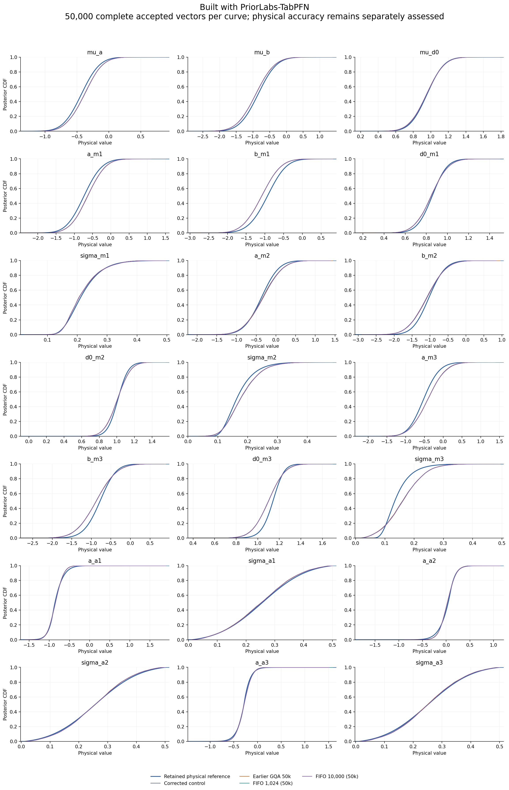
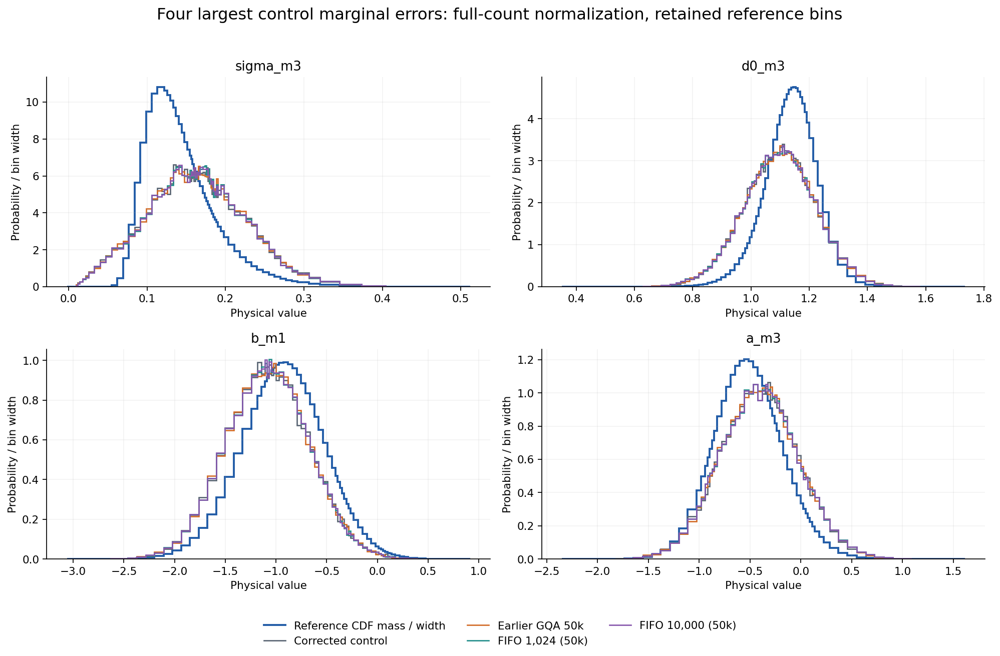
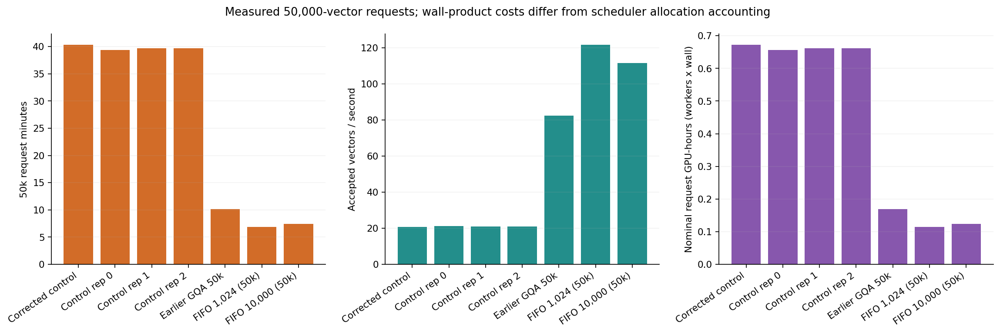
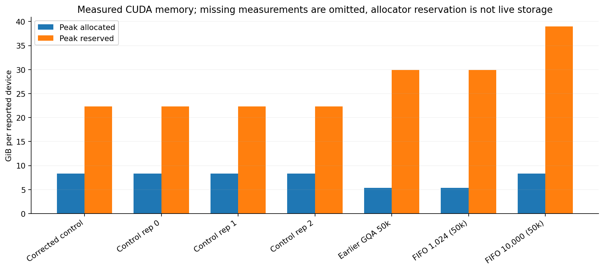
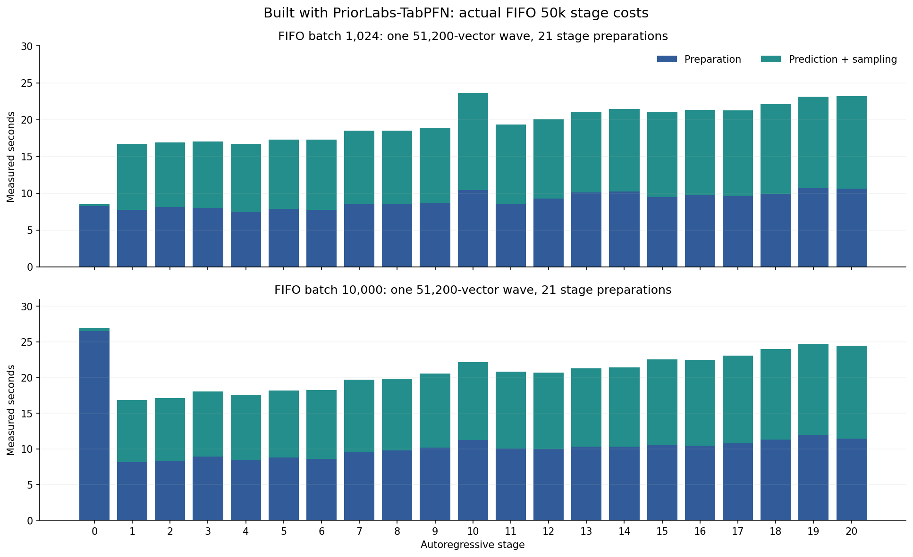
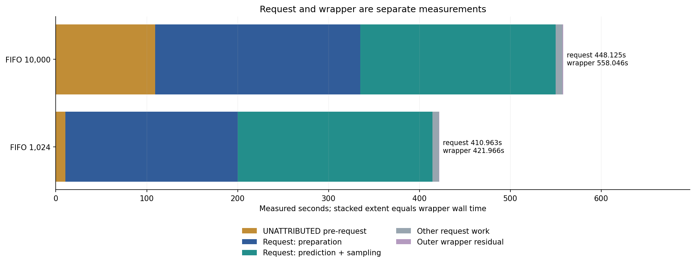
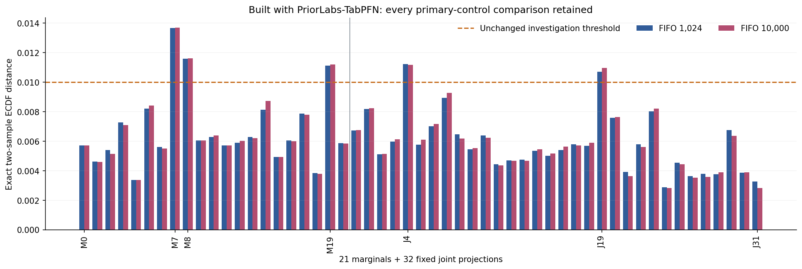
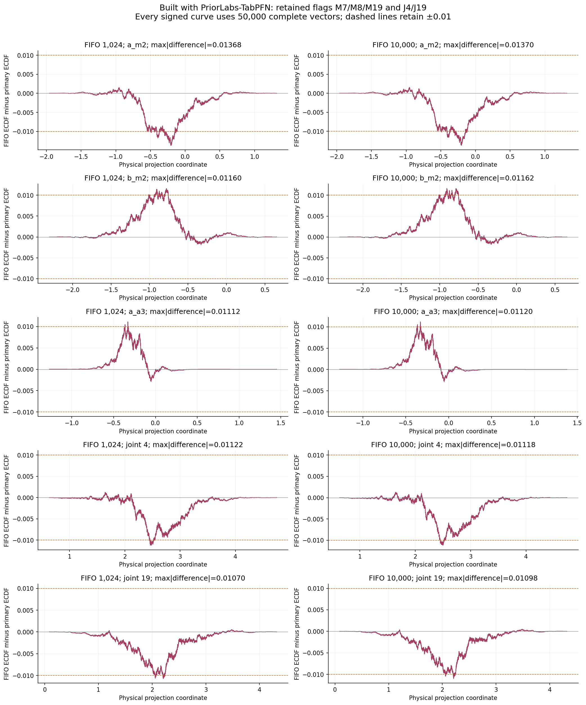
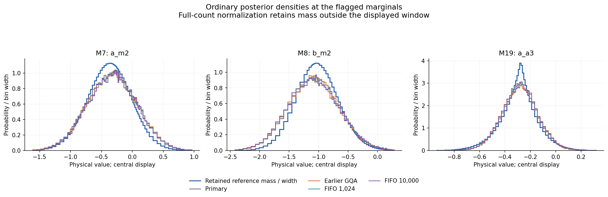
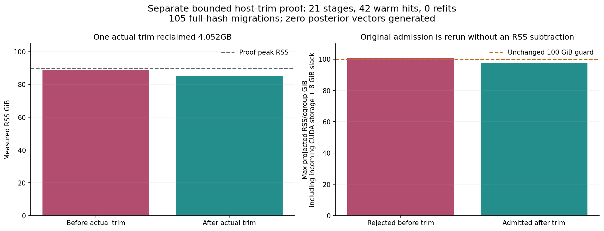

# PosteriorForge performance evidence

Built with PriorLabs-TabPFN. Every posterior curve contains 50,000 complete accepted physical vectors. Runtime qualification and absolute physical accuracy are separate decisions. These plots alone do not establish an optimized execution pass.

| Run | Request seconds | Vectors/s | Physical result |
|---|---:|---:|---|
| Corrected control | 2419.0509968628176 | 20.669262477245518 | model_failure |
| Control rep 0 | 2364.5507467584684 | 21.145665860013512 | model_failure |
| Control rep 1 | 2383.4860378028825 | 20.977676901388698 | model_failure |
| Control rep 2 | 2380.309143734048 | 21.005674885390643 | model_failure |
| Earlier GQA 50k | 607.0815207690466 | 82.36126169128052 | model_failure |
| FIFO 1,024 (50k) | 410.9634176120162 | 121.66533043387375 | model_failure |
| FIFO 10,000 (50k) | 448.12487697135657 | 111.5760417897887 | model_failure |

Timing-only runs retain their distinct runtime and memory measurements without adding duplicate posterior curves or relative-assessment rows. Their complete 50k payload and scientific bindings pass the same checks as the plotted cohorts.

| Run | Max two-sample CDF | Max mean change / reference SD | Max SD fractional change | Investigation flag |
|---|---:|---:|---:|---|
| Corrected control | 0 | 0 | 0 | False |
| Earlier GQA 50k | 0.01034 | 0.0172547 | 0.013443 | True |
| FIFO 1,024 (50k) | 0.01368 | 0.0220494 | 0.0146949 | True |
| FIFO 10,000 (50k) | 0.0137 | 0.0219952 | 0.0145697 | True |

Investigation thresholds remain 0.01 CDF, 0.05 reference SD in mean, and 5% in SD. Repeated controls can also raise flags; every flagged comparison remains an investigation, not an automatic equivalence claim. No reported vector or outlier is removed.

One finite, prior-supported accepted a_a3 sample accounts for88.8% of this coordinate's rep2 squared deviation; central quantiles remain similar and the unchanged engine produces a201.7% relative-SD investigation flag.

The outlier is inside the nominal very wide finite terminal bar. It is not evidence by itself of extrapolation beyond the last finite border.

Original per-draw probabilities and uniform were not retained, so numerical CDF/bin-selection roundoff versus genuine learned terminal-bin probability cannot be identified.

All densities divide by the complete draw count, including mass outside the displayed retained grid. Reference curves use saved values; no new reference integration, clipping, tail repair or physical gate changes were performed. Detailed input/output SHA256 values and absolute assessments are in figure-data.json.

## Completed FIFO 50k pilots

Built with PriorLabs-TabPFN. Both pilots return 50,000 finite, complete, prior-supported vectors. Each is a single timing repetition; overall runtime-phase completion remains pending.

| FIFO batch | Request s | Wrapper s | Preparation s | Prediction + sampling s | Request speedup vs 3-control median |
|---|---:|---:|---:|---:|---:|
| 1024 | 410.963418 | 421.965773 | 189.642159 | 214.088257 | 5.792x |
| 10000 | 448.124877 | 558.046330 | 225.481781 | 215.058071 | 5.312x |

The contemporaneous control request median uses all three distinct measurements: 2380.309144s. The historical primary retains its own timing bar; its identical control-repetition 0 posterior payload is omitted only from the curves.

Each FIFO provider generated 51,200 complete proposals in one wave and prepared 21 stages. The unchanged original sampler made two support calls and checked 50,457/50,458 vectors, accepted 50,150 before its final 150-row trim and returned 50,000. The unexamined FIFO remainders were 743/742; these are distinct from the accepted rows removed by final truncation. The FIFO buffer performed no support filtering, row repair, row reordering or RNG draws. Lookahead changes seeded row mapping; no rowwise-equivalence claim is made.

The 10,000-row pilot has 109.467749 seconds in the runner before the posterior request. This interval is **UNATTRIBUTED pre-request work**, not post-sampling work. The outer wrapper adds a separate 0.453703-second residual. The 1,024-row equivalents are 10.491280 and0.511076 seconds. No cause is assigned to the differing startup intervals.

Peak allocated/reserved GPU memory is 5.38686/29.8926 GiB for FIFO 1024 and 8.32160/38.9963GiB for FIFO 10000. Reservation is not live tensor storage. Request wall-product GPU-hours differ from scheduler allocation accounting.

## Retained distribution investigations

Both primary comparisons retain flags at M7, M8 and M19 and joint projections J4 and J19. The maximum exact two-sample ECDF distances are 0.01368 and 0.01370. Mean changes are at most 0.0220494/0.0219952 reference SD and SD fractional changes 1.46949%/1.45697%. The 0.01 CDF, 0.05 reference-SD mean and 5% SD investigation thresholds are unchanged. Every control-repetition comparison and all 53 CDF plus 21 moment metrics are retained in the review extracts and CSVs. The original physical assessment remains **model_failure** and the numeric status **distribution_investigation_required**. Performance-first authorization retains the physical failure separately; no row, tail or flag is removed.

The ordinary densities below use the actual saved complete cohorts and retained reference bin masses. Counts divide by 50,000 even when a central display window excludes tail mass. No new reference integration, density correction or sample clipping is performed.

These finite-cohort checks do not establish population equivalence or global calibration. No earlier randomized p-values or permutation diagnostic are transferred to these pilots.

## Separate successful host-trim proof

The authenticated host-trim screen passed all 21 stages, two full warm scans with 42 warm cache hits and zero refits after cold preload, and 105 full-storage-hash migrations preserving tensor identity, layout and aliases. One real trim reclaimed 4.052291584 GB (decimal) without changing live cache bytes or RNG. The original 100 GiB admission limit and 8 GiB transient margin were rerun unchanged; no RSS subtraction, eviction, LRU or guard bypass was used. Peak process RSS was 89.93889 GiB. All 21 cached stages ended on CPU, with 8.51968 MB of known global CUDA allocation equal to the initial residual.

This is a fixed-conditional migration and retention proof with **zero posterior vectors generated**. It is **not a 50k host timing measurement**, and its gains are not added to the FIFO 50k timings. The cache-only full21 screen remains failed. The full raw host proof and large independent-review traces remain outside Git; compact extracts bind their source hashes. All generated figures/tables and source bindings are checksummed.
