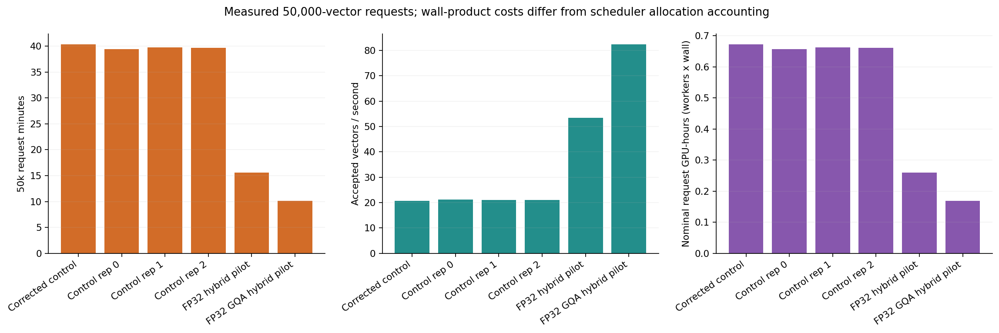
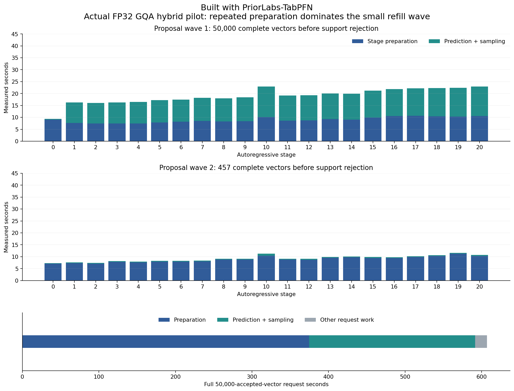
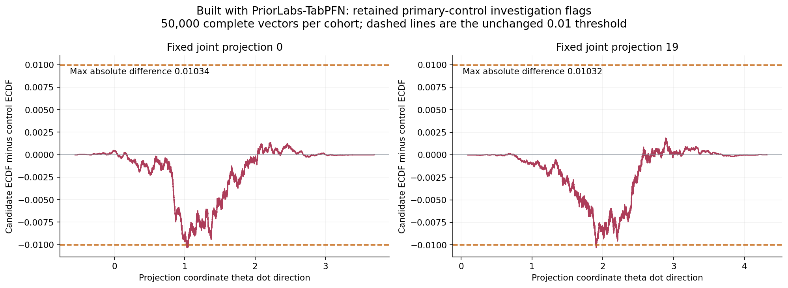
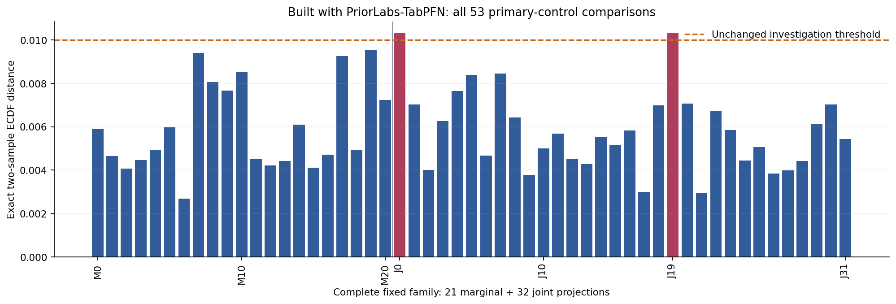
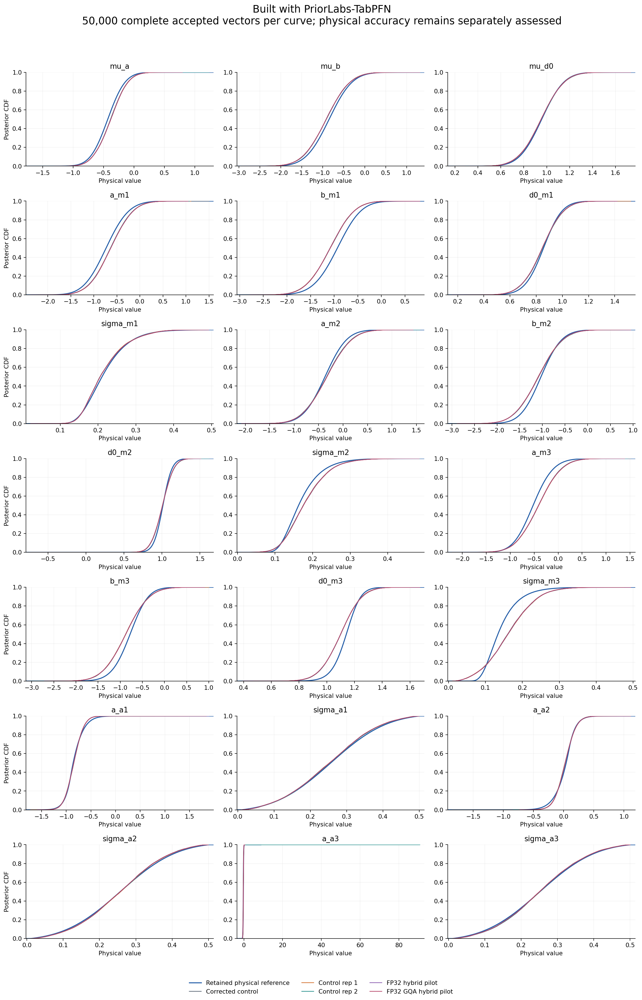
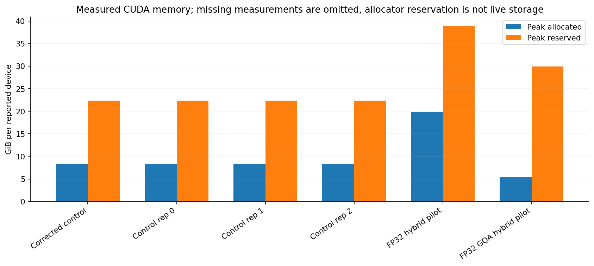

# First completed FP32 GQA hybrid pilot

Built with PriorLabs-TabPFN. This package records one completed 50,000-vector GQA pilot. Final optimized timing repetitions and overall runtime-phase completion remain pending. Repository code is MIT licensed; [NOTICE](../../../NOTICE) and the bundled upstream licenses retain PriorLabs/TabPFN attribution and terms.

The request took **607.081521 seconds** (10.12 minutes), versus a **2380.309144-second** median across three contemporaneous unoptimized controls: **3.921x request speedup** in this pilot. Wrapper wall time was **617.295869 seconds**, a **3.884x speedup** against the three-control wrapper median.

| Unoptimized control | Request seconds | Wrapper seconds |
|---|---:|---:|
| Repetition 0 | 2364.550747 | 2372.390917 |
| Repetition 1 | 2383.486038 | 2397.317792 |
| Repetition 2 | 2380.309144 | 2399.943702 |
| Median | 2380.309144 | 2397.317792 |

The posterior CDF and density curves omit control repetition 0 because its payload is byte-identical to the corrected historical primary control. Its distinct runtime and memory measurements remain visible as a separate bar. All three contemporaneous control timings contribute to the medians above. The five posterior-curve cohorts are the corrected primary control, control repetitions 1 and 2, the earlier FP32 hybrid, and the new FP32 GQA hybrid; the timing/memory plots include those five plus control repetition 0.



Compared with the earlier FP32 hybrid, the GQA pilot was **1.541x faster by request wall time** and **1.596x faster by wrapper wall time**. Its complete-cohort comparison with that earlier hybrid has maximum exact CDF distance **0.00136**, mean change at most **0.000652 reference SD**, and SD change at most **0.0678%**, with no investigation threshold exceeded in that pair. Both pilots used the same named sampling-stream roles and seeds. These are coupled cohorts, not independent repetitions; their 452- and 457-proposal refills can alter retained-row alignment. All 53 distances, stream metadata, rejection counts and bindings are in [earlier-hybrid-comparison.json](earlier-hybrid-comparison.json). The close comparison does not establish population equivalence.

Stage preparation consumed **374.714 seconds**, prediction plus sampling **216.982 seconds**, and other request work **15.385 seconds**. The **457-proposal** refill repeated **186.385 seconds** of preparation. [pilot-stage-events.csv](pilot-stage-events.csv) retains all 42 stage events. Nominal one-GPU request and wrapper wall-products were **0.168634** and **0.171471 GPU-hours**; scheduler allocation accounting is separate.



All 50,000 returned rows are finite, complete and prior-supported. Against the primary control, the maximum exact two-sample empirical-CDF difference is **0.01034**, with retained flags at joint projections **0 and 19**. Mean change is at most **0.0172547 reference SD**, and SD change at most **1.3443%**. Other-control CDF flags and the separate control-2 tail-sensitive SD investigation remain visible. No vector, outlier or flag was removed.



The complete family contains 21 marginal and 32 joint projections. [pilot-cdf-family.csv](pilot-cdf-family.csv) and [pilot-summary.json](pilot-summary.json) retain every distance, signed maximizer and physical projection coordinate.



The original physical assessment remains **model_failure**, retained separately under the explicit performance-first authorization. The independent numeric status remains **distribution_investigation_required**. This GQA pilot has **no new permutation diagnostic**; the earlier pilot's randomized p-values are not transferred to it.



The declared full-21 GQA hybrid fixed-conditional screen passed, with the original corrected uncached route retained only for **stage 10, member 5**. The cache-only full-21 screen remains failed. The raw GPU qualification producer retains its failed status; a separate source-bound CPU recovery resolves only process addresses of two pinned preprocessing functions, preserving exact type/pickle, numeric, state, RNG and source checks. The original engine descriptor's `qualified=false` is preserved alongside the separately authenticated recovered GQA pass. Fixed-prefix engineering evidence does not prove the full posterior law.

All **1,285** actual prediction contexts passed source and attention-alias restoration checks. The run recorded **31,272** attention calls, including **15,492** expanded shared-KV views, plus **8** original-route fallback prediction calls. Actual GQA metadata, source hashes and qualification bindings are in [pilot-summary.json](pilot-summary.json). Host reuse is a separate path and contributed no speedup to this pilot.



The saved budget snapshot records **21.036389 allocated GPU-hours** and **0.666667 reserved GPU-hours** under the immutable 200-hour cap. It was captured while the separate host qualification was running; it is a historical snapshot, not a claim about current accounting. Its original content is retained in [budget-gqa-hybrid-pilot-snapshot.json](budget-gqa-hybrid-pilot-snapshot.json).

## Files and custody

- [report.md](report.md) embeds all seven verified figures. [figure-data.json](figure-data.json) binds the base-report cohorts, physical assessments, saved reference and accounting snapshot; [timings.csv](timings.csv) contains all six timing/memory runs, including control repetition 0.
- [pilot-summary.json](pilot-summary.json) binds the reporting source, raw candidate/control manifests and payloads, independent review, earlier-hybrid comparison, exact tables and three detail figures.
- [execution-review-extract.json](execution-review-extract.json) preserves all numeric decisions, primary/control-repetition metrics, physical assessment and qualification scope without the large audit traces. The full source review SHA256 is `e00b5e18ce61d27dfbf437a0dba4d43a5d57a10f729c8b4f059efda5d9a9254e`.
- [render-verification.json](render-verification.json) records the CPU render, all-seven-figure visual review, exact metric checks, strict cohort-label checks and byte-stable repeat. [checksums.json](checksums.json) hashes every other package file.
- [science-control-repeat-tails.json](science-control-repeat-tails.json) retains the prior supported-outlier diagnostic without removing any row or weakening a threshold.

The GQA pilot's raw manifest SHA256 is `87a54e1627cf8d48e9a5bb00daaccdc32671838b9b9573f2f5a81da0e4506abc`; its 50,000-vector NPZ SHA256 is `6696dfd124f4f7ff1984589cbad6aed3faea2cdbd79e81de531e68695e120169`. Raw posterior samples, large manifests, full independent review and derived signed-curve witness NPZ stay outside Git. The reporting command regenerates the witness curves. Existing controls are available in the [performance-first-v1-controls raw release](https://github.com/BrieucB/PosteriorForge/releases/tag/performance-first-v1-controls). The GQA pilot raw release and public portable replay remain pending; this package does not imply that they are already published or completed.

## Reproduce from saved artifacts

Use Python 3.11 with the project's NumPy, SciPy and Matplotlib dependencies. This package was rendered with the verified reference environment on Karolina using CPU-only saved-artifact reads. No model calls, new reference integrations or GPU allocation are needed.

The artifact root must preserve the original `results/` layout, including `gate-final.json`, `banks-v1`, authenticated parent/refined reference grids, corrected primary cohort, all three controls, the earlier FP32 hybrid, the GQA pilot and its independent review, and the tail diagnostic. The details command authenticates the fixed pilot/review, validates actual GQA source/restoration metadata, the expected five posterior-curve cohorts and all three distinct control timing measurements, and recomputes the exact comparisons.

From the repository root, set paths to the saved-artifact root, a verified Python environment and a new output directory:

```bash
PF_ROOT=/path/to/unpacked-artifacts
PF_PYTHON=/path/to/verified-python3.11
PF_OUTPUT=/path/to/new-gqa-pilot-report
PF_PHASE="$PF_ROOT/results/performance-first-v1"

PYTHONPATH=src OPENBLAS_NUM_THREADS=2 OMP_NUM_THREADS=2 "$PF_PYTHON" \
  scripts/report_execution_performance.py \
  --control "$PF_ROOT/results/cdf-arithmetic-v1/context-4096/seed-20261111-case-0" \
  --reference "$PF_ROOT/results/reference-grids-v1/case-0" \
  --output "$PF_OUTPUT" \
  --timing-run "Control rep 0=$PF_PHASE/controls/rep-0/seed-20261111-case-0" \
  --run "Control rep 1=$PF_PHASE/controls/rep-1/seed-20261111-case-0" \
  --run "Control rep 2=$PF_PHASE/controls/rep-2/seed-20261111-case-0" \
  --run "FP32 hybrid pilot=$PF_PHASE/hybrid-fp32-batch-1024/rep-0/seed-20261111-case-0" \
  --run "FP32 GQA hybrid pilot=$PF_PHASE/gqa-hybrid-fp32-batch-1024/rep-0/seed-20261111-case-0" \
  --tail-diagnostic "$PF_PHASE/control-tail-diagnostic/science-control-repeat-tails.json" \
  --budget-summary evidence/performance-first-v1/gqa-hybrid-pilot-01/budget-gqa-hybrid-pilot-snapshot.json

PYTHONPATH=src OPENBLAS_NUM_THREADS=2 OMP_NUM_THREADS=2 "$PF_PYTHON" \
  scripts/report_gqa_pilot_details.py --root "$PF_ROOT" --output "$PF_OUTPUT"
```

The details script infers its checkout from `__file__`; `--root` locates only saved artifacts. Repeating it replaces a marked report block without duplicates and reproduces byte-identical outputs in the verified environment.

The [source-bound memory-scope audit](memory-peak-scope-audit.json) confirms one peak reset immediately before the complete request, covering all 42 stage preparations and both proposal waves. The active engine, all 22 SDK Python files and upstream sampler contain no per-stage peak reset. The measured whole-request peaks are 5.386858 GiB allocated and 29.892578 GiB reserved; allocator pool reservation is distinct from concurrently live allocated tensors. No allocator policy was changed.
