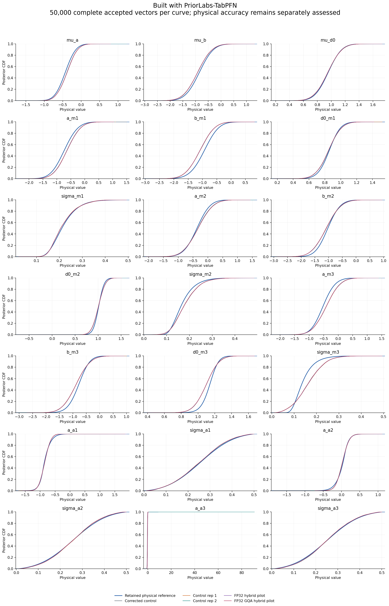
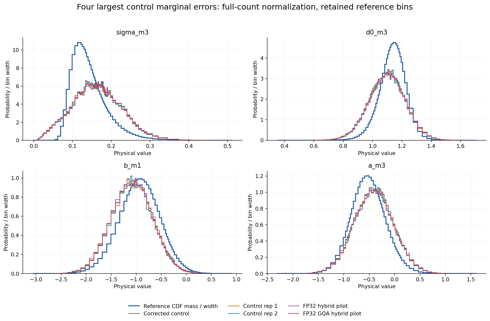
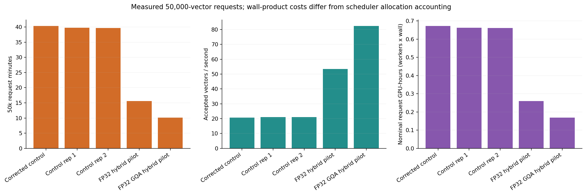
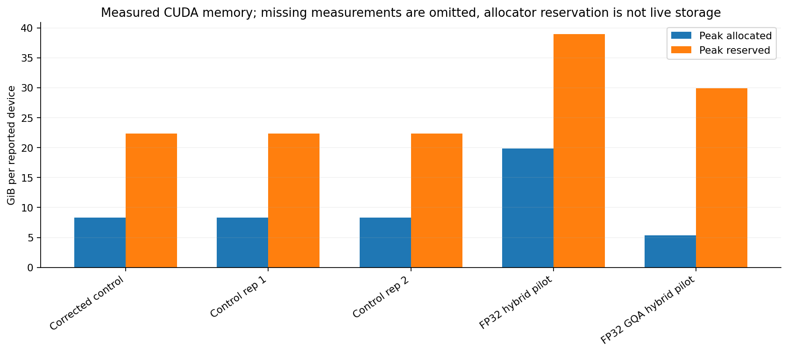
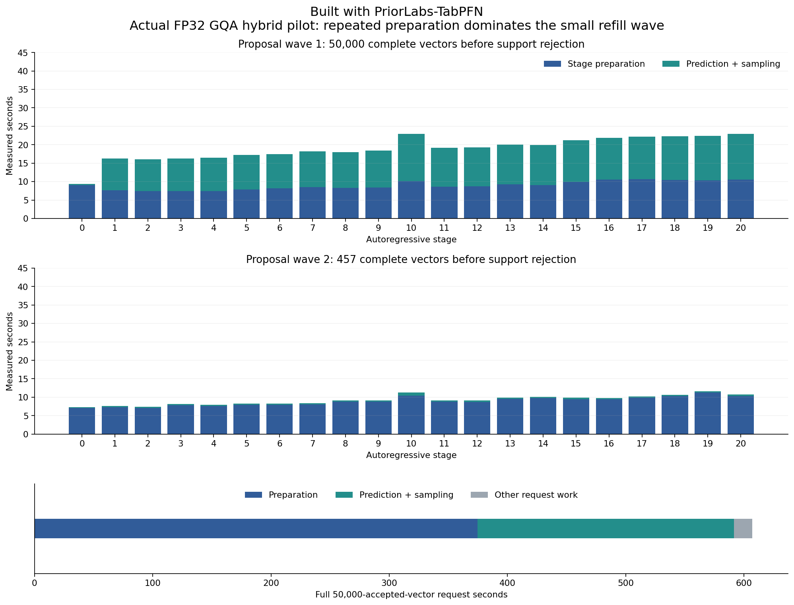
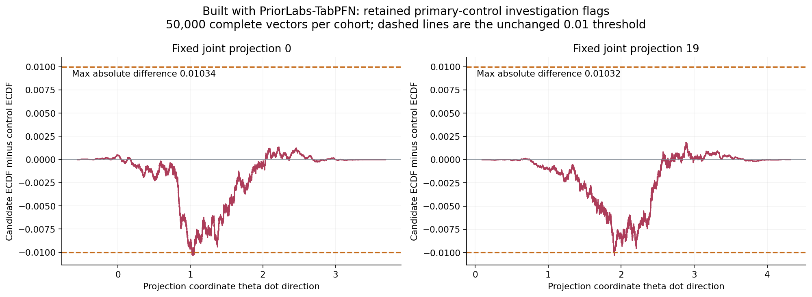
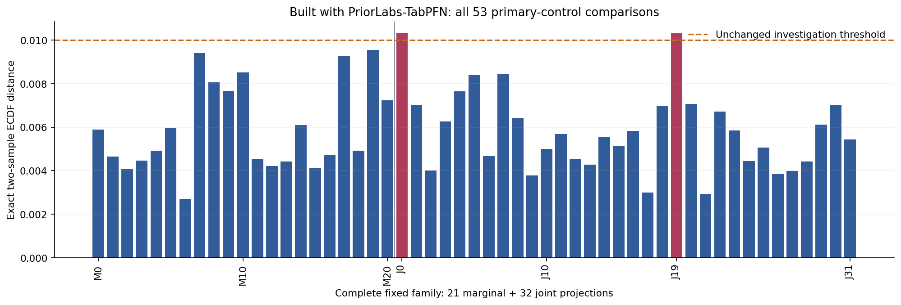

# PosteriorForge performance evidence

Built with PriorLabs-TabPFN. Every posterior curve contains 50,000 complete accepted physical vectors. Runtime qualification and absolute physical accuracy are separate decisions. These plots alone do not establish an optimized execution pass.

| Run | Request seconds | Vectors/s | Physical result |
|---|---:|---:|---|
| Corrected control | 2419.0509968628176 | 20.669262477245518 | model_failure |
| Control rep 1 | 2383.4860378028825 | 20.977676901388698 | model_failure |
| Control rep 2 | 2380.309143734048 | 21.005674885390643 | model_failure |
| FP32 hybrid pilot | 935.5202134829015 | 53.44619953624749 | model_failure |
| FP32 GQA hybrid pilot | 607.0815207690466 | 82.36126169128052 | model_failure |

| Run | Max two-sample CDF | Max mean change / reference SD | Max SD fractional change | Investigation flag |
|---|---:|---:|---:|---|
| Corrected control | 0 | 0 | 0 | False |
| Control rep 1 | 0.01062 | 0.0169244 | 0.00752352 | True |
| Control rep 2 | 0.01042 | 0.0174565 | 2.01708 | True |
| FP32 hybrid pilot | 0.01062 | 0.0171257 | 0.0135927 | True |
| FP32 GQA hybrid pilot | 0.01034 | 0.0172547 | 0.013443 | True |

Investigation thresholds remain 0.01 CDF, 0.05 reference SD in mean, and 5% in SD. Repeated controls can also raise flags; every flagged comparison remains an investigation, not an automatic equivalence claim. No reported vector or outlier is removed.

One finite, prior-supported accepted a_a3 sample accounts for88.8% of this coordinate's rep2 squared deviation; central quantiles remain similar and the unchanged engine produces a201.7% relative-SD investigation flag.

The outlier is inside the nominal very wide finite terminal bar. It is not evidence by itself of extrapolation beyond the last finite border.

Original per-draw probabilities and uniform were not retained, so numerical CDF/bin-selection roundoff versus genuine learned terminal-bin probability cannot be identified.

Cumulative allocated cost at the saved snapshot: 21.036389 GPU-hours spent and 0.666667 reserved, under the immutable 200-hour cap. Request wall-products in the plots are separate from scheduler allocation accounting.

All densities divide by the complete draw count, including mass outside the displayed retained grid. Reference curves use saved values; no new reference integration, clipping, tail repair or physical gate changes were performed. Detailed input/output SHA256 values and absolute assessments are in figure-data.json.

<!-- posteriorforge:completed-gqa-hybrid-pilot-details:begin -->
## Completed pilot interpretation

Built with PriorLabs-TabPFN. The strict 50,000-vector FP32 GQA hybrid request took 607.081521 seconds (10.12 minutes), versus a 2380.309144-second median across three contemporaneous unoptimized controls: **3.921x request speedup in one pilot**. Wrapper wall time was 617.295869 seconds, a 3.884x speedup against the three-control wrapper median. Final optimized timing repetitions and overall runtime-phase completion remain pending.

All 50,000 rows are finite, complete and prior-supported. The primary-control maximum exact two-sample empirical CDF difference is 0.01034, with retained flags at joint projections 0 and 19. Mean change is at most 0.01725 reference SD and SD change at most 1.34%. Comparisons against control repetitions 1 and 2 retain their additional CDF flags; the separate control-2 tail-sensitive SD flag remains visible. No row, outlier or flag was removed. These finite-cohort checks do not prove population equivalence. The original absolute physical result remains **model_failure**; it is retained separately under the authorized performance-first review.

Stage preparation consumed 374.714 seconds; prediction and sampling consumed 216.982 seconds; other request work consumed 15.385 seconds. The 457-proposal refill repeated 186.385 seconds of stage preparation. Nominal one-GPU request and wrapper wall-products were 0.168634 and 0.171471 GPU-hours; scheduler allocated cost is a separate quantity.

The signed empirical-CDF witnesses below use every complete vector at all pooled projection values, preserving ties. Dashed lines retain the 0.01 investigation threshold.

All 21 marginal and 32 joint comparisons remain in the complete family plot, pilot-cdf-family.csv and pilot-summary.json. The saved witness NPZ is derived curve data, not a posterior cohort.

The declared full-21 GQA hybrid fixed-conditional screen passed, with the original corrected uncached route retained only for stage 10, member 5. The cache-only full-21 screen remains failed. The raw GPU qualification producer remains archived with its original failed status: a separate source-bound CPU recovery resolves only process addresses of two pinned preprocessing functions, preserving exact configuration type/pickle, numeric, state, RNG and source checks. These fixed-prefix engineering checks do not prove the full posterior law. All 1,285 actual prediction contexts passed source and attention-alias restoration checks. The run recorded 31,272 attention calls, including 15,492 expanded shared-KV views. The original engine descriptor still records qualified=false; the separately authenticated recovered qualification records the declared full-21 GQA hybrid pass. Host reuse remains a separate candidate and contributes no speedup to this pilot.

The plotted cohorts omit control repetition 0 because its posterior payload is byte-identical to the corrected primary control; all three contemporaneous control timings still contribute to the reported median. The earlier hybrid pilot is plotted for execution context.

Compared with that earlier hybrid, the GQA pilot was 1.541x faster by request wall time and 1.596x faster by wrapper wall time. The saved-cohort comparison has maximum exact CDF distance 0.00136, mean change at most 0.000652 reference SD and SD change at most 0.0678%, with no investigation thresholds exceeded in that pair. Both pilots used the same named sampling-stream roles and seeds, so these are coupled cohorts rather than independent repetitions. Their 452- and 457-proposal refills can alter retained-row alignment. All 53 paired distances, stream metadata and rejection counts remain in earlier-hybrid-comparison.json; their close agreement is diagnostic evidence, not a population-equivalence claim.

This GQA pilot has no new permutation diagnostic. The earlier pilot's randomized p-values are not transferred to it. The independent numeric status remains **distribution_investigation_required**.
<!-- posteriorforge:completed-gqa-hybrid-pilot-details:end -->
