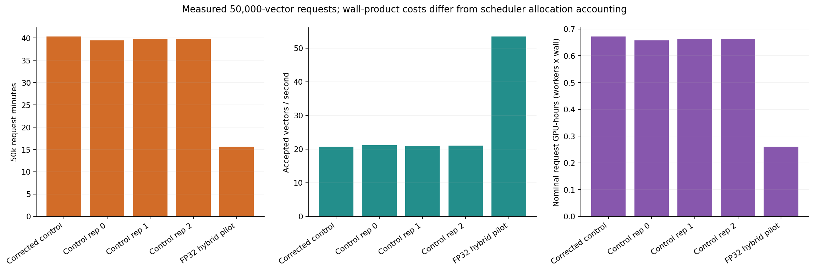
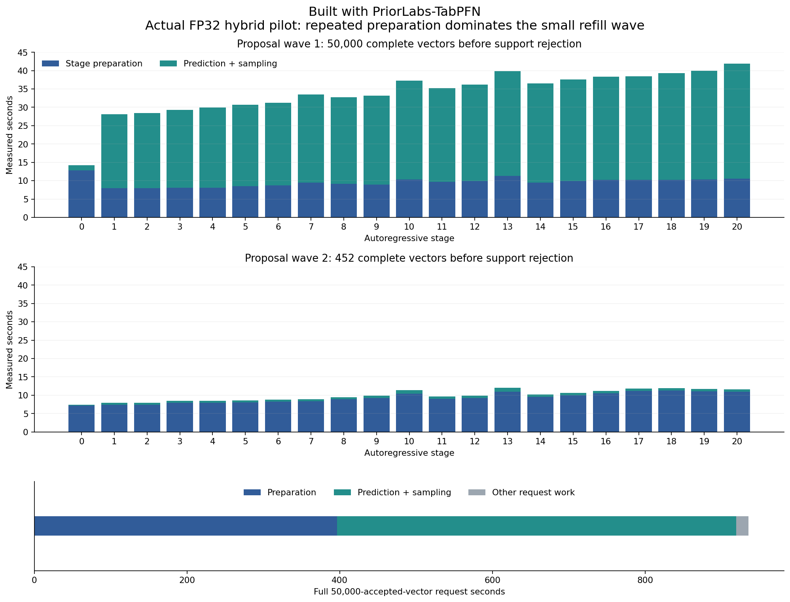
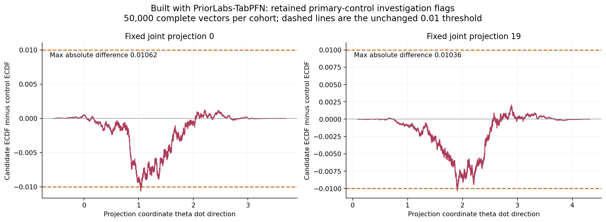
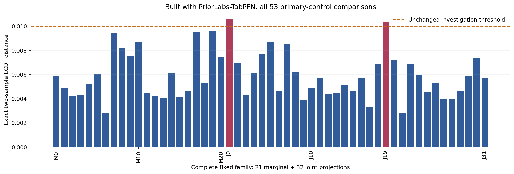
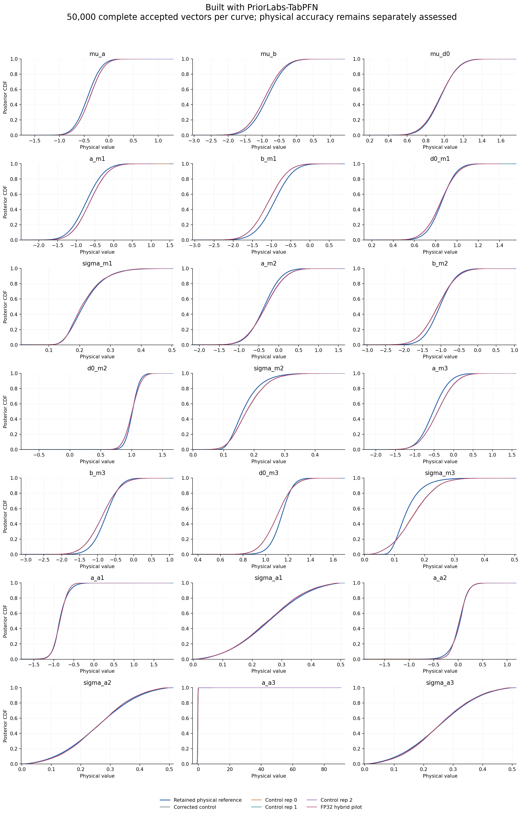

# First completed FP32 hybrid pilot

Built with PriorLabs-TabPFN. This package records one completed 50,000-vector pilot, not overall runtime-phase completion. Repository code is MIT licensed; PriorLabs/TabPFN and bundled upstream notices remain in [NOTICE](../../../NOTICE) and the repository's license files.

The request took **935.520213 seconds**, versus a **2380.309144-second** median across three contemporaneous unoptimized controls: **2.544x request speedup** in this single pilot. Wrapper wall time was **985.387429 seconds**, a **2.433x speedup** against the three-control wrapper median. The corrected historical control and control repetition 0 have identical posterior payloads; they are not four independent controls. Final optimized timing repetitions remain pending.



Preparation consumed **396.479 seconds**, and prediction plus sampling consumed **522.871 seconds**. A second wave of only **452 proposals** repeated **194.732 seconds** of preparation. All 42 stage events are retained in [pilot-stage-events.csv](pilot-stage-events.csv). Nominal one-GPU request and wrapper costs are 0.259867 and 0.273719 GPU-hours; these wall-products differ from scheduler allocation accounting. The saved budget snapshot records 20.435278 cumulative allocated GPU-hours, zero reserved, under the 200-hour cap as of its recorded timestamp.



All 50,000 returned rows are finite, complete and prior-supported. Against the primary control, the largest exact two-sample empirical-CDF difference is **0.01062**; joint projections **0 and 19** retain their investigation flags. Mean change is at most **0.01713 reference SD**, and SD change at most **1.36%**. Comparisons against control repetitions 1 and 2 retain additional CDF flags. The separate control-2 tail-sensitive SD investigation remains visible, including the finite, supported a_a3 outlier; no row, outlier or flag was removed.



The complete fixed family contains 21 marginal and 32 joint projections. Exact distances, signed maximizers and their physical projection coordinates are in [pilot-cdf-family.csv](pilot-cdf-family.csv) and [pilot-summary.json](pilot-summary.json).



A separate CPU whole-row label-permutation diagnostic gave candidate-versus-control max53-KS randomized p-values **0.2344, 0.1016 and 0.1328**, using 127 balanced permutations per pair (resolution 1/128). It preserves cross-projection correlations and ties. This is an exploratory finite-cohort diagnostic, not an equivalence test, population guarantee or flag waiver. All six pair comparisons and Monte Carlo intervals are in [maxks-permutation.json](maxks-permutation.json).

The original absolute physical assessment remains **model_failure**, visible in the full [report](report.md), [figure-data.json](figure-data.json) and [hash-bound independent-review extract](execution-review-extract.json). Performance-first authorization permits the engineering review while retaining that failed physical assessment separately. The independent numeric status remains **distribution_investigation_required**.



The declared full-21 hybrid fixed-conditional screen passed; the cache-only full-21 screen did not. The inherited qualification/trace plots show an earlier bounded cache probe and preserve its conditional mismatch and limited stage coverage. They are not the hybrid's full-21 pass evidence or a posterior-law proof. Bounded host reuse and GQA layout remain separate, unqualified candidates at this snapshot; their probes failed while metadata representation and global workspace use were being investigated. No performance gain from either proposal is attributed to this pilot.

## Files and custody

- [report.md](report.md) embeds all nine verified figures; [timings.csv](timings.csv) retains complete-cohort timing measurements.
- [pilot-summary.json](pilot-summary.json) binds the portable reporting source, saved candidate/control manifests and payloads, reference manifest, full independent review, original permutation diagnostic, tables and three detail figures by SHA256.
- [execution-review-extract.json](execution-review-extract.json) preserves all numeric decisions, all primary-control metrics, other-control metrics, physical assessment and qualification scope without large audit traces. Its source is the unmodified full independent review, SHA256 `ee081dbd320f2548edfa0ab99c5249852f5b28b357293315511a8be28c17c390`.
- [render-verification.json](render-verification.json) records the remote CPU render, visual review, exact all-53 comparison check and byte-stable idempotence check. [checksums.json](checksums.json) hashes every other file in this package.
- [science-control-repeat-tails.json](science-control-repeat-tails.json) and [budget-hybrid-pilot-snapshot.json](budget-hybrid-pilot-snapshot.json) preserve the existing tail diagnostic and saved accounting snapshot.

The actual pilot sample payload SHA256 is `52c7e0a53e7dd95901ce68338d79cb1966d5d6ce43c4cf78f40998b3910c7683`. Raw posterior NPZ samples, the roughly 29 MB candidate manifest, the roughly 45 MB independent review and the 1.3 MB derived signed-curve witness NPZ stay outside Git. The two reporting commands regenerate the curve witness. Existing controls are available in the [performance-first-v1-controls raw release](https://github.com/BrieucB/PosteriorForge/releases/tag/performance-first-v1-controls). The first-pilot posterior payload, complete review and qualification archives are available in the [first-hybrid-pilot raw release](https://github.com/BrieucB/PosteriorForge/releases/tag/performance-first-v1-hybrid-pilot).

## Reproduce from saved artifacts

Use Python 3.11 with the project's NumPy, SciPy and Matplotlib dependencies (the verified reference environment was used for this CPU-only render). The artifact root must retain the original `results/` layout, including `gate-final.json`, `banks-v1`, authenticated parent/refined references, corrected primary cohort, three controls, the first pilot and its independent review, `cache-qualification-02/manifest.json`, tail diagnostic and max53 permutation result. No GPU or new model/reference calls are needed.

Run from the repository root. Set the three paths below to the saved-artifact root, a verified Python environment and a new report directory. The first command creates the generic report; the second adds the pilot block and derived tables/curves. Repeating the second command replaces its marked section without duplicates.

```bash
PF_ROOT=/path/to/unpacked-artifacts
PF_PYTHON=/path/to/verified-python3.11
PF_OUTPUT=/path/to/new-pilot-report
PF_PHASE="$PF_ROOT/results/performance-first-v1"

PYTHONPATH=src OPENBLAS_NUM_THREADS=2 OMP_NUM_THREADS=2 "$PF_PYTHON" \
  scripts/report_execution_performance.py \
  --control "$PF_ROOT/results/cdf-arithmetic-v1/context-4096/seed-20261111-case-0" \
  --reference "$PF_ROOT/results/reference-grids-v1/case-0" \
  --output "$PF_OUTPUT" \
  --run "Control rep 0=$PF_PHASE/controls/rep-0/seed-20261111-case-0" \
  --run "Control rep 1=$PF_PHASE/controls/rep-1/seed-20261111-case-0" \
  --run "Control rep 2=$PF_PHASE/controls/rep-2/seed-20261111-case-0" \
  --run "FP32 hybrid pilot=$PF_PHASE/hybrid-fp32-batch-1024/rep-0/seed-20261111-case-0" \
  --qualification "$PF_PHASE/cache-qualification-02/manifest.json" \
  --tail-diagnostic "$PF_PHASE/control-tail-diagnostic/science-control-repeat-tails.json" \
  --budget-summary evidence/performance-first-v1/hybrid-pilot-01/budget-hybrid-pilot-snapshot.json

PYTHONPATH=src OPENBLAS_NUM_THREADS=2 OMP_NUM_THREADS=2 "$PF_PYTHON" \
  scripts/report_hybrid_pilot_details.py --root "$PF_ROOT" --output "$PF_OUTPUT"
```

The script infers the checkout from its own file location and uses `--root` only for saved data. It rejects a different first-pilot payload or independent review, authenticates complete 50k cohorts, and recomputes exact signed empirical-CDF witnesses without altering any inference, cache, qualifier, sampler or evaluator.
