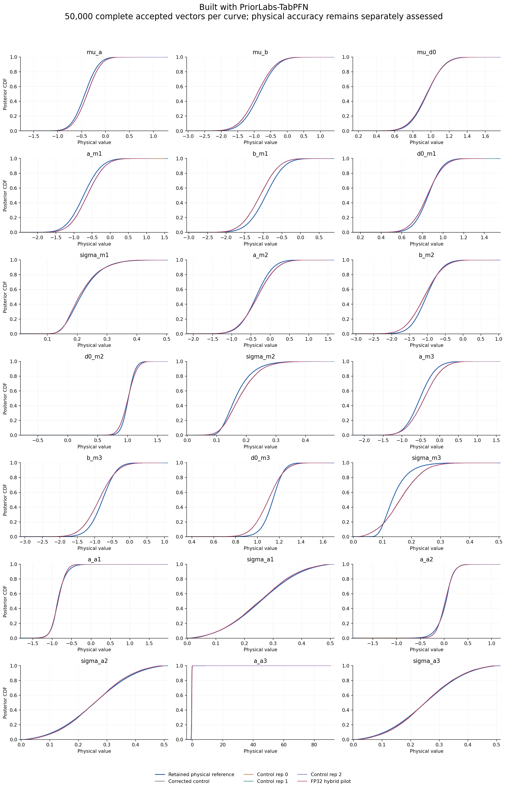
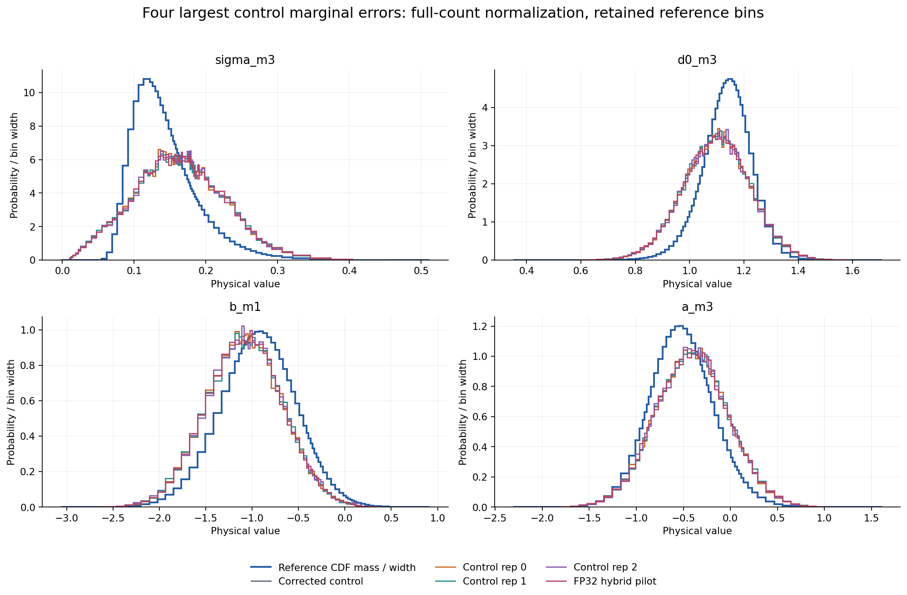
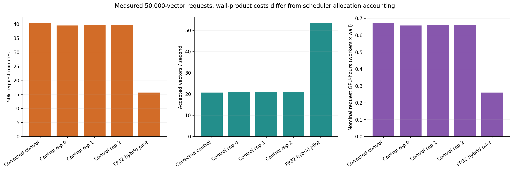
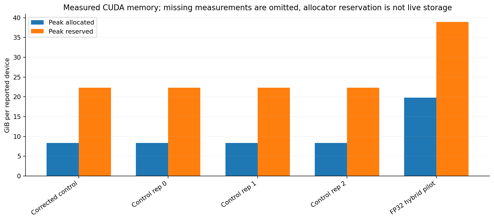
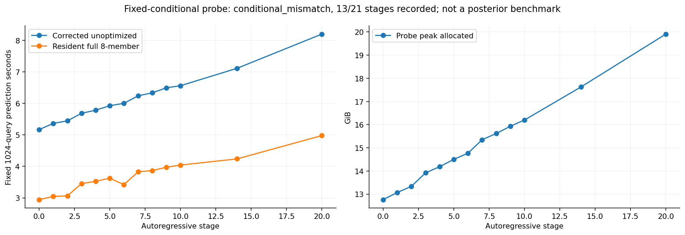
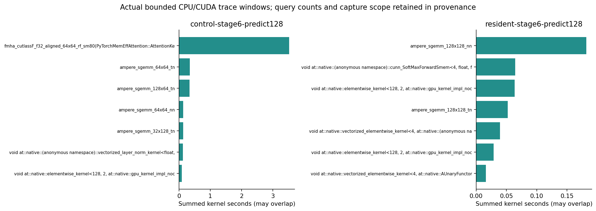
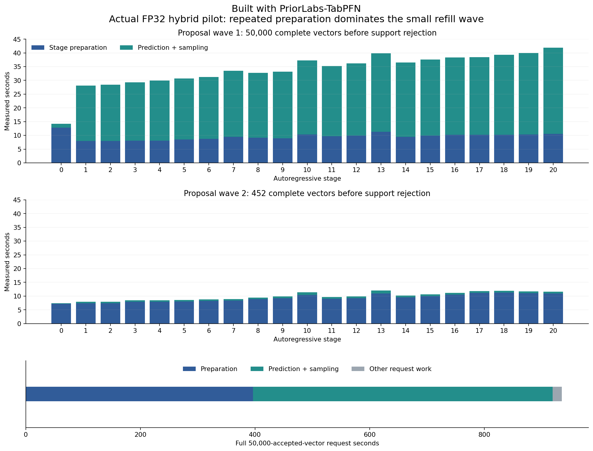
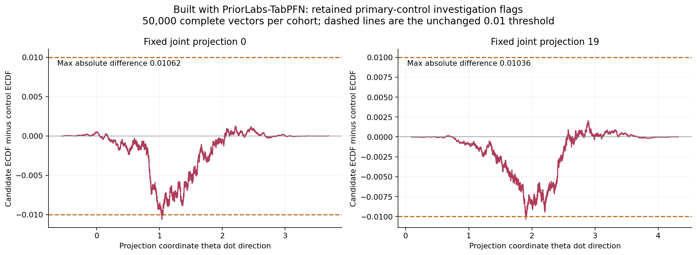
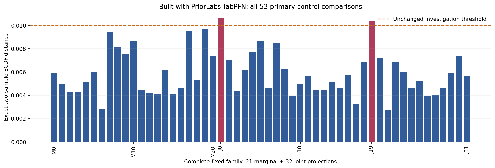

# PosteriorForge performance evidence

Built with PriorLabs-TabPFN. Every posterior curve contains 50,000 complete accepted physical vectors. Runtime qualification and absolute physical accuracy are separate decisions. These plots alone do not establish an optimized execution pass.

| Run | Request seconds | Vectors/s | Physical result |
|---|---:|---:|---|
| Corrected control | 2419.0509968628176 | 20.669262477245518 | model_failure |
| Control rep 0 | 2364.5507467584684 | 21.145665860013512 | model_failure |
| Control rep 1 | 2383.4860378028825 | 20.977676901388698 | model_failure |
| Control rep 2 | 2380.309143734048 | 21.005674885390643 | model_failure |
| FP32 hybrid pilot | 935.5202134829015 | 53.44619953624749 | model_failure |

| Run | Max two-sample CDF | Max mean change / reference SD | Max SD fractional change | Investigation flag |
|---|---:|---:|---:|---|
| Corrected control | 0 | 0 | 0 | False |
| Control rep 0 | 0 | 0 | 0 | False |
| Control rep 1 | 0.01062 | 0.0169244 | 0.00752352 | True |
| Control rep 2 | 0.01042 | 0.0174565 | 2.01708 | True |
| FP32 hybrid pilot | 0.01062 | 0.0171257 | 0.0135927 | True |

Investigation thresholds remain 0.01 CDF, 0.05 reference SD in mean, and 5% in SD. Repeated controls can also raise flags; every flagged comparison remains an investigation, not an automatic equivalence claim. No reported vector or outlier is removed.

One finite, prior-supported accepted a_a3 sample accounts for88.8% of this coordinate's rep2 squared deviation; central quantiles remain similar and the unchanged engine produces a201.7% relative-SD investigation flag.

The outlier is inside the nominal very wide finite terminal bar. It is not evidence by itself of extrapolation beyond the last finite border.

Original per-draw probabilities and uniform were not retained, so numerical CDF/bin-selection roundoff versus genuine learned terminal-bin probability cannot be identified.

Cumulative allocated cost at the saved snapshot: 20.435278 GPU-hours spent and 0.000000 reserved, under the immutable 200-hour cap. Request wall-products in the plots are separate from scheduler allocation accounting.

All densities divide by the complete draw count, including mass outside the displayed retained grid. Reference curves use saved values; no new reference integration, clipping, tail repair or physical gate changes were performed. Detailed input/output SHA256 values and absolute assessments are in figure-data.json.

<!-- posteriorforge:completed-hybrid-pilot-details:begin -->
## Completed pilot interpretation

Built with PriorLabs-TabPFN. The strict 50,000-vector FP32 hybrid request took 935.520213 seconds (15.59 minutes), versus a 2380.309144-second median across three contemporaneous unoptimized controls: **2.544x request speedup in one pilot**. Wrapper wall time was 985.387429 seconds, a 2.433x speedup against the three-control wrapper median. Final optimized timing repetitions and overall runtime-phase completion remain pending.

All 50,000 rows are finite, complete and prior-supported. The primary-control maximum exact two-sample empirical CDF difference is 0.01062, with retained flags at joint projections 0 and 19. Mean change is at most 0.01713 reference SD and SD change at most 1.36%. Comparisons against control repetitions 1 and 2 retain their additional CDF flags; the separate control-2 tail-sensitive SD flag remains visible. No row, outlier or flag was removed. These finite-cohort checks do not prove population equivalence. The original absolute physical result remains **model_failure**; it is retained separately under the authorized performance-first review.

Stage preparation consumed 396.479 seconds; prediction and sampling consumed 522.871 seconds; other request work consumed 16.170 seconds. The 452-proposal refill repeated 194.732 seconds of stage preparation. Nominal one-GPU request and wrapper wall-products were 0.259867 and 0.273719 GPU-hours; scheduler allocated cost is a separate quantity.

The signed empirical-CDF witnesses below use every complete vector at all pooled projection values, preserving ties. Dashed lines retain the 0.01 investigation threshold.

All 21 marginal and 32 joint comparisons remain in the complete family plot, pilot-cdf-family.csv and pilot-summary.json. The saved witness NPZ is derived curve data, not a posterior cohort.

The declared full-21 hybrid fixed-conditional screen passed; the cache-only full-21 screen did not. Fixed-conditional evidence does not prove the full posterior law. Bounded host reuse and GQA layout are separate candidates; their current probes remain unqualified, with metadata representation and global workspace use under investigation. This pilot claims no gain from either proposal.

## Exploratory finite-cohort calibration

The separate CPU diagnostic preserved whole vectors, all 53 projection correlations and exact ECDF ties. Its 127 balanced label permutations per pair gave candidate-versus-control randomized max53-KS p-values 0.2344, 0.1016 and 0.1328 (resolution 1/128). This is a coarse random-label diagnostic, not an equivalence test, population guarantee or flag waiver. Original CDF investigations and the separate tail-sensitive SD comparison remain unchanged. All six comparisons and their Monte Carlo intervals remain in maxks-permutation.json; the independent numeric review remains distribution_investigation_required.
<!-- posteriorforge:completed-hybrid-pilot-details:end -->
