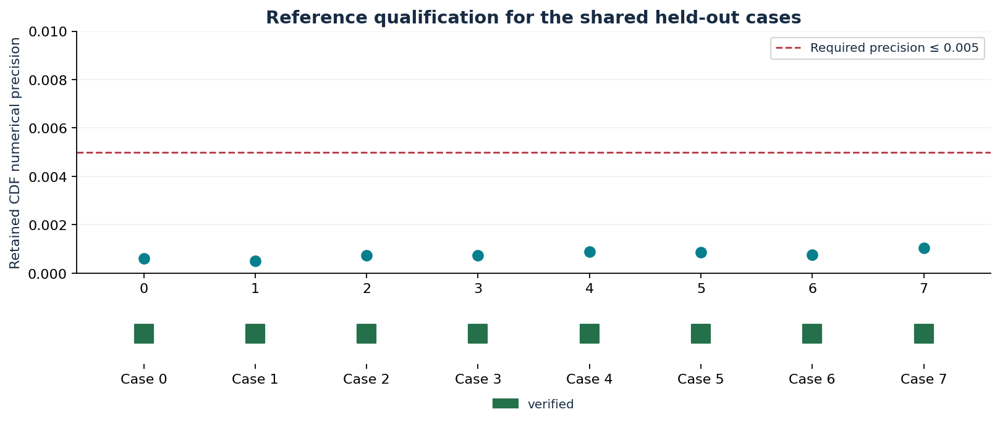
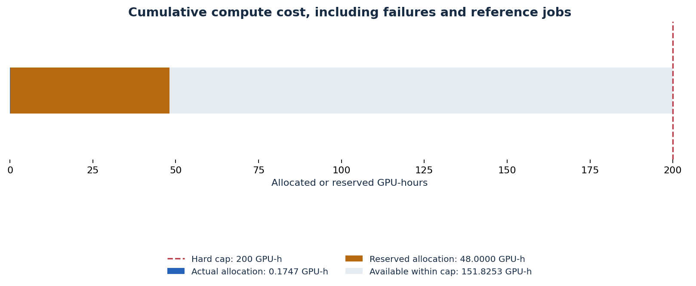

# PosteriorForge retained evidence

Built with PriorLabs-TabPFN.

Scientific gate status: **incomplete**. 0/24 expected upstream runs passed the absolute gate.

This is an eight-case diagnostic screen of the analytical 21-parameter, 33-observation inferred-noise hierarchy. It is not full SBC or a global calibration certificate.

## Reference precision

Each shared held-out case needs retained float64 refinement, independent numerical checks, and CDF precision at most 0.005. Unavailable precision is shown explicitly and cannot pass.

## Posterior agreement

No retained numeric posterior assessments are available in this gate artifact. Posterior agreement remains unmeasured.

## Measured runtime and memory

No complete numeric request timings are retained in this gate artifact.

No numeric CUDA peak memory measurements are retained in this gate artifact.

## Cumulative compute budget

Actual allocation: **0.1747 GPU-hours**. Held reservations: **48.0000 GPU-hours**. Capacity after reservations: **151.8253 GPU-hours**.

The immutable cap is 200 allocated GPU-hours. Failed allocations and reference calculation are included; unknown submission outcomes retain their full reservation.

## Engineering gate

Optimization and multi-GPU scaling remain deferred because the retained scientific gate has not passed. No engineering success is claimed.

## Portable evidence

`gate.json` retains per-run assessments. `runs.csv`, `references.csv` and `budget.csv` provide portable tables. `budget.json` omits submission commands and private absolute paths. `checksums.json` binds this report to its input snapshots and all output files. Raw arrays remain external; retrieval and verification commands are documented in the repository at `docs/artifacts.md`.
